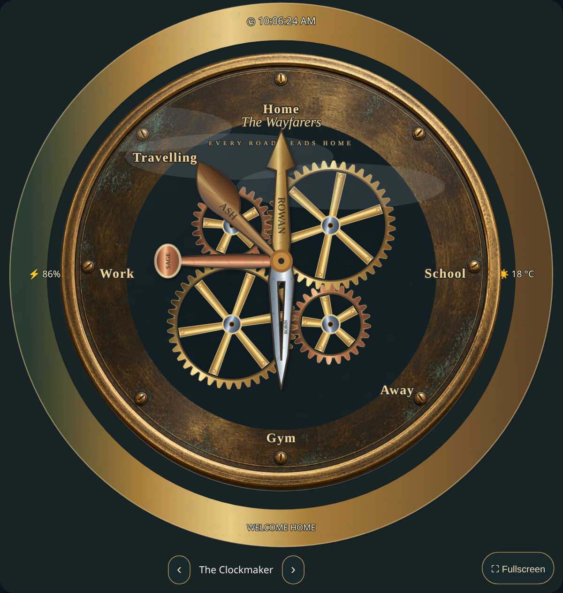

# Magical Family Clock 0.4.0: Design Studio guide

This guide covers **version 0.4.0 — Living World**. Install or update through **HACS → Magical Family Clock → Download/update → 0.4.0**, then reload the Home Assistant frontend. For first installation, add `https://github.com/deadmeat75/magical-family-clock` as a **Dashboard** custom repository. See the [installation guide](USER-GUIDE.md).

The [Living World guide](WORLD-GUIDE.md) adds fitted destination panels, textured backgrounds, large graphics, animated landscape layers, selectable inhabitants and a live sensor-driven moon. These complement the controls below.

## Start with a small working clock

1. Open the card’s visual editor on a test dashboard. Keep your working clock in place.
2. Choose **Guided setup**, or use **General** to select a face and enter a title/caption.
3. In **People**, add one person and select their **Location entity**. Use an existing `person`, `device_tracker` or sensor. The card does not track devices by itself.
4. In **Locations**, list the exact source states for each destination. For example, `home` might point to Home and `Office` to Work. Developer Tools → States shows what your entities actually report.
5. Watch **Live clock preview** while editing. Text, numbers and colors update as you type; image loading/error messages appear below the preview. Expand the preview’s header if you have collapsed it.
6. Save with Home Assistant’s **Save** button. Saving a library entry and saving a dashboard card are separate actions.

Each ordinary control has an explanation beneath it. Advanced settings remain in expandable groups. Open groups stay open when you add a reading or change sections. Device reduced-motion preferences are honored automatically.

## Save a person once and reuse them

1. In **People**, configure the person’s tracking sensor, optional travelling sensor, portrait, hand style and optional readings/rules.
2. Give them an **Editor label** such as “Alex’s phone”. This identifies the person in the editor/library and is not drawn on the hand.
3. Choose **Save person profile** and wait for the confirmation. It stores the profile in your signed-in Home Assistant account.
4. On another clock, open **Saved people** or choose **Use saved person**.
5. Choose **Add person to this clock**, then save the dashboard.

Profiles include sensor selections, portrait/crop, hand appearance, lettering, optional readings and personal location rules. Rule destinations are reused by matching ID/name; missing referenced destinations are added, so review their names/angles before saving. Home Assistant accounts have separate libraries. Browser-only appearance presets are unrelated.

An added person is an **independent copy**, with a new member ID. Editing one clock does not change the library or another clock. **Update saved person profile** explicitly updates a linked library entry for future additions; it does not push changes into existing clocks. Save as a new profile when you want a different reusable variant. Rename, duplicate and delete entries under **Saved people**. Deleting a library profile keeps existing dashboard hands.

## Completely remove a hand’s name

**Editor label** is separate from visible **Hand lettering**. Clear **Hand lettering (blank for none)** to leave it empty, or choose **Remove hand lettering** to clear the name/nickname too. The hand and its sensors keep working. Blank text stays blank after saving/reloading: it does not turn into “Person” or fallback initials.

**Show name** hides all naming text, including initials. A portrait can remain visible. **Display name** and **Nickname** retain compatibility with older configurations; exact Hand lettering takes priority when supplied. The editor label can still identify an unnamed hand in the editor or accessible tooltip.

## Choose dimensional hands

Expand **Customize hand and portrait** for each person:

| Control         | How to use it                                                                                                       |
| --------------- | ------------------------------------------------------------------------------------------------------------------- |
| Hand design     | Theme, spoon, classic, original curved/pointed, arrow, leaf, sword, cathedral, filigree, skeleton, quill or compass |
| Hand material   | Custom color, brass, aged brass, copper, silver, steel, wood, ivory, obsidian or glass                              |
| Hand finish     | Polished, brushed or aged; combines with material, relief and global effects                                        |
| Length          | 0.5–1.1 times the standard length; start with 1                                                                     |
| Hand width      | 0.5–2.5 times the standard stem width; does not stretch the portrait                                                |
| Hand edge depth | 0–1; stronger relief produces a more pronounced bevel                                                               |
| Text color      | Choose a readable engraving color, often dark on light metal                                                        |
| Head size       | Independently scale the portrait frame from 0.6–1.5                                                                 |

Metal/wood/glass surfaces use layered shading, bevels, texture and reflection rather than a flat fill. Filigree and skeleton silhouettes contain cutouts. Clock faces can supply a default hand style, while explicitly selected per-person styles remain fixed as you switch faces.

## Place and rotate lettering on a hand

In **People**, select a person and use these controls:

1. **Hand lettering (blank for none)** sets the exact visible name. A short name usually reads best.
2. **Lettering position → Along the stem** engraves the shaft. **At spoon / pointer tip** uses the spoon bowl or a solid area near a pointer's tip. A spoon bowl remains visible for its lettering even with portraits turned off.
3. **Lettering direction → Parallel to hand** runs the name along the hand's length. **Perpendicular to hand** runs it across the hand. This changes only lettering, independently of portrait rotation.
4. Expand **Customize hand and portrait** for **Lettering rotation (degrees)**. This adds an angle from -180 to 180 to the selected direction; 0 keeps it exactly parallel or perpendicular.
5. **Keep lettering upright** flips the lettering as the hand turns to keep it readable. Turn it off to keep a fixed orientation relative to the hand, including upside-down positions.

The overall **Name size** is a maximum, not a forced size. Lettering automatically shrinks to fit the actual filled material at its selected angle, including cutouts, and is clipped to that surface as a final guard. It never enlarges a short name beyond your chosen size. If a very narrow or open design has no usable space, the lettering is hidden rather than spilling out: choose a shorter name, increase **Hand width**, select a broader hand, or use a spoon bowl. Blank lettering stays blank.

## Position and style title/caption text on any face

Open **Labels & effects**. The main title (“Our whereabouts” by default) and small caption (“Magical Family Clock”) have independent controls for:

- Text, font, size and color.
- Horizontal and vertical position as a percentage of the face: 0 is top/left, 50 is center, 100 is bottom/right.
- Opacity from 0 to 1; zero makes that layer invisible.
- **Reset position** to the template’s recommended position, or **Remove** to clear the text.

The castle now places its default title/caption higher, in the upper scene area. Clear a vertical coordinate or use Reset position to return to automatic placement; explicit percentages work on every face. Title and caption content remain the same when cycling templates. The older **Show title on custom face** setting controls whether the branding layers are shown at all.

An uploaded image may contain painted-in lettering; overlay controls cannot remove lettering already inside that image. All bundled new artwork keeps text separate and editable.

## Customize fixed and sensor-driven location labels

Each location under **Locations** has separate display and matching controls:

- **Location name** is the fixed text and editor identifier.
- **Location label source → Fixed name** displays the fixed name.
- **Sensor state or attribute** displays **Location label entity**, optionally using an exact attribute key. **Unavailable location label** is the fallback when the source is absent/unknown/unavailable; it can be blank.
- Font, size, color, opacity and rotation affect this label only. Empty font/size use the clock’s overall label style; **Use clock label style** clears per-label style overrides.
- Horizontal/vertical percentages move just the text. Clearing both uses the destination angle and label radius. **Reset location label position** restores that arrangement.

**Angle in degrees**, **Matching states**, aliases and zone matching still decide where hands point. A sensor-driven display name does **not** silently rewrite tracking rules. For example, a fixed destination “Room” can keep angle 45 while its label changes between Kitchen and Bedroom from `sensor.alex_room`.

Angle conventions: -90 top, 0 right, 90 bottom, 180 left. Plain-label radius starts at 213 SVG units. On framed panels, automatic fitting follows the actual sector instead; see [panel placement](WORLD-GUIDE.md#design-the-location-panels). Dragging the small location dial changes the destination angle; explicit x/y label coordinates remain independent.

The scalable castle frame supports editable labels and arbitrary locations; editing a label no longer forces you away from the castle. **Automatically add detected locations** is a separate feature which may redistribute destination angles. Leave it off when positions must stay fixed.

## Add an information bezel

Open **Bezel**, enable **Show information bezel**, then select a material and width (18–70 SVG units). This is an extra ring outside the face; the viewport expands to keep it visible.

Choose **Add bezel readout**, or start with **Add time and date examples**. Up to sixteen independent readouts are available. Each has a type, position angle, font, size, color, opacity and optional short symbol.

| Readout type | Setup                                                                                                                                                                                 |
| ------------ | ------------------------------------------------------------------------------------------------------------------------------------------------------------------------------------- |
| Sensor       | Pick any available entity; leave attribute blank for its state, or enter a scalar attribute such as `temperature`. Add an optional label, units, decimal places and unavailable text. |
| Time         | Uses Home Assistant’s timezone. Enable Show seconds if desired.                                                                                                                       |
| Date         | Displays the local short month/day.                                                                                                                                                   |
| Text         | Displays Fixed readout text, with an optional label/symbol.                                                                                                                           |

Examples: `weather.home` attribute `temperature`, label “Outside”, unit `°C`, one decimal; a phone battery sensor with `%`; a room sensor with no unit; household status from an existing template sensor. Units are appended, not converted. Missing/object-valued readings use the configured fallback; a blank fallback hides the value.

Readout angles follow the same top/right/bottom/left convention as locations, but move only bezel text. Long readings and nearby angles can overlap; shorten labels, reduce size, spread angles or use fewer readouts. The ring remains fixed while you switch clock templates.

## Select and combine visual effects

Under **Labels & effects → Choose visual effects**, expand face, frame, hands, portraits or bezel. Each target has independent values from 0 to 1:

| Effect     | Result                                               |
| ---------- | ---------------------------------------------------- |
| Shadow     | Depth beneath that component                         |
| Bevel      | Raised edge/highlight                                |
| Reflection | Surface highlights; hands have a gentle moving glint |
| Glare      | Additional glass-like sheen                          |
| Patina     | Oxidized surface detail                              |
| Wear       | Fine scratches and wear                              |

Use **Clear … effects** to set the added effects to zero for a component. Inherent shading/texture painted into a raster illustration stays in that illustration. Hand material/finish also affects the surface; choose Polished if you want less built-in wear. Start with small glare/reflection values so text remains readable. Reduced motion stops moving glints but keeps the chosen material appearance.

## Animate the clock and castle

The Clockwork face has a connected four-wheel gear train. The axle spacing follows the pitch circles, all teeth share a common module and 20-degree involute profile, and each contact pairs a tooth with a gap. Meshing neighbors turn in opposite directions; smaller wheels turn faster according to their tooth counts. The mechanism is visible independently of the static outer rim artwork.

**Animate gears** pauses/resumes the mechanism. **Gear revolution (seconds)** sets the 40-tooth driving wheel's period: lower is faster. Each 24-tooth wheel takes 60% of that time, so a 60-second driver gives 36-second smaller wheels. **Decorative motion speed** scales the whole connected train together and preserves those ratios. Gear animations start on the same browser timeline to keep their teeth aligned.

**Animate castle scenery** controls cloud movement, water ripples, flickering window lights, seasonal drifting detail and evening fireflies. It operates independently of weather. **Castle motion intensity** ranges from 0–1, and **Decorative motion speed** ranges from 0.25–3. The hand’s location-transition duration remains separate, so decorative speed does not alter tracking behavior.

Weather can still add rain, snow, wind, fog, ice and occasional lightning. Offscreen cards pause their animations. Reduced motion and device preferences stop decorative animations and transitions; readings and destination updates continue.

The castle uses full-size 1254-pixel source scenes instead of approximately 314-pixel atlas cells: about four times the linear source detail and sixteen times the pixels per source scene. Winter has separately drawn snowy scenery; other seasons use coordinated grading and animated details. Time-of-day lighting overlays keep the same castle composition. The frame, labels, hands and motion overlays are scalable vectors. This improves sharpness without claiming unlimited source resolution; very large fullscreen displays can still exceed the raster scene’s native resolution.

## Swipe or click between faces

Open **Face cycling** and choose **Use curated face collection** for a ready-made set, or **Add current face as template** and edit the template list. Templates can use the editable faces or animated castle.

- **Enable face switching** shows previous/next buttons and the selected template name.
- Swipe horizontally across the clock, click an arrow, or focus the card and press left/right arrow keys. Vertical gestures keep normal page scrolling.
- Use **Move template earlier** to reorder the selection and **Remove template** to remove a choice.
- **Remember last face on this browser** remembers the selection for this clock. Other devices/browsers can choose a different face.
- **Automatically cycle faces** advances at the selected interval (10–3600 seconds). It pauses during hover, keyboard focus, offscreen, and reduced motion.
- **Face transition** controls the fade duration; zero switches directly.

The same people, sensors, optional readings, destinations and bezel remain in use. Templates change presentation, not household data. Explicit per-person shapes stay fixed; Theme hands follow a template’s default shape. Custom text positions remain unless a template explicitly overrides them. Loading a saved full clock gives the new independent copy its own browser-selection identity.

## Understand the live preview

The preview remains visible at the top of the editor and retains the current clock while navigating sections. Input changes update without waiting to leave a text field. Matching configuration echoes from Home Assistant do not replace the active form, so consecutive edits continue working.

Images preload before replacing the displayed image. Loading and failure messages are visible. The newest selection takes priority even when an older request finishes later. Failed custom backgrounds keep the previous background; failed complete faces use the bundled fallback. Moving between tabs reconnects the preview safely, and open advanced sections stay open.

If a source URL is inaccessible, correct it, use Upload, or choose the visible **Retry images** action to retry after a connection recovers. For a genuinely stalled connection, switch to a bundled face and retry after the error. The preview is a visualization: remember to save the dashboard after editing.

## Backup, privacy and compatibility

Full clock/person libraries include household sensor IDs, pictures and rules. They are stored in the signed-in Home Assistant account. Privacy-safe exports remove the new bezel sources, profile metadata, dynamic-label sources and template images as well as older personal fields. Use a personal JSON export only as a private backup.

The schema remains compatible with existing version-1 configurations. The separate original clock files/custom element are unchanged. Current per-image/card/library size limits still apply; see the main guide. The bundle is self-contained for HACS distribution. Existing version-1 configurations remain supported; saving a clock/person library entry is separate from saving the dashboard.

## Verification of version 0.4.0

Version 0.4.0 passed **51 unit/packaging tests and 44 Chromium browser tests**, including the existing Design Studio checks below and new [Living World checks](VALIDATION.md). Browser checks verify fitted lettering across twelve hand designs, three widths, both placements/directions and extra rotations; spoon bowl attachment; rendered gear contact clearance, tooth-count speed ratios and synchronized phase; actual gear/cloud motion, reduced-motion pause, face switching by click/swipe with retained data, remembered selection, blank lettering, live sensor labels, bezel output, inline guidance, a slow image losing to a newer preview request, and image retry recovery. The exact supplied legacy card was included in coexistence testing.

In the isolated Home Assistant 2026.10.2 instance, native entity selection, saved people, independent profile additions, blank lettering, title controls, bezel, template changes and dashboard reload passed with **zero frontend exceptions**. Original user reference files retain their recorded checksums. See [acceptance evidence](DESIGN-STUDIO-ACCEPTANCE.json). The user’s live installation was untouched. Authenticated installation/update through a user-connected HACS instance remains unverified; see [publication status](PUBLISHING-STATUS.md) for release and asset verification.
