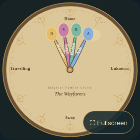
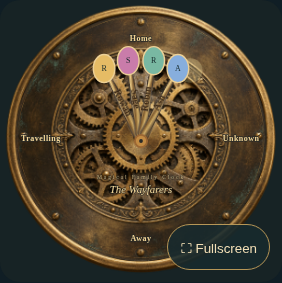
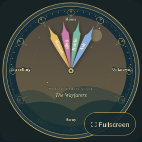
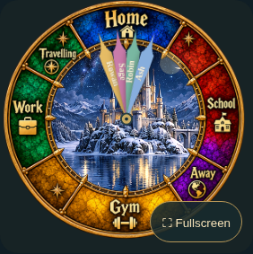

# Magical Family Clock: installation and user guide

This guide covers **version 0.2.0**. Install and update through HACS. Ordinary card setup uses Home Assistant’s visual editor; YAML, npm, SSH and custom helpers are not required.

The card shows **where people are**, rather than hours and minutes. Each person has a hand pointing to a location. Several people can share a location, and several independent clocks can use the same Home Assistant entities.

## Contents

1. [Before installing](#1-before-installing)
2. [Install with HACS](#2-install-with-hacs)
3. [Create your first clock](#3-create-your-first-clock)
4. [Choose a theme and artwork](#4-choose-a-theme-and-artwork)
5. [Add and customize people](#5-add-and-customize-people)
6. [Create locations and match states](#6-create-locations-and-match-states)
7. [Set up travelling and unknown states](#7-set-up-travelling-and-unknown-states)
8. [Add portraits](#8-add-portraits)
9. [Configure seasonal castle scenes](#9-configure-seasonal-castle-scenes)
10. [Adjust hands and readability](#10-adjust-hands-and-readability)
11. [Create another independent clock](#11-create-another-independent-clock)
12. [Back up, restore and share](#12-back-up-restore-and-share)
13. [Use fullscreen and tablet layouts](#13-use-fullscreen-and-tablet-layouts)
14. [Test beside your existing clock](#14-test-beside-your-existing-clock)
15. [Update, roll back or uninstall](#15-update-roll-back-or-uninstall)
16. [Troubleshooting](#16-troubleshooting)
17. [What has been verified](#17-what-has-been-verified)
18. [Upload images](#18-upload-images-from-your-device)
19. [Save and reuse clocks](#19-save-complete-clocks-and-reuse-them)
20. [Handmade face and typography](#20-customize-the-handmade-face-and-typography)
21. [Weather combinations](#21-combine-weather-seasons-and-time)
22. [Sensor rules and dynamic locations](#22-use-sensor-rules-and-automatic-locations)
23. [Optional hand data](#23-add-optional-data-to-a-hand)
24. [New-feature troubleshooting](#24-troubleshoot-the-new-controls)

## 1. Before installing

You need Home Assistant, HACS configured with its GitHub connection, and permission to edit a dashboard. You also need at least one existing location entity, such as a `person`, `device_tracker` or location sensor. Location accuracy comes from that entity; the card does not track phones itself.

For a first test, use a separate dashboard or add a separate card. Keep the old clock resource and any existing standalone page in place.

The release is [available on GitHub](https://github.com/deadmeat75/magical-family-clock/releases/tag/v0.2.0). The automated HACS check passed 6 of 8 checks; the remaining repository-owner tasks are an About description and topics. See [publishing status](PUBLISHING-STATUS.md) for exact settings. End-to-end authenticated HACS installation/update has not yet been verified, and public default-store approval is not claimed.

If you are only installing the card, repository metadata is the repository owner’s task. Do not change your working Home Assistant configuration to try to fix a GitHub metadata error.

## 2. Install with HACS

1. Open **HACS** in Home Assistant.
2. Open its three-dot menu and choose **Custom repositories**. Menu labels can vary slightly by HACS version.
3. Enter `https://github.com/deadmeat75/magical-family-clock`.
4. Choose **Dashboard** as the category and add the repository.
5. Find **Magical Family Clock** and open its download/install dialog.
6. Select version **0.2.0** (or a newer published version). This release does not require enabling prereleases.
7. Download, then reload the Home Assistant frontend when prompted.

HACS normally manages the JavaScript resource. Routine installation should not require copying a JavaScript file or registering a resource manually. If HACS does not register it, first check the troubleshooting section and your HACS installation status.

Do not copy the new bundle over `/local/magical-clock/magical-family-clock.js` or delete the old resource. The new HACS package has its own installation location.

## 3. Create your first clock

1. Open the dashboard where you want to test it.
2. Enter dashboard **Edit** mode and choose **Add card**.
3. Select **Magical Family Clock (HACS)**. This distinguishes the new card from an older clock entry with a similar name.
4. Choose **Guided setup** for your own household, or **Try demonstration** to inspect fictional people first.
5. Work through the editor sections: **General**, **People**, **Locations**, **Appearance**, **Behavior**, **Presets**, **Saved clocks**.
6. Use the preview while changing settings.
7. Finish with Home Assistant’s **Save** action. If dashboard edit mode has a separate **Done** action, finish that too.

**Finish setup** completes the guided editor; it does not replace Home Assistant’s Save action. Reload the dashboard after saving to check that your settings persist.

If you tried the demonstration, disable **General → Demonstration states** before checking real tracking. Remove any fictional people you do not want, then add your actual people.

## 4. Choose a theme and artwork

In **General → Clock theme**, choose one of these designs:

| Theme | Value shown in the selector | Appearance |
| --- | --- | --- |
| Whimsical Workshop | `whimsical-workshop` | Handmade parchment, mismatched plates and aged materials |
| Enchanted Spoons | `enchanted-spoons` | Parchment dial and spoon-shaped portrait hands |
| Brass Clockwork | `brass-clockwork` | Dark metallic dial, gears and warm brass accents |
| Living Magical | `living-magical` | Source-aligned curved hands with fantasy scenery |

For the stained-glass castle style, open **Appearance** and choose **Use layered castle artwork**. It selects Living Magical and applies the six reference locations and raised pivot. Your people and colors are retained, but the location layout is replaced. Choose this before creating a custom layout, or make a full backup first. Review personal state overrides if they referred to locations from a different layout.

The castle frame contains six fixed labels. Editing its location names or angles switches to the customizable vector dial so that the rendered labels can follow your layout. For arbitrary household locations, use the customizable dial.

Switching ordinary themes keeps the household configuration. An explicit layout-preset button also changes the layout settings described by that preset.

## 5. Add and customize people

Open **People → Add person**. For each person:

1. Enter a **Display name**. A nickname is optional.
2. Use **Location entity** to choose their existing person, device tracker or location sensor. Use the entity picker rather than typing an entity ID.
3. Leave **State attribute** empty for normal `person` and `device_tracker` entities. Set it only if your chosen sensor stores its location in an attribute instead of its state.
4. Choose **Hand color** and **Text color** with enough contrast against each other and the dial.
5. Start with length `1` so everyone has equal-length hands.
6. Leave **Hand design** on `theme` to follow the theme, or select a specific shape.
7. Use **Show name**, **Show portrait**, nickname and portrait settings as needed.

**Move up**, **Move down**, and **Display priority** control ordering. Higher numeric priority draws later, on top. Disable **Enabled** to temporarily hide a person without deleting their settings. **Remove person** removes that entry from this card only; it does not remove a Home Assistant entity or affect another clock.

The guard is 250 people and 250 locations per card. That is an input limit, not a promise that 250 names will be readable on one dial. Use smaller groups or multiple cards for crowded households.

## 6. Create locations and match states

The important distinction is between **the entity’s actual state** and **the label you want on the clock**. They can be different.

| Actual entity state | Example clock label |
| --- | --- |
| `home` | Home |
| `not_home` | Away |
| `Office` | Work |
| `Grandparents` | Grandma’s House |

Use your own actual state strings. If unsure, inspect the entity in Home Assistant; **Developer Tools → States** can show the exact state and attributes. A friendly entity name is not necessarily its state.

In **Locations**:

1. Add a location and enter its display name.
2. Enter **Matching states**, one exact value per line.
3. Add **Additional aliases** when several different states should point to the same location.
4. Choose an optional Home Assistant zone. This contributes the zone’s friendly name to matching.
5. Drag its dot around the dial, enter an exact angle, or use **Space locations evenly**.
6. Save and inspect the preview.

Do not assume that a person entity returns `zone.office` just because that zone exists. It may return `Office`. A literal zone ID matches only when explicitly listed and actually returned by the source. Case-insensitive matching is available; avoid unintended leading/trailing spaces in state values.

Angles use this convention:

| Position | Angle |
| --- | --- |
| Top | −90° |
| Right | 0° |
| Bottom | 90° |
| Left | 180° |
| Upper-left | −135° |
| Lower-right | 45° |

For one person’s exception, open that person’s **Personal state overrides**, enter the actual state, choose **Display as location**, and select **Add personal mapping**. Personal overrides take precedence over shared aliases. A selected active travelling sensor takes precedence over both.

Changing state aliases on the current castle layout also switches to the customizable dial in this candidate, because location edits are treated as custom-layout edits.

## 7. Set up travelling and unknown states

Travelling can work in either of two ways:

- Your location entity already returns a travelling state: map that state to the desired location.
- You already have a suitable movement/travelling sensor: choose it in **People → Travelling entity (optional)**, then choose **Behavior → Travelling location**.

The optional travelling sensor is treated as active for states `on`, `true` or `moving`. Do not select an unrelated “phone connected” sensor unless that state truly means travelling for your setup. A sensor rule can use an existing speed sensor to select Travelling; see [sensor rules](#22-use-sensor-rules-and-automatic-locations). The card does not create tracking helpers.

Choose **Behavior → Unknown state location** for missing, unavailable or unmatched location states. Enabled hands remain present rather than disappearing. The reference six-location layouts use Away as their unknown fallback; the general default layout has a separate Unknown location. Change the fallback if that better communicates uncertainty.

## 8. Add portraits

In a person’s **Portrait** box, choose **Upload Portrait** and select an image from your device. The **Use an image URL or /local/ path** disclosure also accepts an existing accessible path such as `/local/portraits/example.jpg`. See [upload instructions and limits](#18-upload-images-from-your-device).

Then adjust:

| Control | Purpose |
| --- | --- |
| Portrait shape | Circle or oval |
| Portrait frame | Brass outline or no frame |
| Portrait zoom | Enlarge the image within its crop; start at 1 |
| Horizontal/vertical position | Move the crop; start at 50/50 |
| Portrait rotation | Correct a tilted image |
| Head size | Increase or decrease the spoon/portrait head |

Uploads are optimized and embedded in the card configuration. No external hosting is required. Protected `media-source://` links are not resolved; use the upload control instead.

Spoon-style hands use initials when there is no portrait. Curved/pointed legacy-style hands can retain their undecorated silhouette when no portrait is selected. Disable portraits when recreating the original plain hands.

Private portraits are not sent to a third-party service by this card. An external URL that you deliberately configure still makes an ordinary browser request to that image host. Prefer local paths or HTTPS images accessible to the viewing device.

## 9. Configure seasonal castle scenes

With layered castle artwork selected, use **Appearance → Scene season** and **Scene time**.

| Setting | Choices |
| --- | --- |
| Scene season | auto, spring, summer, autumn, winter |
| Scene time | auto, dawn, day, dusk, night |

For a quick visual check, select winter/night, then spring/day. The gold frame and hands should stay in place while the scenery changes. Return both controls to `auto` for automatic selection.

Automatic mode uses Home Assistant’s timezone, location and selected sun entity. Set **Hemisphere** correctly. Dawn and dusk use a ±30-minute window around known sunrise/sunset events. Recent events are retained when Home Assistant advances its next-event timestamps. After a fresh reload, calculated solar times provide a fallback and may differ slightly from Home Assistant’s exact times. With insufficient solar data, a stable daytime fallback is used.

Use **Background crossfade (ms)** to adjust transition duration; zero makes switching immediate. Reduced-motion settings also reduce transitions. Incoming images preload before fading, and failed custom scenes retain the previous scene rather than blanking the clock.

The generic vector dial has separate **Background mode**, **Manual background**, **Seasonal backgrounds**, sun and optional weather controls. Those generic controls are separate from the castle’s Scene season/time controls. Weather effects now overlay both generic vector skies and the sixteen castle tiles; see [weather combinations](#21-combine-weather-seasons-and-time).

**Complete clock-face image URL** is for a single image containing its own face and scenery. An opaque image covers moving scenery beneath it. Use the layered castle option when you want the changing castle scenes. The bundled transparent frame is a generated derivative of the supplied reference, not a pixel-identical extraction; see [artwork notes](ARTWORK.md).

Use the season/time/weather override controls to upload a background for a specific combination. See [weather combinations](#21-combine-weather-seasons-and-time).

## 10. Adjust hands and readability

In **Behavior**, start with a moderate movement duration and leave reduced motion off unless preferred. The operating system’s reduced-motion preference is respected too.

If several people occupy one location:

1. Increase **Hand separation (degrees)** gradually.
2. Try **Collision arrangement → fan** for angular spread, or **stack** for varied reach with spread.
3. Reduce portrait head size or use short nicknames.
4. Adjust display priority if one hand should draw above another.
5. Split people into separate clocks if a small screen remains crowded.

**Maximum size** is a width limit, not a command to overflow a narrow dashboard column. Start with aspect ratio `1` for a square clock. For a dimmer display, adjust **Brightness**. **Animate gears** and **Gear revolution (seconds)** apply to Brass Clockwork.

## 11. Create another independent clock

Use Home Assistant’s card menu to duplicate a clock if that option is available, or add a new card and import a full clone through **Presets**, **Saved clocks**.

Then edit the copy’s title, people, theme or locations and save it. Changing the copy does not change the original card. Two clocks can intentionally watch the same entity while using different labels or designs.

For example, use a kitchen clock for everyone, an office clock for selected people, and a dim bedroom clock with reduced motion. Each card needs its own saved settings.

## 12. Back up, restore and share

### Make a full private backup

1. Open **Presets**, **Saved clocks**.
2. Enable **Include personal details in export**.
3. Choose **Download JSON** and store the file privately.

This includes names, entities and image references. It stores references to image files, not the image files themselves. Back up those files separately using your normal Home Assistant backup process.

### Restore a backup

1. Open the target card’s **Presets** section.
2. Copy the saved JSON text into **Configuration JSON**.
3. Choose **Import configuration**.
4. Check the preview, entities and image paths, then save the card in Home Assistant.

Import replaces this card’s configuration; back up an existing card first. Invalid or unsupported imports show an error. Another Home Assistant instance will usually have different entity IDs and local image paths.

### Share a design safely

Leave **Include personal details in export** off. Choose **Export configuration** to populate the text box or **Download JSON** to save a file. Default exports remove personal names, entity assignments, portraits, custom image paths, zone mappings and personal location names. The recipient needs to configure their own people and mappings.

**Clone full configuration** fills the text box with a complete copy, including personal data. Use it for private duplication, not public sharing.

### Save an appearance preset

Enter a **Preset name** and select **Save appearance preset**. To use it later, choose it in **Saved appearance preset** and select **Load appearance preset**.

Appearance presets store a subset of theme/background/brightness/gear settings in this browser. They are not complete backups and do not include people, mappings, portraits or every castle setting. They do not synchronize across devices and may disappear if browser storage is cleared. Use a full JSON backup for portable recovery.

## 13. Use fullscreen and tablet layouts

Use the card’s **Fullscreen** button. Use the button again or the browser’s normal exit action to leave fullscreen. If native fullscreen is unavailable, the card uses an in-page expanded view.

For a wall display, start with a dedicated dashboard, a sufficiently wide card column, a short title and readable nicknames. Confirm the device can load your normal authenticated Home Assistant dashboard before troubleshooting the card itself. No additional access token is required by the dashboard card.

WebKit and older-iPad testing are outside the release requirements. Compatibility remains unverified; the Home Assistant frontend itself may require a newer browser.

## 14. Test beside your existing clock

The old card uses `magical-family-clock`; the new one uses `magical-family-clock-card`. In the picker, choose **Magical Family Clock (HACS)** for the new card. Leave the old JavaScript resource and standalone HTML page in place.

For the supplied original layouts, the new editor offers **Use supplied Home Assistant layout** and **Use supplied standalone layout**. They are separate because the source files differ in pivot, silhouette and spacing. They preserve your people/colors but apply a location layout and the existing face-image path. Check personal overrides after applying either layout.

Use **Appearance → Pivot horizontal/vertical position** only when aligning a custom face. The supplied canvas source used 50% height; the standalone used 47%. Reading the existing `/local/magical-clock/clock-face.png` does not change that image.

Verified original-household colors and optional entity examples are in [advanced examples](EXAMPLES.md); none is prepopulated as a product default.

Before relying on the new clock, confirm each person appears, shared locations keep all hands visible, locations match actual states, settings survive a reload, and your old clock still works. Observe normal state changes; do not change existing helpers or automations just to manufacture a test.

## 15. Update, roll back or uninstall

Before updating, download a full private configuration backup and note the currently installed version. Use HACS’s normal update action, reload the frontend when prompted, and check the clock again.

If a new version misbehaves, keep the old clock available. HACS may offer another version through its download dialog; available choices depend on published releases and your HACS version. Do not overwrite the legacy JavaScript to attempt a rollback. Restore a saved card configuration only when necessary and after backing up its current state.

To uninstall, remove the new cards you no longer want, then remove this new package through HACS. Follow HACS’s prompts for its resource. Keep the separate legacy resource and image if the old clock still uses them. Uninstalling the new card should not require deleting people, zones, helpers or automations.

## 16. Troubleshooting

| Symptom | What to check |
| --- | --- |
| Repository cannot be added | Correct URL and Dashboard category; HACS GitHub connection; current repository metadata status in publishing notes |
| Card missing from picker | HACS download completed, frontend reloaded, correct new entry, resource loaded once |
| “Custom element doesn’t exist” | New card type is `custom:magical-family-clock-card`; check HACS resource status rather than replacing the old resource |
| Fictional people keep appearing | Disable Demonstration states and remove unwanted demo entries |
| A person points to Unknown/Away | Actual entity state, exact aliases, personal overrides, active travelling sensor and selected fallback |
| A person is absent | Enabled setting and whether the person was added to this card; unknown states should retain enabled hands |
| Portrait missing | Existing accessible image path, HTTPS/local URL, current browser’s access and portrait visibility |
| Castle scene does not change | Scene season/time overrides, sun entity, hemisphere, and whether a complete opaque face is covering the layers |
| Castle labels change back to a plain dial | Editing castle location settings intentionally switches to the customizable dial |
| Weather does not appear | Check the selected weather entity, effect override, motion setting and system reduced-motion preference |
| Names overlap | Separation, head size, nicknames, priority and number of people on the small dial |
| Settings disappear after reload | Complete Home Assistant’s card Save and dashboard Done actions |
| A saved appearance preset is missing | Same browser/profile; storage not cleared; use a full JSON backup for portability |
| Imported settings use unknown entities | Select entities belonging to this Home Assistant instance and review mappings |

When reporting a problem, include the card version, Home Assistant/HACS/browser versions, theme, steps to reproduce and any visible error. Share a privacy-safe export when useful. Do not post access tokens, full private backups, or private portraits.

## 17. What has been verified

The published candidate passed 25 unit/packaging checks and 17 Chromium browser checks. Version 0.2.0 passed 31 unit/packaging checks and 22 Chromium browser checks, plus account-storage and upload persistence validation; see [version validation](NEXT-VERSION.md). In a separate Home Assistant 2026.10.2 test instance, dashboard saving/reload, live entity state movement, native entity selection and independent cards were verified without frontend exceptions. The published bundle was downloaded and matched against the tested artifact.

HACS 2.0.5 was installed in that disposable instance and its setup form loaded. Authenticated custom-repository installation/update remains unverified. No existing user installation was modified. The latest outstanding repository-owner tasks and workflow results are recorded in [publishing status](PUBLISHING-STATUS.md), with further detail in [validation](VALIDATION.md).

## 18. Upload images from your device

In **People**, open a person’s **Portrait** box and choose **Upload Portrait**. Select a PNG, JPEG or WebP file. A preview appears after optimization. Expand **Customize hand and portrait** to adjust the crop, zoom and rotation, then save the dashboard. **Remove Portrait** restores initials or the plain hand silhouette.

The same upload controls appear in **Appearance** for the center illustration, complete face and custom backgrounds. The **Use an image URL or /local/ path** disclosure retains the existing URL workflow. Files are embedded as optimized raster images in the card configuration; they do not create files in `/config/www`, need a companion integration or contact an image host. A full saved clock or personal JSON backup includes these images.

Limits: source files up to 10 MB and 40 million decoded pixels; portraits are resized to at most 512 pixels on their longest side and other images to 1600 pixels. Optimized images must fit within two million encoded characters, and each complete card is limited to 2.5 MB. Home Assistant also limits a dashboard save message; several image-heavy cards on one dashboard may need smaller images or shared /local/ URLs. PNG transparency is retained through WebP optimization. SVG, GIF and animated uploads are not supported. Use a smaller source if optimization exceeds the limit. Large numbers of images make dashboard saves and backups larger; reuse backgrounds sparingly.

## 19. Save complete clocks and reuse them

1. Configure a clock and choose **Save clock** at the top of the editor.
2. In **Saved clocks**, enter a descriptive **Saved clock name**, such as “Hallway family clock”.
3. Choose **Save as new clock**. Wait for **Saved.** and the named entry to appear.
4. On another dashboard, add a Magical Family Clock card and choose **Use saved clock**.
5. Select **Preview saved clock** if desired, then **Load independent copy**.
6. Save that dashboard using Home Assistant’s Save button.

This library stores the complete configuration, including people, entity choices, matching rules, uploaded images, captions and styling. It uses Home Assistant’s frontend user data store, scoped to the signed-in account. Other devices signed into that same Home Assistant account can load it. Another household member’s account has its own library. This is separate from the older browser-only appearance presets.

**Duplicate saved clock** creates another named library entry. **Rename clock** changes its library name. **Delete saved clock** asks before deletion and leaves existing dashboard copies intact. Loading a clock creates an independent copy: subsequent edits to a dashboard or saved entry do not synchronize with its other copies. To save a revised design, save it as a new clock and optionally remove the older entry.

The library holds up to 30 clocks and 3 MB of encoded data in total. Failed storage operations show an error instead of claiming success or silently falling back to browser storage. Refresh after a connection error. Avoid editing the library simultaneously from different devices: the underlying Home Assistant store uses last-write-wins storage. Export personal JSON for an independent backup before deleting or replacing important designs.

## 20. Customize the handmade face and typography

Choose **General → Clock theme → whimsical-workshop** for an original handmade face with irregular parchment, mismatched wood and metal plates, screws and weathered texture. **brass-clockwork** now uses layered metallic shading, grain and aged surfaces. These illustrations are created for this project; they do not copy film artwork.

**General → Clock caption (blank to hide)** changes the “Magical Family Clock” wording on each instance, including the castle artwork. This is separate from **Title**. An empty caption leaves no wording. Text uses editable SVG text rather than being baked into the bundled artwork. A caption already baked into a custom uploaded face cannot be removed by this control; choose an image without lettering.

In **Appearance**, select independent fonts and text sizes for names, location labels and captions. Hand names follow the stem and use inset shading rather than floating over the face. The font menu includes serif, monospace, sans-serif and cursive choices. Fonts come from the viewing device; unavailable named fonts use their listed fallback. Custom paper, ink, metal and rim colors apply to the customizable vector dial. **Restore theme colors** removes those overrides. The realistic brass and handmade face illustrations and castle raster artwork retain their material colors.

For each person, expand **Customize hand and portrait**, adjust **Hand width (0.5–2.5)** and choose spoon, classic, curved, pointed, arrow, leaf or sword. Width changes the stem silhouette without stretching portrait images. Length, material and colors remain independently configurable. Use narrower hands for a large household and short nicknames for readability.

## 21. Combine weather, seasons and time

The castle keeps the same subject across its sixteen season/time scenes. Additional seasonal color treatment makes spring, summer, autumn and winter easier to distinguish. Weather is a separate overlay and can accompany every season and time, including uploaded scene backgrounds.

In **Appearance**, select a **Weather entity (optional)** and leave **Weather effect** on `auto`, or choose an effect manually:

| Effect | Appearance |
| --- | --- |
| clear | Warm light in clear conditions |
| clouds | Slowly drifting cloud banks |
| light-rain | Shorter, slower gentle rain |
| rain | Longer, faster rainfall |
| snow | Gently falling snowflakes |
| sleet | Mixed rain and snow |
| wind | Moving wind trails and cloud movement |
| fog | Broad drifting low mist |
| ice | Icy precipitation and frost around the scene edge |
| lightning | Rain, cloud and an occasional lightning highlight |

Automatic mode recognizes standard Home Assistant weather states, including `sunny`, `clear-night`, `partlycloudy`, `cloudy`, `rainy`, `pouring`, `snowy`, `snowy-rainy`, `windy`, `windy-variant`, `fog`, `hail`, `lightning` and `lightning-rainy`. A missing or unsupported state uses clear conditions. Weather intensity is a manual density control from 0.2 to 2; this version does not infer precipitation intensity from arbitrary attributes.

Turn off **Animate weather** for static weather marks. **General → Reduced motion**, or the device’s reduced-motion preference, also stops weather animation and lightning flashes. Weather pauses when the card is offscreen. Day/night brightness comes from the selected scene; clear-night does not add a daylight sky replacement.

To supply your own scene for a combination, open **Season, time and weather image override**, choose the three values and select **Configure this combination**. Upload an image in the resulting box. For example, winter + night + snow takes priority over the ordinary winter-night scene. The castle frame stays fixed and weather effects remain above it. A failed image load keeps the preceding scene.

## 22. Use sensor rules and automatic locations

**Locations → Add discovered locations** imports available Home Assistant zone names and the current location states of selected people as editable dial entries. Review the names, matching states and angles afterward. Discovery reads states already available to your browser; it does not invent locations or query phone history.

For ongoing discovery, enable **Automatically add detected locations**. The card temporarily adds up to 24 unconfigured names and distributes all labels evenly. These runtime additions do not rewrite the dashboard configuration. Names can disappear when the corresponding source data disappears. Use fixed locations when hand angles must remain stable. Editing locations switches the fixed six-location castle artwork to the customizable dial.

For conditional location matching, open a person’s **Optional hand information and location rules** and choose **Add location rule**. Select a source entity, optional attribute, comparison, value and destination. Leave the source entity empty to use that person’s configured location entity.

Examples:

| Source | Comparison | Value | Destination |
| --- | --- | --- | --- |
| `sensor.phone_speed` state | above | `5` | Travelling |
| `sensor.indoor_room` state | equals | `Kitchen` | Kitchen |
| `device_tracker.phone` attribute `activity` | contains | `cycling` | Travelling |

Create the destination under **Locations** first. The dedicated travelling entity has highest priority, followed by the first matching sensor rule, personal state overrides, ordinary location matching and finally the unknown-state fallback. Missing, unavailable or unknown source values do not satisfy a rule. Numeric comparisons use the source’s reported units: a speed threshold of 5 means 5 in that sensor’s units, with no implicit conversion.

## 23. Add optional data to a hand

1. Open **People**, find the person and expand **Optional hand information and location rules**.
2. Choose **Add hand information**.
3. Select a **Reading entity**, or leave it blank to use the person’s location entity.
4. Leave **Reading attribute** blank to show the state, or enter an exact attribute name such as `battery_level`, `speed` or `room`.
5. Enter a short **Reading label**, optional unit and decimal places.
6. Check the preview and save the dashboard.

For battery, choose the phone battery sensor, label “Battery”, unit `%` and zero decimal places. For speed, choose a speed sensor and its actual unit. For room, choose the room sensor and leave the unit blank. Other scalar states and attributes work the same way. Choose **Reading placement** to put information below, above or beside the portrait or tip. Up to four readings appear on each hand; they remain upright and separate from the location label. Object-valued attributes and missing/unknown/unavailable readings are hidden. These readings are display-only and never change the hand’s destination; use a location rule explicitly when desired.

## 24. Troubleshoot the new controls

| Problem | Check |
| --- | --- |
| Upload rejected | PNG/JPEG/WebP format, source size, decoded pixel count and optimized limit |
| Image appeared but disappeared after reload | Save the card and dashboard after uploading |
| Saved clocks are missing on another device | Same Home Assistant installation and signed-in account; choose Refresh saved clocks |
| Library operation failed | Connection and frontend storage support; no local-only fallback is used |
| Copy changes unexpectedly affect another clock | Check that you loaded an independent copy rather than editing the same dashboard card |
| Sensor reading is hidden | Entity exists, attribute name is exact, value is scalar and available |
| Numeric rule does not match | Actual units, numeric value, rule order and chosen destination |
| New automatic location moves other labels | Runtime discovery redistributes angles; disable it and use fixed locations |
| Weather is static | Animate weather, reduced motion, system preference and offscreen pause |
| Text remains on an uploaded face | Image contains baked-in text; replace it with an unlettered image |
