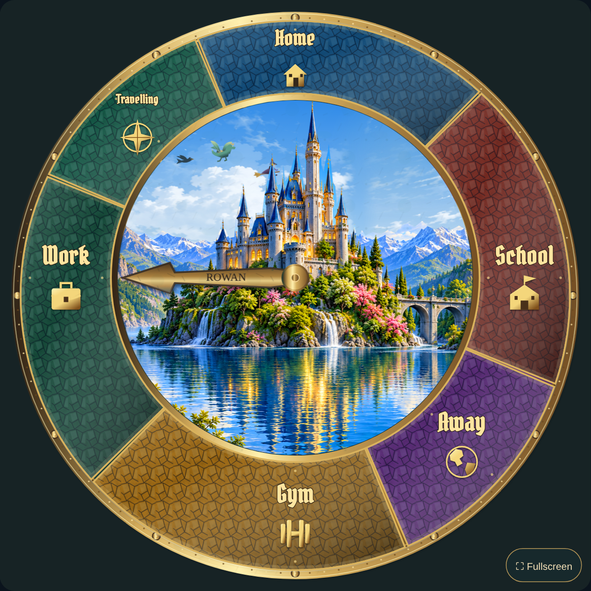
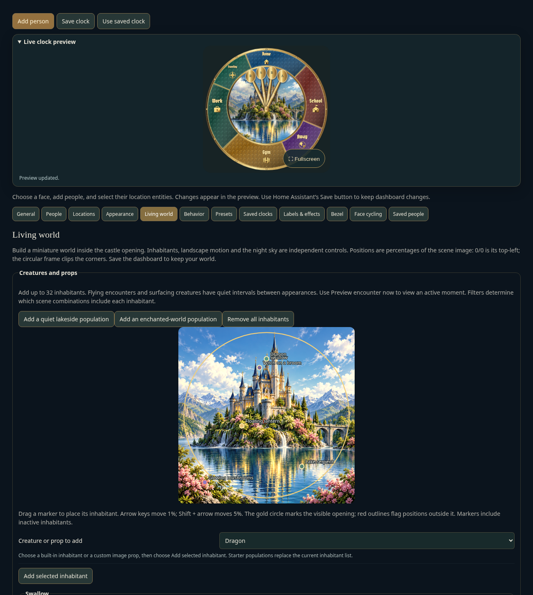
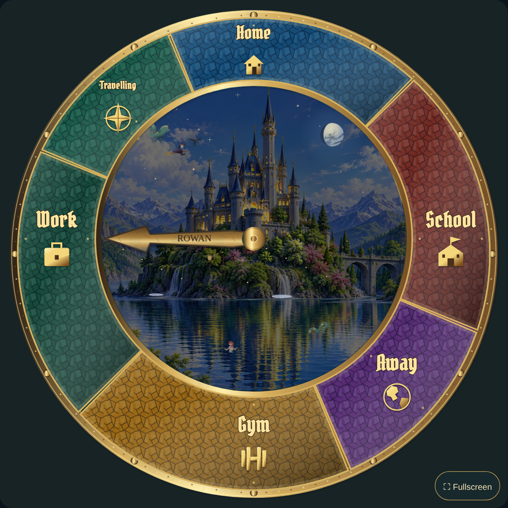

> **Unreleased review draft.** Publication is held for individual visual approval. See the [review gallery](visual-review/README.md). HACS remains on 0.4.0.

# Living World: detailed setup guide

For the **unreleased Magical Family Clock 0.4.1 draft**. HACS remains on **0.4.0** while the visual review is in progress. The features below describe the engineering draft; install the next version through HACS only after it is published. First installation is covered in the [user guide](USER-GUIDE.md#2-install-with-hacs). [Current publication and HACS validation status](https://github.com/deadmeat75/magical-family-clock/blob/main/docs/PUBLISHING-STATUS.md).



## Create your first living world

1. Open your clock's visual editor. Home Assistant shows the single clock preview on the right; the left column contains the settings. Keep a private full backup under **Presets** before replacing a layout or population you have customized.
2. For a new clock, choose **Appearance → Use layered castle artwork**. This selects the layered castle while preserving your configured people and destinations. Use the layout controls separately if you want a reference arrangement. Configure tracking in **People** and **Locations** as usual.
3. For an existing customized clock, open **Living world**. If offered, choose **Use the animated castle for this world**. This selects the layered castle and clears an opaque complete-face image while keeping your destinations and tracking rules.
4. Open **Locations → Location panel design** and choose **Fit all names and graphics inside panels**. This removes old free-position label coordinates/rotation and restores automatic panel fitting. It does not change matching states or destination angles.
5. Open **Living world** and choose **Add a quiet lakeside population** for a swallow and boat, or **Add an enchanted-world population** for six visitors/props. These buttons replace the current inhabitant list; they do not append to it.
6. Use the placement map and **Preview encounter now** to inspect inhabitants. Start with a few, then add more after checking your normal dashboard size.
7. Expand **Landscape and motion controls**. Enable **Show miniature world** and **Animate castle scenery**. Try **Scene time → Day**, then **Night**. Return to **Auto** when finished.
8. Expand **Moon sensor and night sky** and choose your phase source as described below.
9. Finish with Home Assistant's **Save** button, then reload the dashboard to confirm persistence. Saving a library entry is a separate action from saving the dashboard.

To leave more room for the scenery, clear **Show clock title and caption** in the landscape controls. The text remains saved. **Labels & effects** still moves, styles or removes the title and caption independently.

## Design the location panels

Open **Locations → Location panel design**. Each destination gets its own textured sector, metallic frame, large graphic and fitted name. Sectors follow the actual destination angles and the raised castle opening. Hands keep using the same tracking rules.

| Control | Meaning |
| --- | --- |
| Show framed location panels | Use the new panels; off restores plain location labels. Location labels must also be enabled. |
| Use panels on other faces too | Extend panels to editable non-castle faces. Complete-face images retain their own artwork. |
| Default panel texture | Cracked glass, hammered metal, parchment, wood or plain. |
| Panel lettering font | Pirata One is embedded for consistent ornate lettering without an external font service. Other fonts depend on the viewing device. |
| Panel name maximum size | A ceiling of 8–38 SVG units, initially 25. Long names shrink to fit; this does not force small panels to display large text. |
| Castle opening radius | 155–205 SVG units, initially 180. Smaller makes wider panels and a smaller visible landscape. |
| Panel frame color | Outline tint for the sectors; the outer rim retains its own material. |
| Fit all names and graphics inside panels | Reset free x/y name positions, label rotation and radial offsets, enable labels and fit the content again. |

Expand **Panel artwork and layout** inside an individual location:

- **Location graphic:** Auto chooses a symbol from the destination name. You can explicitly choose a house, briefcase, school, gym weights, compass, globe, hospital, shop, family, garden, bed, magic wand, pin, none or Custom.
- **Panel layout:** name above graphic, name below graphic, name only or graphic only. Names remain horizontally readable; destinations around the sides do not turn their entire layout sideways.
- **Graphic maximum size:** 10–62 SVG units. The renderer reduces the graphic when the frame requires it. **Graphic color** tints built-in symbols; uploaded images keep their own colors.
- **Graphic horizontal/vertical offset:** move the graphic within the panel. Start at zero. Large offsets may leave too little space for usable artwork.
- **Name radial offset:** move the name toward/away from the center. Start at zero for fitting.
- **This panel texture/background color:** override just that destination, leaving the default for other panels.
- **Location graphic image:** upload a PNG/JPEG/WebP, then select **Custom** in Location graphic. Transparent PNGs work well for isolated symbols.
- **Panel background image:** upload a separate texture or illustration that fills this sector and is clipped at its border. This is independent of the graphic.

The existing location font, color, opacity, size and fixed/sensor-driven name settings remain available. A long name may wrap, shrink or end in an ellipsis; its full name remains available as an accessible label. Short display names are easier to read on a tablet.

Explicit **Horizontal/vertical position** values intentionally override automatic name placement. If a migrated clock still has labels across the castle opening, choose **Fit all names and graphics inside panels**. Clearing both per-location coordinates also restores fitting for that location. More destinations or nearly identical angles produce narrower panels; fitting prevents overflow but cannot make arbitrarily small text readable.

## Populate the miniature world

Open **Living world → Creatures and props**. There are **17 choices** and room for **32 inhabitants per clock**:

| Category | Choices |
| --- | --- |
| Sky visitors | Swallow, owl, witch on a broom, wizard on a broom, dragon, phoenix, fairy |
| Lake inhabitants | Lake serpent, mermaid, merman |
| Floating props | Sailing boat, floating lantern |
| Shore props | Enchanted cottage, glowing mushrooms, crystal cluster, unicorn |
| Your artwork | Custom image prop |

Choose **Creature or prop to add**, then **Add selected inhabitant**. Each has its own settings, position and movement; you can add multiple of the same kind. Owls and lanterns initially use a night filter. Starter populations are editable examples, not a separate fixed scene.

### Place inhabitants with the map

The map shows the current scene and a gold circle for the visible opening. Drag a named marker to move its inhabitant, or focus the marker and use arrow keys for 1% steps; **Shift + arrow** moves 5%. Numeric position controls update too. Red outlines flag centers outside the opening. Markers include inhabitants currently hidden by filters so you can still edit them.

Coordinates use the **square scene image**, not the entire clock: 0/0 is the image's top-left and 100/100 its bottom-right. The circular frame clips its corners. Sky routes usually work around 10–30% vertical; the lake is around 72–90%. A creature's full travel path can leave the opening even when its center marker is inside it.

Selecting a marker or choosing **Preview encounter now** brings an active moment into the preview. This changes the preview animation, not the saved configuration. Editing preserves its current motion phase; choose Preview encounter now again when you want another active moment. Filters, tower masking, clipping and reduced motion still apply.



### Understand an inhabitant's controls

Expand **Edit inhabitant settings**. The first inhabitant starts expanded; other groups can be opened as needed.

| Control | Meaning |
| --- | --- |
| Inhabitant name | Editor/accessibility description. It is not a floating name drawn above the creature. |
| Show this inhabitant | Hide temporarily without deleting settings. |
| Inhabitant color | Tint the built-in body, cloth or prop while retaining shaded details. Custom images retain their original colors. |
| Horizontal/vertical position | Route midpoint, stationary center or surfacing waterline, in scene percentages. |
| Inhabitant scale | 0.25–3 times the base size. Start at 1. Small figures give a stronger sense of a large castle. |
| Movement cycle | Full 8–240 second repeat, including quiet time between flying/surfacing appearances. It is not just time on screen. |
| Travel span | Requested route width in scene percentages. Routes extend beyond the opening when necessary so figures never appear or reset in open sky. |
| Inhabitant movement | Fly past then rest; surface/linger/submerge; drift back and forth; gently bob; or remain still. |
| Facing direction | Mirror the figure left/right. Flying visitors travel in that direction. Drifting props move back and forth. |
| Pass behind the castle | Hide a sky visitor behind the bundled tower silhouette. Disable for foreground routes or custom scene geometry. |
| Visible at time/in season/in weather | All selected filters must match. Any leaves that filter unrestricted. |

Surfacing creatures disappear below their configured waterline and leave animated rings. Flying figures enter and leave beyond the opening along curved routes; they do not fade out in the open sky. Wings use flap/glide cadences, with cloth and tail movement where appropriate. The cottage has chimney smoke, and glowing props have light effects. A custom uploaded prop moves as one image; it does not acquire separately animated limbs.

**Visual review:** the revised painted character and hand proposals are not integrated into this renderer yet. Natural environment contact, species-specific animation and the new face controls must be completed and reviewed before release. See the [recorded requirements](visual-review/REVISION-NOTES.md).

**Duplicate inhabitant** creates an independent copy with a new ID. **Move inhabitant forward** moves it ahead of the next inhabitant in drawing order; tower masking remains separate. **Remove inhabitant** deletes just that entry. **Remove all inhabitants** keeps the landscape and moon settings.

Try a dragon with a long cycle, a small swallow with a shorter cycle, and a lake serpent at about 65% horizontal/80% vertical. Use a moderate scale and the preview before adding another visitor. Occasional appearances leave time to notice the moving landscape.

## Control landscape motion and performance

Expand **Landscape and motion controls**:

- **Show miniature world** enables the world overlays. Turning it off keeps the base illustration and tracking hands.
- **Animate castle scenery** pauses/resumes the landscape and inhabitants together. A paused world stays visible.
- **Moving clouds**, **Swaying trees**, **Rippling lake** and **Running waterfalls** use separate drifting cloud decks, visible root-anchored canopy sway, continuous reflection waves and downward flow threads with fine impact spray. Clouds replace the bundled stationary sky beneath them. Waterfall spray has no solid glowing discs.
- **Seasonal petals and leaves** drifts blossom petals in spring and leaves in autumn, independently of tree sway. Summer and winter add neither. The active season follows Appearance settings.
- **Warm castle window lights** gives identified castle panes independent irregular candle or torch flicker at dusk/night. Revision 5 slows the time scale by 25% from revision 4 and excludes surrounding trees. **Evening fireflies** adds small green-glowing lights near foreground vegetation, with independent paths and pulses.
- **Twinkling stars** and **Occasional shooting stars** show during dawn/dusk/night. Cloud coverage erases stars and meteors behind it, and the moon, castle and foreground stay in front. Meteors have varied origins and flight angles, with irregular 20–75 second quiet intervals.
- **World detail → Rich** uses the most foliage/stars and a 24-fps landscape painter. **Balanced** reduces foliage and paints at 18 fps. **Light** paints at 12 fps with lower resolution, fewer stars and no moving foliage regions. Use fewer inhabitants too on slower displays.
- **Scene time** previews dawn/day/dusk/night. Auto uses Home Assistant sun data and local solar calculations. Season and weather remain controlled in Appearance and can be combined with inhabitants' filters.

**Appearance → Decorative motion speed** changes decorative motion speed; inhabitant cycle values remain their base settings. Castle motion intensity controls landscape movement strength. Weather has its own animation switch and effects. Tracking hands still respond to entity state changes independently.

**General → Reduced motion**, the viewing device's accessibility preference, and off-screen visibility pause decorative animation. Device reduced motion takes precedence over the animation switch. The world remains a still illustration; shooting stars are hidden. Return the device preference to normal if you want motion.

The photo-aligned trees, lake, waterfalls and windows are designed for the bundled castle composition. Custom combination backgrounds still support the inhabitants, moon and general cloud overlays, but do not gain photo-aligned landscape animation automatically. For custom artwork, position the inhabitants appropriately and turn off tower masking when its silhouette does not match.

## Match the moon to a Home Assistant sensor



Expand **Moon sensor and night sky**:

1. Enable **Show the moon**. It is drawn at dawn/dusk/night, not during the daytime scene.
2. Choose **Moon phase source → Selected Home Assistant sensor**.
3. Select your existing Moon integration entity using **Moon phase entity**. The card reads the entity; it does not create a sensor or install an integration.
4. Leave **Moon phase attribute** blank for an ordinary Moon sensor. Enter an exact attribute key only when that is where your sensor stores its phase.
5. Choose the value format below. The ordinary Home Assistant Moon integration uses **Named phase**.
6. Read **Current moon** below the controls. It reports the phase/source and whether calculated fallback is being used. Sensor updates change the moon without reloading the background image.
7. Choose **Scene time → Night** temporarily to inspect it, then restore Auto and save the dashboard.

| Format | Accepted values |
| --- | --- |
| Named phase | `new_moon`, `waxing_crescent`, `first_quarter`, `waxing_gibbous`, `full_moon`, `waning_gibbous`, `last_quarter`, `waning_crescent`. `third_quarter` also means last quarter. |
| Cycle fraction | 0–1 around the full lunar cycle; 0 is new, 0.25 first quarter, 0.5 full, 0.75 last quarter. |
| Cycle percent | 0–100 around that same cycle; 50 means full moon. |
| Moon age | Days since new moon, 0–29.53059. |

**Illuminated percentage is not cycle percentage.** A 50%-illuminated moon can be waxing or waning; that number alone cannot select the correct side. Use a named phase or an actual cycle/age sensor.

**Auto** first uses an explicitly retained sensor selection, otherwise looks for an existing recognizable moon-phase sensor, then calculates locally. **Local astronomical calculation** uses the bundled SunCalc library without an external service. **Manual phase preview** uses the selected manual phase until you switch back to a live source.

If an explicitly selected sensor is unavailable or unreadable, **Unavailable moon sensor** chooses local calculation or hides the moon. The current-source message identifies fallback. Position controls use scene percentages, with a radius of 6–32 SVG units. The moon is kept inside the opening and masked behind the castle silhouette; a position behind a tower may conceal it. The illustrated phase is decorative, not a simulation of the moon's exact altitude or local orientation.

## Save, reuse and share

Home Assistant's **Save** stores the panels, population, moon source and existing tracking configuration in the dashboard card. **Saved clocks** stores complete clocks in your signed-in Home Assistant account for independent reuse on another dashboard. **Saved people** remains the place to reuse a person's sensor/hand setup across different clocks. See the [Design Studio guide](DESIGN-STUDIO.md#save-a-person-once-and-reuse-them).

A full private JSON backup includes custom artwork and sensor IDs. The default privacy-safe export removes the moon entity/attribute, custom panel images and all inhabitant entries, along with the existing household details; it uses a calculated moon instead. Review a shared export before posting it.

## Troubleshooting

| Symptom | Action |
| --- | --- |
| New controls are missing | Update to 0.4.1 through HACS and reload the frontend. If the old editor remains, hard-refresh/clear the frontend cache. |
| Landscape is still | Enable world/scenery animation, check General reduced motion and device accessibility preferences, and ensure the clock is visible. Light detail intentionally omits swaying trees. |
| New world is covered | Clear an opaque Complete clock-face image, or use the animated-castle button. Hide title/caption overlays if they cover visitors. |
| Creature is absent | Check Show this inhabitant, all three filters, route position, tower mask and quiet interval. Use Preview encounter now. |
| Preview says no active moment | Select the matching scene/weather, enable world/motion and move the route into the opening. Reduced motion keeps a still world. |
| Lake creature is on land | Move its vertical waterline to the lake and check the opening on the placement map. |
| Names still cross the inner frame | Choose Locations → Fit all names and graphics inside panels to clear free-position overrides. |
| Uploaded graphic is missing | Choose Custom in Location graphic; check the image upload/URL and frame size. Background image is a different field. |
| Moon looks wrong or is absent | Inspect Current moon, source/format, sensor availability and Scene time. A new moon has no lit face. Check tower masking and position. |
| Animation is slow | Choose Balanced/Light, reduce the population, and disable expensive landscape/weather layers. |
| Changes disappear after reload | Finish with Home Assistant's Save action; saving an account-library copy alone does not save the dashboard. |

The world combines high-resolution illustrated scenery, Canvas 2D landscape animation and layered SVG inhabitants. The recording uses normal-speed playback without seeking encounters. It is not a free-roaming 3D game or a physics simulation. The 1254-pixel source retains a raster-resolution limit; frames, names, icons, hands and inhabitants are vectors. See [validation and practical limits](VALIDATION.md) and the [animation recording](living-world-preview.mp4). Screenshots and video use fictional people and simulated sensors.

## Review draft: weather and glass

The [latest visual review index](visual-review/LATEST-REVISIONS.md) is the place to inspect the current examples. Earlier revisions remain archived. These changes are not a new HACS release yet.

1. In **Appearance**, select a **Weather effect** to inspect it. Start with intensity **1**. Return to **Auto** to follow your existing weather entity.
2. Enable **Weather animation** to see falling rain, snow, sleet, drifting fog and wind-blown leaves. General reduced motion and your device's accessibility preference can pause decorative movement.
3. **Clear** gives a cloud-free sky. It removes both the photograph's painted clouds and the moving cloud layer. **Moving clouds** still controls cloud animation for other weather conditions.
4. **Ice** reveals fine white branching needles continuously inward from the central glass rim over 28 seconds, then holds the completed frost. A single growth front prevents whole crystals popping in. It is clipped away from the outer destination ring. Reduced motion shows the completed pattern without growth.
5. **Lightning** combines distant strikes behind clouds with nearer strikes, different positions, branching channels and brief surrounding illumination. Weather can keep moving while castle scenery is paused.
6. **Wind** moves loose leaves across the opening and increases canopy gusts. **Fog** drifts in layers across the landscape; it does not darken the entire clock.

Rain and sleet have different densities. Snow has small distant flakes and larger nearby flakes. Each animated review has a still image too; open the GIF to judge movement. A shooting-star review may skip long quiet gaps so several passages can be inspected; the visible passages run at normal speed.

## Review draft: realistic moon

The approved lunar surface stays the same across every phase. Lighting determines which side is visible. The unlit side is transparent so the actual sky color shows through; a dark disc is not painted over blue sky. Stars remain hidden behind the moon's complete outline.

**Living world → Moon phase → Show moon in daylight** also allows a daytime moon. This is a display choice: a phase sensor alone does not establish whether the moon is above your local horizon. The existing sensor formats, manual phases, calculation fallback and unavailable-sensor choices work as before. Return to your selected live source after previewing manual phases.

## Review draft: crafted information bezels

In **Bezel**, select wood, aged brass or silver for the new crafted rim. Wood has carved ornament and continuous grain around the ring. The metal rims have dimensional chased ornament and quiet inset bands for the information. **Width** changes the ring thickness while retaining the artwork; it does not repeat square texture tiles.

Readings follow curved paths on the smooth information band. Upper baselines are inset to clear the decorative outer edge; silver and wood lower baselines sit slightly farther outward. Add a few readings first, give each its own angle, and choose a readable font, size and color. Existing sensors, time, date, labels and fallback text remain editable. A wider bezel gives longer readouts more room. Saving the dashboard stores the bezel choices with that clock.

## Review draft: understand the six surface effects

Open **Labels & effects**. Each surface—hands, portraits, face, frame and bezel—has independent strengths from **0** (off) to **1** (strongest). Change one effect at a time and inspect your usual dashboard size.

| Effect | What it does | Suggested first value |
| --- | --- | --- |
| Shadow | Makes a raised part cast a soft shadow down and right, separating it from the surface beneath. | 0.3 |
| Bevel | Adds a lit upper-left edge and a shaded lower-right edge, making the existing outline look cut or raised. | 0.35 |
| Reflection | Reflects cooler sky light and warmer surroundings in curved polished material. Wood and brushed finishes reflect less. | 0.25 |
| Glare | Adds a concentrated light highlight on polished metal or portrait glass. | 0.15 |
| Patina | Accumulates darker oxidation along metal edges and crevices. Wood uses darker aging rather than green oxide. | 0.2 |
| Wear | Adds fine handling scratches and brighter worn edges. | 0.1 |

The revised E01–E06 sheets show **effect off** beside **effect at 85%**, with each comparison isolated so the settings cannot interfere. Use lower strengths for a restrained finished clock. Surface wear and patina do not cover the castle sky with a tiled material layer. Changing these controls does not change tracking, names, sensor rules or saved people.

Approved face, hand, material, symbol and seasonal artwork remains preserved in the decision record. Some approved art still needs final runtime registration, pivots, animation layers or material mapping. The gallery identifies artwork studies separately from implemented runtime examples; an artwork approval alone does not publish a release.

## Review draft: functional picture-disc face (F03)

This face is available in the **unreleased review branch**. Published HACS remains v0.4.0. Update through HACS when an approved release becomes available.

1. Open the card editor and choose **Clock theme → astronomical**. This selects vector artwork and clears a custom face image so the functional face is visible.
2. Keep existing people, sensors and locations. Family hands still show whereabouts. Four separate illustrated discs supply additional information through fixed windows; these astronomical windows have no hands or numbered scales.
3. **Day / night** shows dawn, day, dusk or night using the configured sun data or local solar calculation. Without solar data, the Home Assistant local hour supplies a civil-time fallback: dawn 06:00–08:00, day 08:00–18:00, dusk 18:00–20:00, night otherwise. These fallback hours are not measured sunrise/sunset. UTC is used when no Home Assistant time zone is provided.
4. **Moon phase** uses **Living world → Moon phase**. Choose the existing lunar sensor, a manual phase, or the calculated source. Named phases, cycle fractions, percentages of a cycle and lunar-age days retain their existing meanings. Illuminated percentage alone does not distinguish waxing from waning. Choose **Hide** or **Calculated** deliberately for unavailable sensor data; Hide shows an unavailable indication.
5. **Season** shows the selected seasonal landscape. **Weather** shows the current configured condition through a painted scene and appropriate weather marks. Existing automatic sources and manual preview overrides apply. Set overrides back to automatic to resume live readings.
6. A changed reading rotates the appropriate image carrier to its next picture over 1.8 seconds. With reduced motion or paused scenery, the reading changes immediately instead. Sensor updates remain live. Discs do not spin freely or accelerate natural seasonal/lunar cycles. Family whereabouts hands remain independent of the image carriers.

[Current F03 stills and mechanism clip](visual-review/REVIEW-ROUND-3.md) use deliberately selected test states. Their rapid succession demonstrates input changes, not real time. This revised appearance is awaiting approval.

## Review draft: physical name attachments (K09–K12)

In **People**, open **Customize hand and portrait** for the person and select **Name attachment**. Choose affixed parchment, a hanging tag, an oval brooch or a portrait frame. **Engrave on hand** retains the existing engraved-name behavior. These settings are saved with the person’s configuration and therefore also travel through the saved-people library.

Start with a short name, **Tag scale = 1**, all offsets and rotations at **0**, **Tag text size = 68**, and centered alignment. The tag follows its parent hand instead of occupying an unrelated place on the face.

| Setting | How to use it |
| --- | --- |
| Hand lettering | Exact text on the attachment. An empty value stays empty. |
| Lettering color | Choose dark brown or black for parchment ink, or another color for your design. The same existing picker controls attachment lettering. |
| Tag scale | Scales the complete attachment and its lettering together. 0.5 is half size; 2 is twice size. |
| Tag horizontal / vertical offset | Moves the whole tag relative to its default position along the hand. Negative values move left/up; positive values move right/down in the hand’s own coordinates. |
| Tag rotation | Rotates the complete tag relative to the hand. |
| Tag text horizontal / vertical offset | Moves only the text on its writing surface. These use source-art coordinates, so start with increments of 10–20. |
| Tag text rotation | Rotates only the text. Zero follows the natural baseline, including the hanging tag’s sloping edge. |
| Tag text size | Source-art font size, before scaling the tag. Increase or decrease from 68 to fit your name. |
| Tag text alignment | Aligns text left, center or right within the writing area. Offsets then fine-tune placement. |
| Tag text font | `Caveat` is bundled for handwriting; `Georgia, serif` gives formal lettering. Blank uses the attachment’s default. |
| Portrait image | The portrait attachment uses this person’s configured photo. Without a photo it has an ivory backing. Use lettering offsets, size and color to suit the portrait. To show only the attached portrait, turn off the separate Show portrait setting; the attachment still uses the configured photo. |

Example person settings:

```yaml
name_attachment: parchment
hand_label: Rowan
text_color: '#37271b'
attachment_font: Caveat
attachment_scale: 1
attachment_text_size: 68
attachment_align: middle
attachment_x: 0
attachment_y: 0
attachment_rotation: 0
attachment_text_x: 0
attachment_text_y: 0
attachment_text_rotation: 0
```

This is a person-level fragment, not a complete card configuration. The GUI provides these settings; editing YAML is optional. Long names require fitting with the size and offset controls. Changing a tag does not alter the person’s sensor mappings.

## Review draft: material panels, wind and central frost

**Location panels:** hammered metal, parchment and wood now use one continuous source texture spanning the full dial. There is no repeating 190-unit texture grid. Panel background color, graphic and name remain independent. Inspect at your normal dashboard size and in fullscreen; the revised material examples remain awaiting approval.

**Wind:** choose the existing weather entity under weather settings. When it exposes `wind_speed`, the effect converts `wind_speed_unit` to meters per second before controlling travel speed. Supported units include km/h, mph, knots (`kn`), m/s and ft/s. Numeric `wind_bearing` determines east/west drift using the meteorological “from” direction. Zero speed removes airborne wind debris; missing speed data uses the manual visual fallback. Leaves follow varied rising/falling gust paths and tumble individually; they do not all follow one horizontal route.

**Ice:** frost is clipped to the central castle opening, using the configured opening radius. It no longer sits around the destination ring. Give the preview roughly 25 seconds to show the full staggered growth. With decorative motion reduced or weather animation disabled, the completed frost remains visible as a still effect.

**Bezel readings:** text now follows the ring. Each reading is allocated the arc between neighbouring readings and scales down when necessary. Bottom readings turn to remain upright. Space readings apart, use a wider bezel for larger text, and keep sensor labels concise. The approved frame appearance remains unchanged.

**Scene edges and light:** the mountain guide has been retraced against the source photograph, and a continuous source-pixel edge fit is shared by the sky and its depth masks. New day/night close-ups are provided for judging remaining halos or cutout edges. Window animation changes each lamp’s actual brightness independently; fireflies move near foreground planting with a green pulse. Their revised appearance still needs your review.
