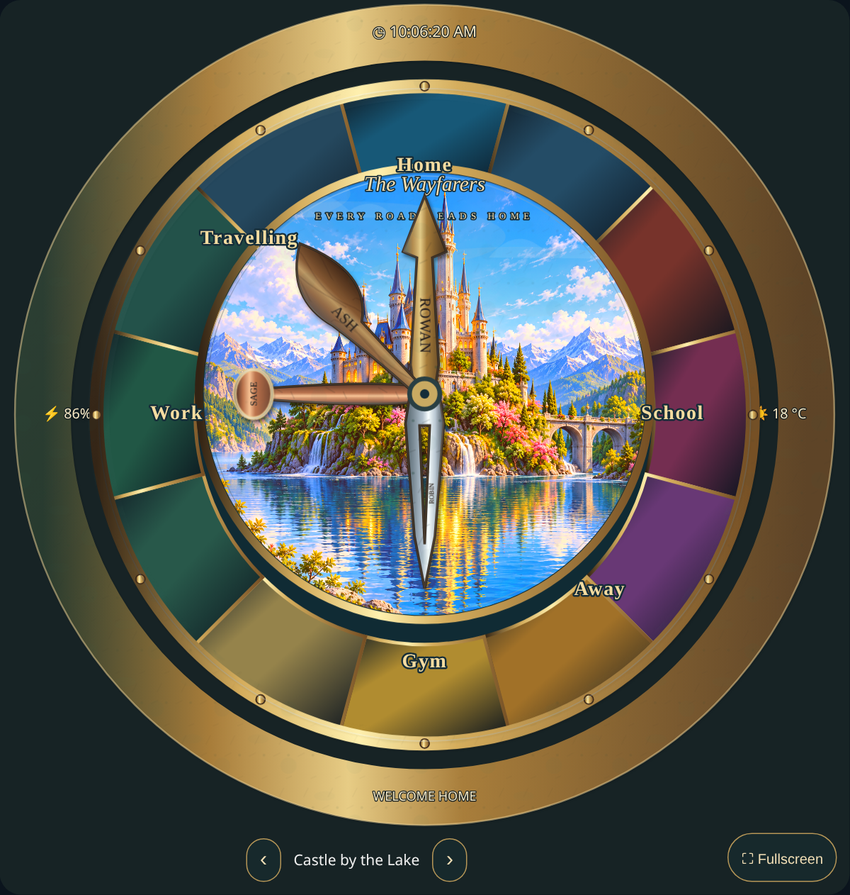
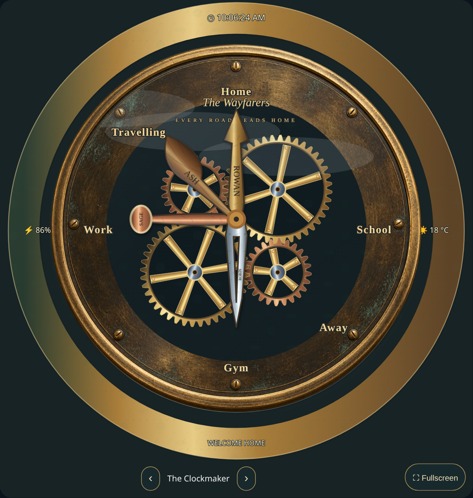
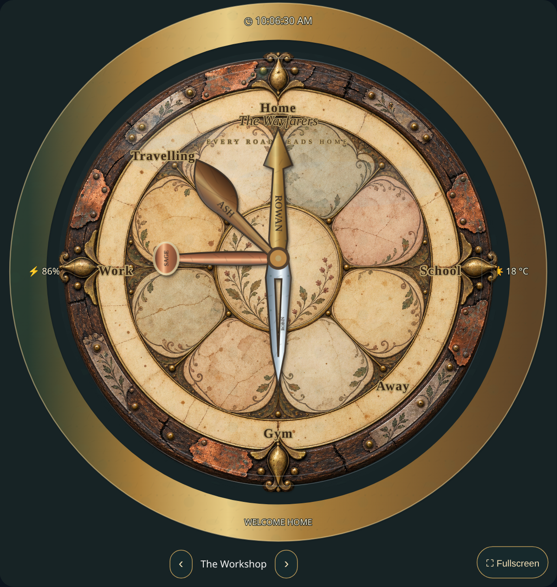

# Design Studio visual preview

These are visual previews of the unreleased Design Studio build. The published HACS release remains **0.2.0**. This preview branch contains previews and documentation; it does not publish the new implementation.

[Download the 12-second MP4 animation](https://raw.githubusercontent.com/deadmeat75/magical-family-clock/preview-design-studio/docs/previews/design-studio/preview.mp4) · [Detailed configuration guide](GUIDE.md)

The updated preview shows lettering fitted inside each hand and a name at the spoon tip. The Clockmaker has a connected gear train with opposite directions at each contact, speed ratios based on tooth counts and synchronized teeth. These changes passed **44 unit/packaging checks and 37 Chromium browser checks**; see [acceptance evidence](ACCEPTANCE.json).

## New lettering controls

In **People**, choose **Lettering position** to put the name along the stem or at the spoon/pointer tip. **Lettering direction** chooses **Parallel to hand** or **Perpendicular to hand**. Expand **Customize hand and portrait** for **Lettering rotation (degrees)** and **Keep lettering upright**. Lettering rotation is independent of portrait rotation.

Name size is a maximum. Text shrinks to fit the selected surface, including cutouts. Very narrow designs may need a shorter name or a wider hand. Clear the lettering field to remove the name entirely.

## Castle by the Lake

## The Clockmaker

## The Workshop

