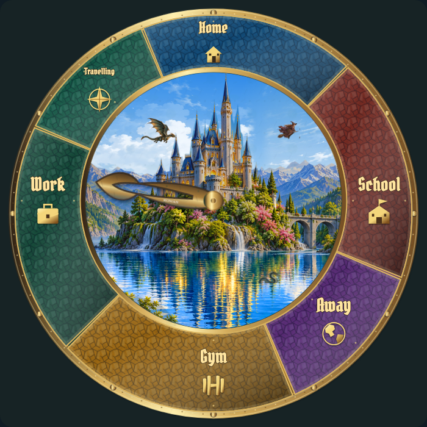
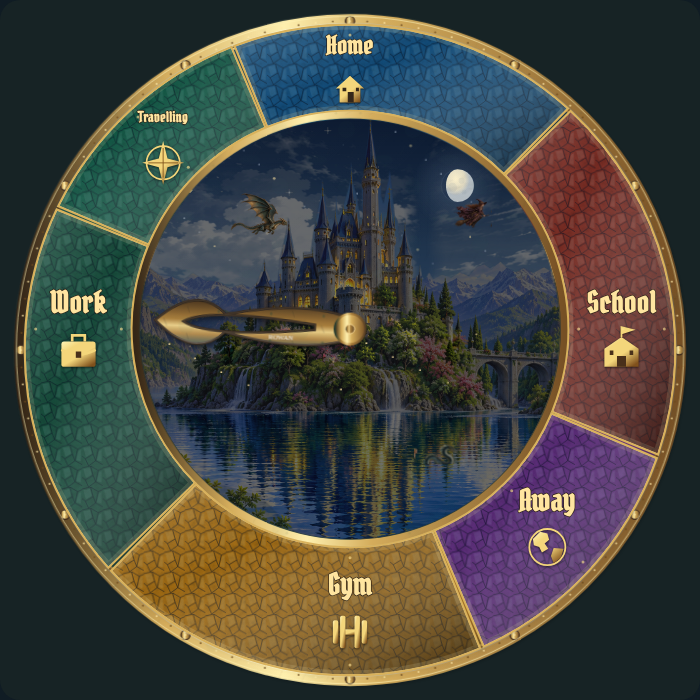

# Magical Family Clock: visual review

**Release is on hold for your individual approval.** The published HACS release remains **0.4.0**. This branch is a review draft; no new release or release tag has been created.

Start with the **[16 proposed painted characters and props](characters-and-props.md)**, then the **[day/night scene concepts](scene-concepts.md)** and **[eight landscape motion examples](landscape-motion.md)**. The other pages show the existing draft visual options so you can review every element individually.

**Current review:** 129 approved; 8 revision requests awaiting approval; 4 omitted; 0 other items awaiting review.

Approved: **C01–C12, X01–X02, L01–L06, L08, F02, F04–F05, H01–H12, K01–K12, P01–P03, P05, M01–M13, S01–S16, I01–I13, T01–T10, U01–U02, W01–W08, W10, N01–N08, E01–E06**, plus the lunar surface artwork. Omitted: **C13–C16**. [Requirements and remaining implementation](REVISION-NOTES.md).

**[Open the current review round with fresh examples](REVIEW-ROUND-3.md)**

## Latest revisions

**[Open the latest revision index](LATEST-REVISIONS.md)**. This index distinguishes new examples from older samples being replaced.

## How to approve or request changes

Every example has an ID and a full-size image or animation. Reply in chat using the IDs, for example:

- `Approve C01, C02 and C04.`
- `Revise C05: make the dragon darker and its tail longer.`
- `Omit C07.`

You can review in batches. Unmentioned items stay pending. No approvals have been assumed. The [complete checklist](APPROVALS.md) and [decision record](approvals.json) list every item.

## Proposed painted style in the clock

These are static concept compositions. Character illustrations and final movement can be reviewed separately; the new illustration set is not installed in the HACS release.

| X01 · Day concept | X02 · Night concept |
| --- | --- |
|  |  |

## Review pages

| Category | Examples | IDs |
| --- | --- | --- |
| [Characters and props](characters-and-props.md) | 16 | C01, C02, C03, C04, C05, C06, C07, C08, C09, C10, C11, C12, C13, C14, C15, C16 |
| [Scene concepts](scene-concepts.md) | 2 | X01, X02 |
| [Landscape motion](landscape-motion.md) | 8 | L01, L02, L03, L04, L05, L06, L07, L08 |
| [Faces](faces.md) | 5 | F01, F02, F03, F04, F05 |
| [Hand shapes](hand-shapes.md) | 12 | H01, H02, H03, H04, H05, H06, H07, H08, H09, H10, H11, H12 |
| [Materials](materials.md) | 13 | M01, M02, M03, M04, M05, M06, M07, M08, M09, M10, M11, M12, M13 |
| [Lettering and portraits](lettering-and-portraits.md) | 12 | K01–K12 |
| [Location panels](location-panels.md) | 5 | P01, P02, P03, P04, P05 |
| [Location symbols](location-symbols.md) | 13 | I01, I02, I03, I04, I05, I06, I07, I08, I09, I10, I11, I12, I13 |
| [Seasons and time](seasons-and-time.md) | 16 | S01, S02, S03, S04, S05, S06, S07, S08, S09, S10, S11, S12, S13, S14, S15, S16 |
| [Weather](weather.md) | 10 | W01, W02, W03, W04, W05, W06, W07, W08, W09, W10 |
| [Moon phases](moon-phases.md) | 8 | N01, N02, N03, N04, N05, N06, N07, N08 |
| [Bezel](bezel.md) | 3 | B01, B02, B03 |
| [Surface effects](surface-effects.md) | 6 | E01, E02, E03, E04, E05, E06 |
| [Typography](typography.md) | 10 | T01, T02, T03, T04, T05, T06, T07, T08, T09, T10 |
| [Editor and fullscreen](editor-and-fullscreen.md) | 2 | U01, U02 |

The scenery clips use normal playback speed. The revised L06 begins just before a shooting star; quiet intervals now vary from 20–75 seconds. The variation study skips quiet gaps while each pass retains its natural speed. The character, face and realistic-hand revisions are original generated artwork proposals. The F01 lettering is editable SVG text. Other samples come from the draft renderer. All example people, states and Home Assistant account data are fictional.

The duplicate editor preview and fullscreen visibility fixes are in the engineering draft. They are being held with the rest of the next release while you review the visuals.
