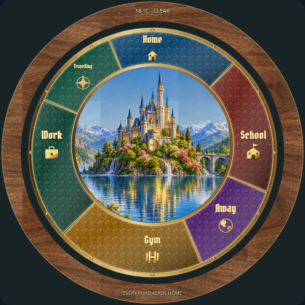

# Bezel: individual review

[Latest revisions](LATEST-REVISIONS.md) · [Complete gallery](README.md)

**Release held. Explicit approvals and omissions are preserved.**

## B01 · aged-brass information bezel

**Awaiting approval.**

Example: current draft rendering.

## B02 · silver information bezel

**Awaiting approval.**

Example: current draft rendering.

## B03 · wood information bezel

**Revision 1 · awaiting approval.**

Natural handcrafted wood grain with knots, material depth, directional lighting and readable bezel information.

Example: implemented runtime natural wood bezel.
