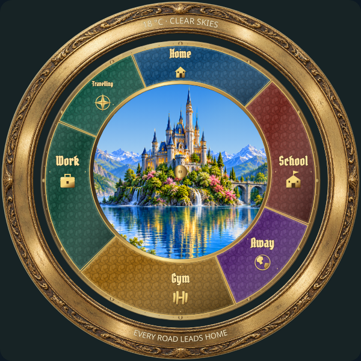
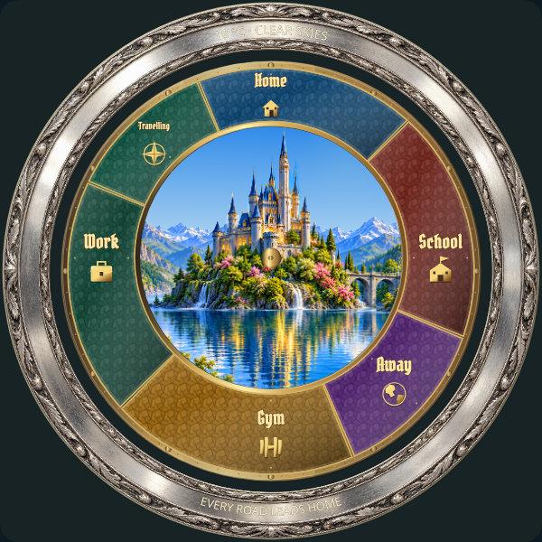
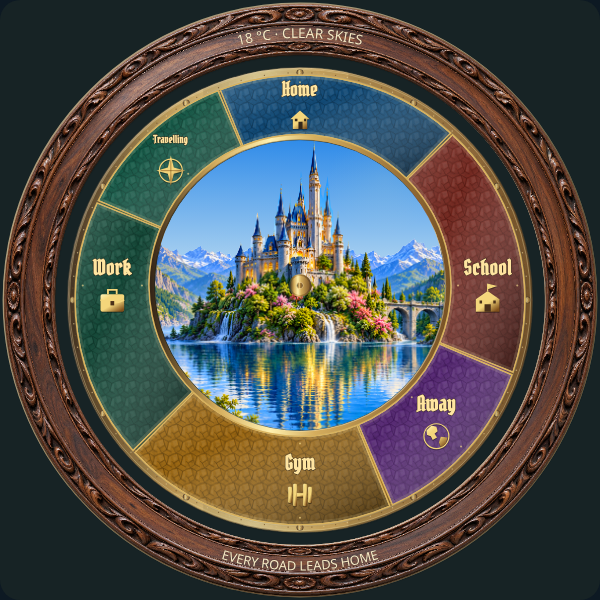

# Bezel: individual review

[Current review round](REVIEW-ROUND-4.md) · [Complete gallery](README.md)

**Visual review complete. Explicit approvals and omissions are preserved.**

All three frame appearances are approved. B02 and B03 revision 4 are approved, with editable text color available. B01 revision 5 text placement is also approved. All three bezels are approved.

## B01 · aged-brass information bezel

**Approved · revision 5.**

Revision 5 explicitly approved by the user. Preserve the brass frame and both slightly lowered curved text lines.

[Upper readout close-up](items/B01-top-r5.png)

[Lower readout close-up](items/B01-bottom-r5.png)

Revision 5 lowers both curved text lines by 1.5 drawing units (about 1.2 pixels at the 600px review size), preserving size and curvature. Approved silver and wood bezel baselines remain unchanged.

## B02 · silver information bezel

**Approved.**

Revision 4 explicitly approved by the user, conditional on editable bezel text color in the UI. Existing Bezel → Readout color picker controls each reading independently; renderer uses item.color.

## B03 · wood information bezel

**Approved.**

Revision 4 explicitly approved by the user. Reviewed frame and curved text placement are preserved.

