# Characters and props: individual review

[Latest revisions](LATEST-REVISIONS.md) · [Complete gallery](README.md)

**Release held. Explicit approvals and omissions are preserved.**

## C01 · Swallow

**Approved.**

[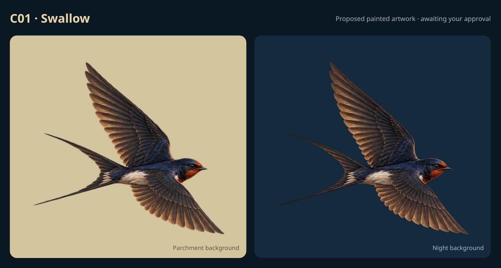](items/C01.png)

Explicitly approved by the user in chat.

Example: proposed painted illustration.

## C02 · Barn owl

**Approved.**

[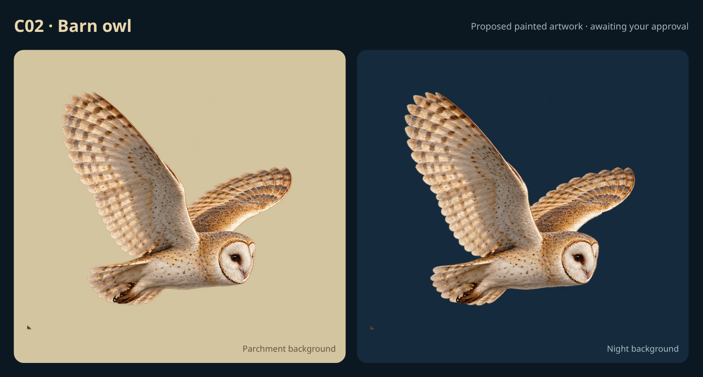](items/C02.png)

Explicitly approved by the user in chat.

Example: proposed painted illustration.

## C03 · Witch on broom

**Approved.**

[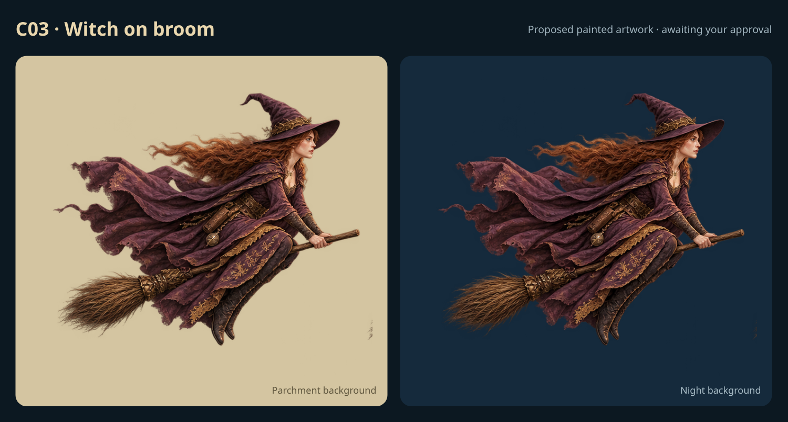](items/C03.png)

Explicitly approved by the user in chat.

Example: proposed painted illustration.

## C04 · Wizard on broom

**Approved.**

[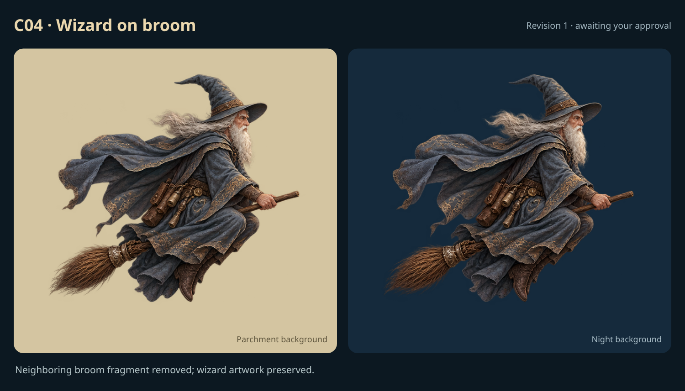](items/C04-r1.png)

Revision 1 explicitly approved by the user in chat after removal of the detached artifact behind the cape.

Example: proposed painted illustration.

## C05 · Dragon

**Approved.**

[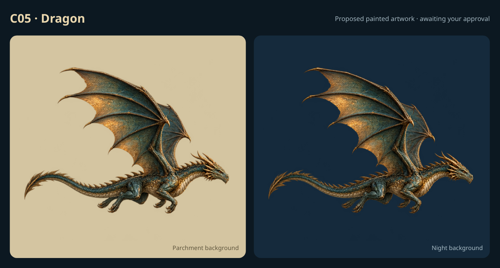](items/C05.png)

Explicitly approved by the user in chat.

Example: proposed painted illustration.

## C06 · Phoenix

**Approved.**

[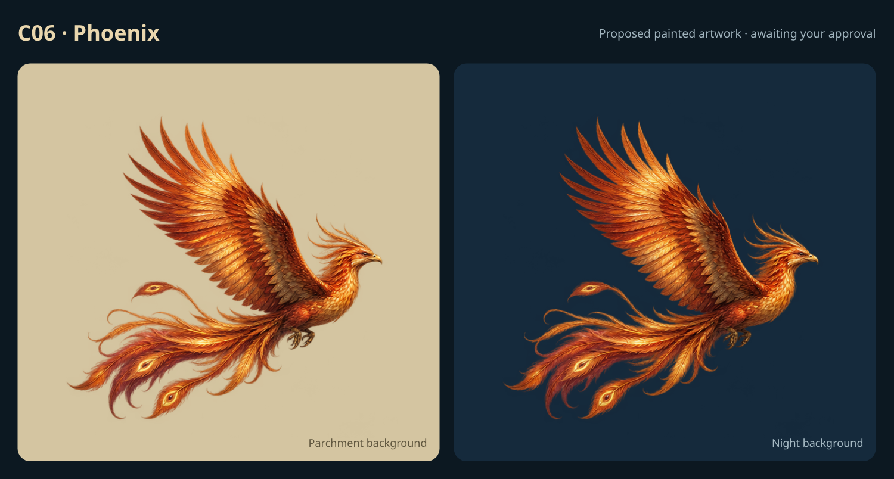](items/C06.png)

Explicitly approved by the user in chat.

Example: proposed painted illustration.

## C07 · Pixie

**Approved.**

[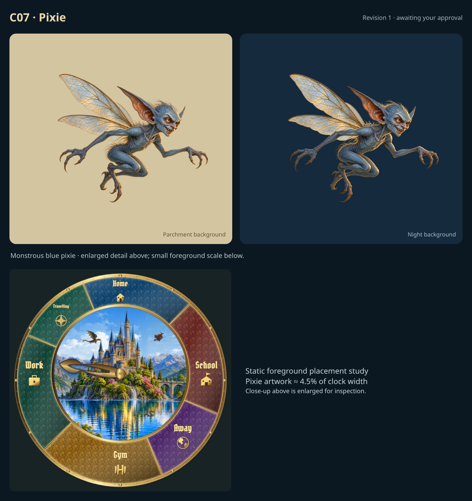](items/C07-r1.png)

Revision 1 pixie artwork explicitly approved by the user in chat. Smaller foreground placement and natural environment-aware creature animation remain required.

Example: proposed painted illustration.

## C08 · Lake serpent

**Approved.**

[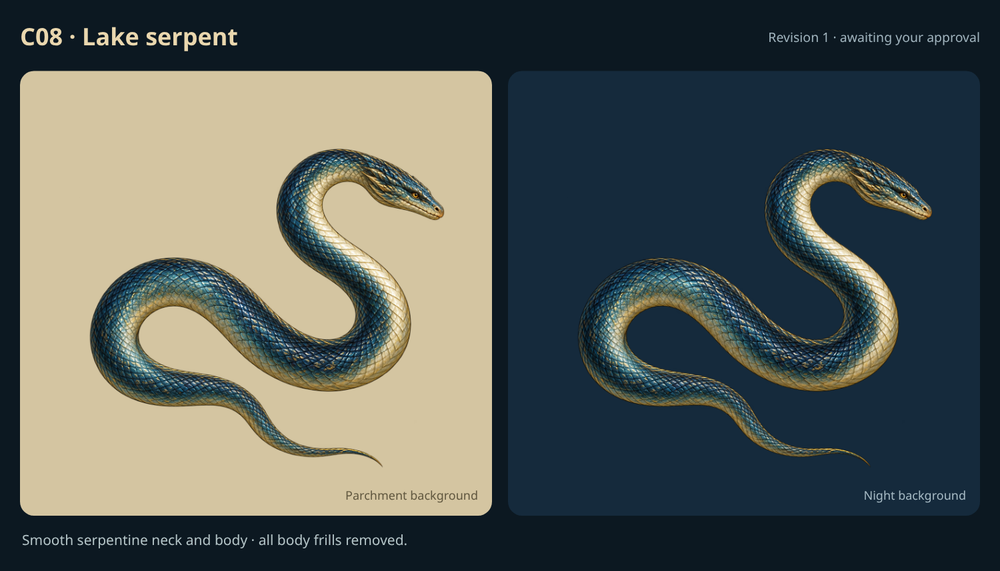](items/C08-r1.png)

Revision 1 lake serpent artwork explicitly approved by the user in chat, with body frills removed and a more snake-like neck.

Example: proposed painted illustration.

## C09 · Mermaid

**Approved.**

[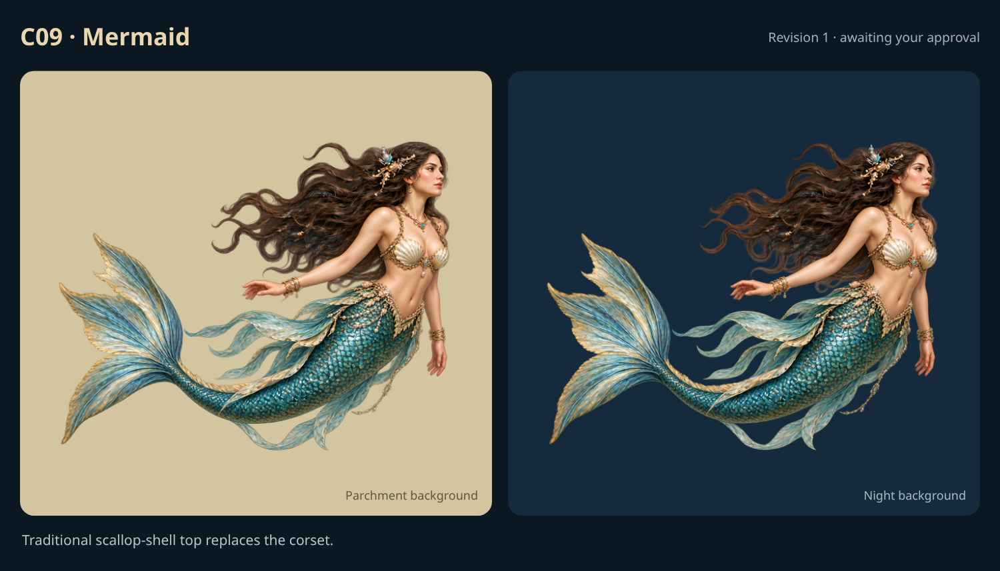](items/C09-r1.png)

Revision 1 mermaid artwork explicitly approved by the user in chat, with the traditional shell-bra top.

Example: proposed painted illustration.

## C10 · Merman

**Approved.**

[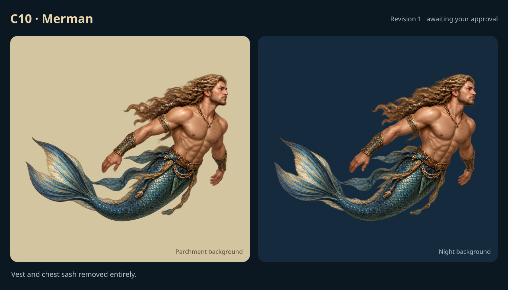](items/C10-r1.png)

Revision 1 merman artwork explicitly approved by the user in chat, with the vest removed entirely.

Example: proposed painted illustration.

## C11 · Unicorn

**Approved.**

[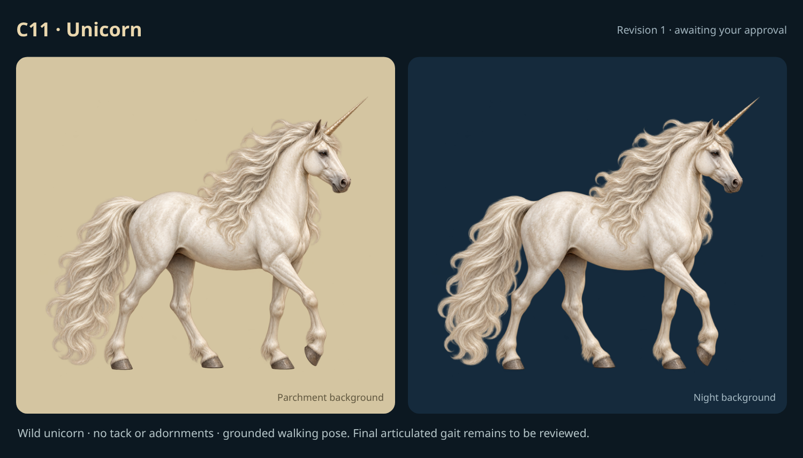](items/C11-r1.png)

Revision 1 unadorned wild unicorn artwork explicitly approved by the user in chat. Natural ground contact, articulated weight-bearing leg movement and environment-aware travel remain required; final animation acceptance is pending.

Example: proposed painted illustration.

## C12 · Sailing boat

**Approved.**

[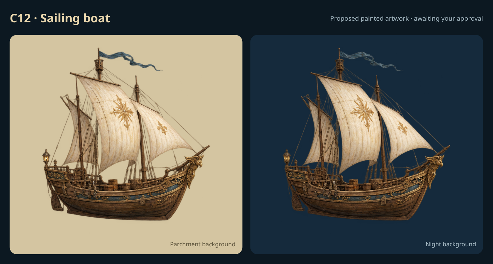](items/C12.png)

Artwork explicitly approved, conditional on appropriate water placement and naturalistic movement through the water. Animation acceptance remains required.

Example: proposed painted illustration.

## C13 · Floating lantern

**Omitted.**

[Previous example — archived](items/C13.png)

Explicitly omitted by the user; exclude from the next release artwork set.

Example: proposed painted illustration.

## C14 · Stone cottage

**Omitted.**

[Previous example — archived](items/C14.png)

Explicitly omitted by the user; exclude from the next release artwork set.

Example: proposed painted illustration.

## C15 · Woodland mushrooms

**Omitted.**

[Previous example — archived](items/C15.png)

Explicitly omitted by the user; exclude from the next release artwork set.

Example: proposed painted illustration.

## C16 · Quartz crystals

**Omitted.**

[Previous example — archived](items/C16.png)

Explicitly omitted by the user; exclude from the next release artwork set.

Example: proposed painted illustration.
