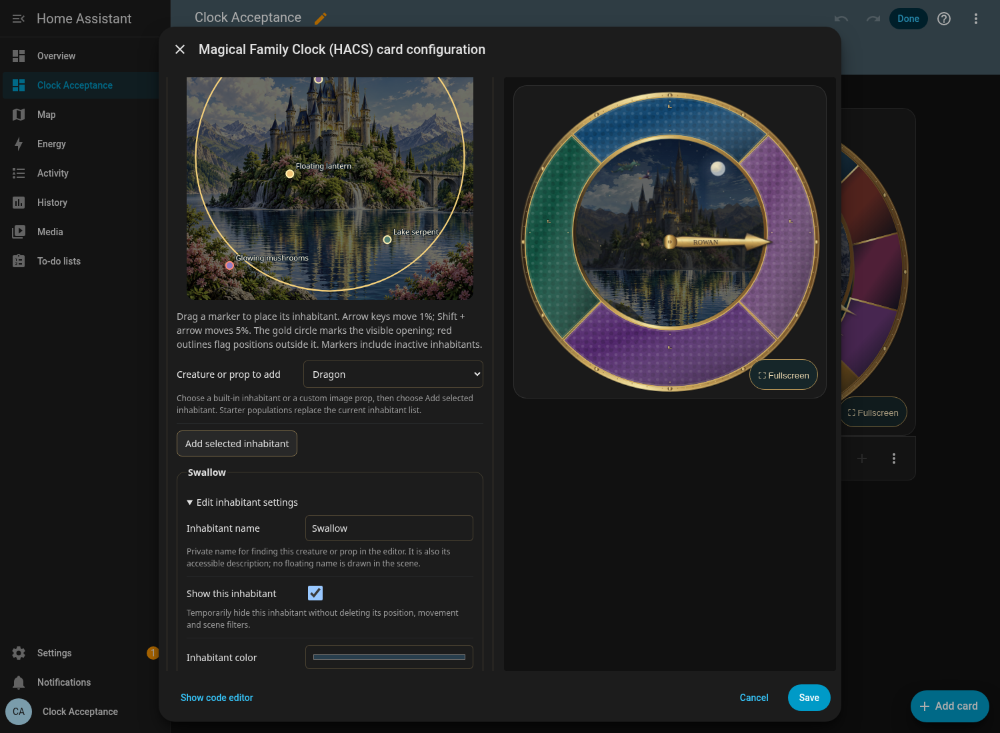
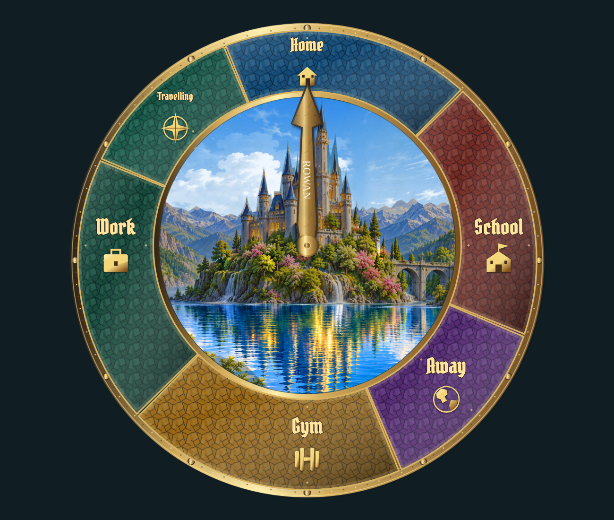

# Editor and fullscreen: individual review

[Back to review gallery](README.md)

**Release held. Every item below is awaiting your approval.**

U01 shows the actual Home Assistant editor with one right-hand preview and no duplicate clock covering the settings. U02 shows the fullscreen layout. These are layout examples, separate from the proposed character artwork.

| **[U01 · One Home Assistant preview; unobstructed settings](items/U01.png)** | **[U02 · Fullscreen layout](items/U02.png)** |
| --- | --- |
|  |  |
| Awaiting approval | Awaiting approval |
