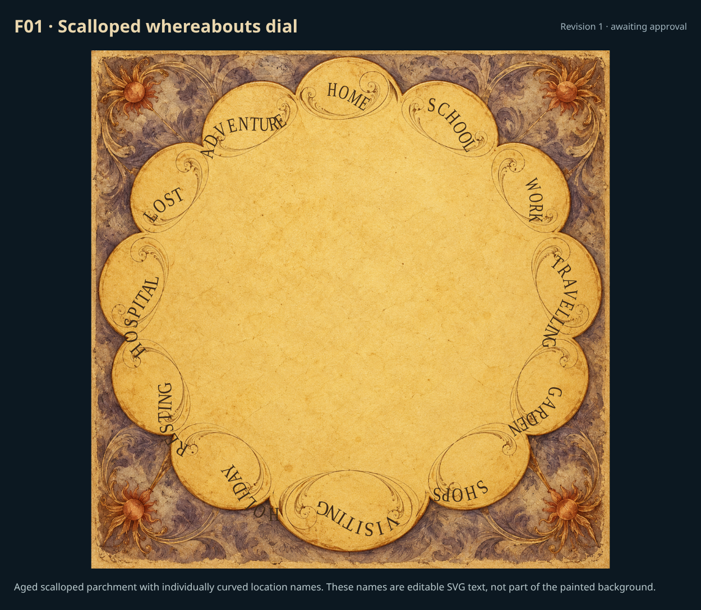
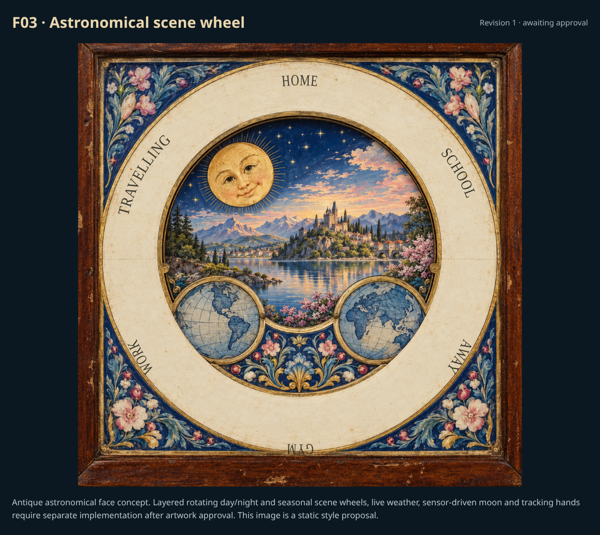

# Faces: individual review

[Back to review gallery](README.md)

**Release held. Decisions below reflect your individual approvals and revision requests.**

F01–F03 have new concept artwork for review. F04 and F05 are approved. F01 curved text is a separate SVG layer; F02 finish controls and F03 rotating sensor-driven scene layers require implementation after art approval.

| **[F01 · Scalloped whereabouts dial](items/F01-r1.png)** | **[F02 · Brass finish range](items/F02-r1.png)** |
| --- | --- |
|  |  |
| Revised r1 · awaiting approval | Revised r1 · awaiting approval |

F01: Scalloped aged parchment with separately editable flowing location lettering. [Editable SVG lettering study](concepts/F01-editable-lettering.svg).

F02: New → lightly aged → antique finish study. Proposed continuous age control, with a shinier default; renderer/editor integration follows artwork approval.

| **[F03 · Astronomical scene wheel](items/F03-r1.png)** | **[F04 · whimsical-workshop](items/F04.png)** |
| --- | --- |
|  |  |
| Revised r1 · awaiting approval | Approved |

F03: Complete astronomical-clock redesign with an ivory dial, painted celestial decoration and landscape aperture. This is a static art-direction concept; separated rotating time/season wheels and live weather are still to implement.

| **[F05 · Layered castle and ornate location ring](items/F05.png)** |   |
| --- | --- |
|  |   |
| Approved |   |
