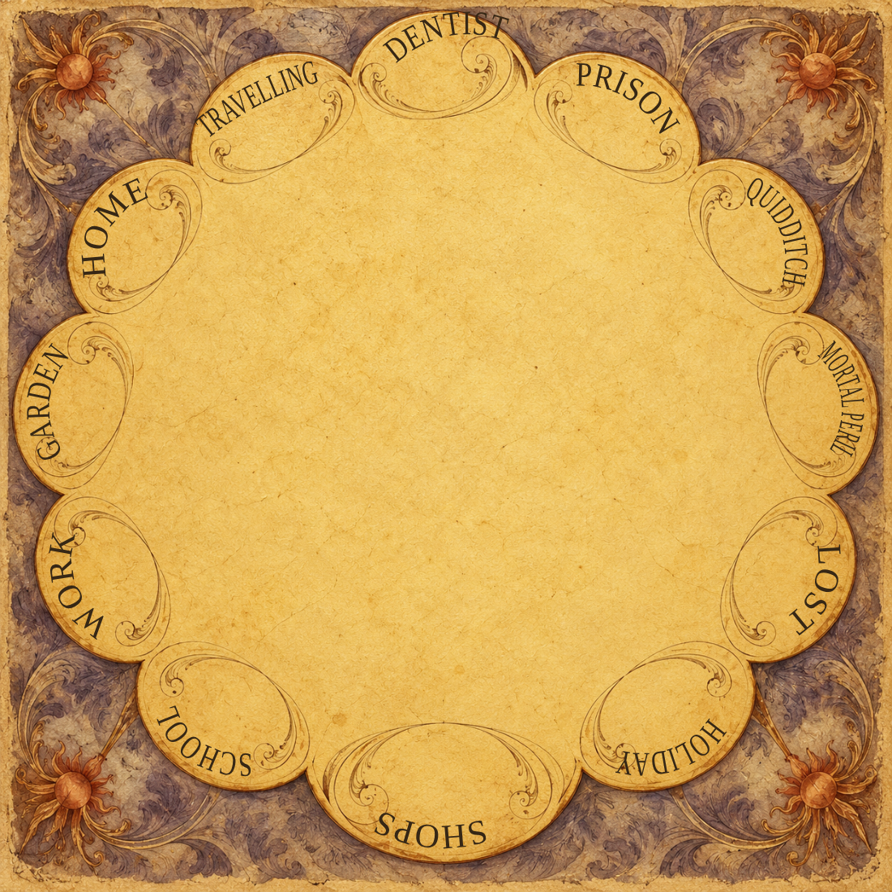
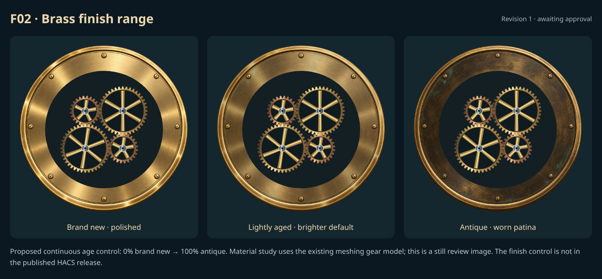
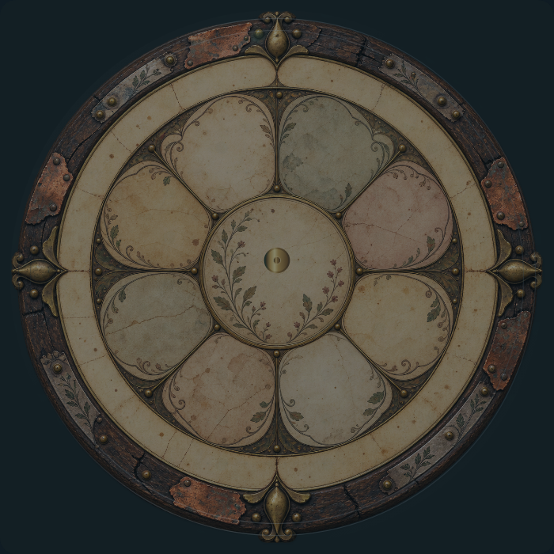
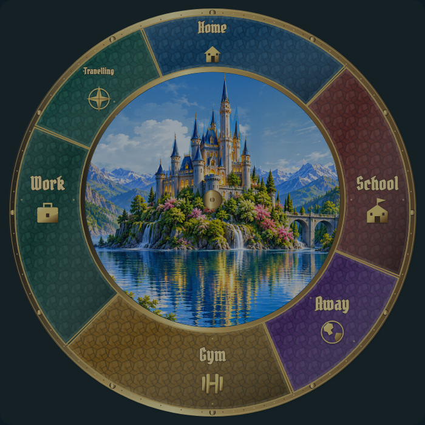

# Faces: individual review

[Current review round](REVIEW-ROUND-4.md) · [Complete gallery](README.md)

**Release held. Explicit approvals and omissions are preserved.**

F02, F04 and F05 are approved. F03 is abandoned. F01 revision 7 is the only face proposal still awaiting review.

## F01 · Scalloped whereabouts dial

**Revision 7 · awaiting approval.**

User reviewed revision 6: closer, but still not perfectly aligned. Refine the individual lettering curves, offsets and orientation to follow each painted scalloped edge more accurately while keeping every glyph fully inside the gold face with clearance. Revision 6 is not approved.

[Editable contour-fitted lettering](concepts/F01-editable-lettering-r7.svg)

Revision 7 fits a separate smooth contour to each painted scallop, then offsets the baseline inward and fits the name to its available arc. Full lettering ink remains inside the painted gold with clearance. This is a lettering proposal; production dynamic-name mapping follows approval.

## F02 · Brass finish range

**Approved.**

Revision 1 explicitly approved by the user. Retain proposed continuous finish-age control requirement.

## F03 · Astronomical scene wheel

**Omitted.**

User explicitly requested that F03 be abandoned. Exclude the astronomical/picture-disc face from the planned release and further review. Existing studies remain archived for reference.

[Archived study](items/F03-r8.gif)

[Still](items/F03-r8.png)

## F04 · whimsical-workshop

**Approved.**

Explicitly approved by the user in chat.

## F05 · Layered castle and ornate location ring

**Approved.**

Explicitly approved by the user in chat.

