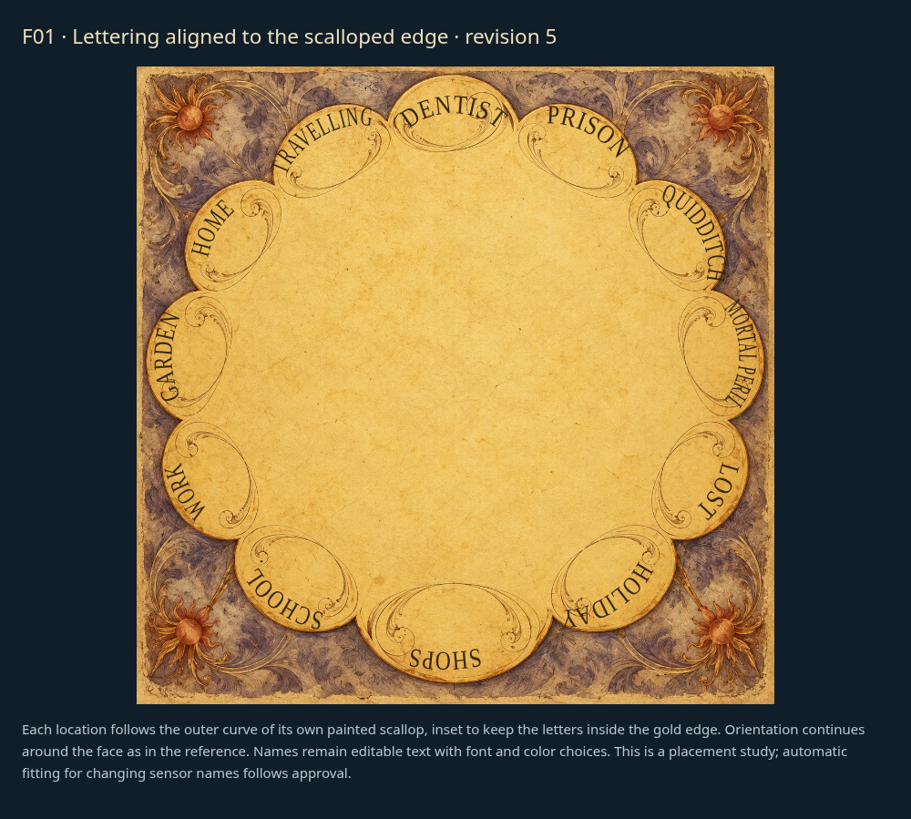
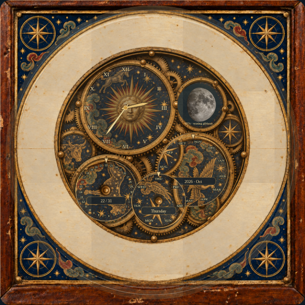

# Faces: individual review

[Latest revisions](LATEST-REVISIONS.md) · [Complete gallery](README.md)

**Release held. Explicit approvals and omissions are preserved.**

F02, F04 and F05 are approved. F01 revision 5 remains a lettering placement study. F03 revision 7 is a functional runtime face: real local time, calendar wheels and sensor-driven lunar phase. Both revised faces still require approval. [Current review round](REVIEW-ROUND-2.md).

## F01 · Scalloped whereabouts dial

**Revision 5 · awaiting approval.**

Lettering alignment improved but remains unapproved. Fit the flowing letters to each scalloped edge.

Example: individually aligned scallop lettering proposal; production mapping follows approval.

## F02 · Brass finish range

**Approved.**

Revision 1 explicitly approved by the user. Retain proposed continuous finish-age control requirement.

Example: proposed face concept; not integrated into the released renderer.

## F03 · Astronomical scene wheel

**Revision 7 · awaiting approval.**

Functional astronomical dials: actual lunar phase from configured sensor or explicit calculation fallback, local time, calendar and annual cycles; no arbitrary decorative wheel rotation. Follow supplied antique astronomical clocks.

Example: implemented runtime rendering.

[Functional dial close-up](items/F03-functional-detail-r7.png)

[Example: 15 Jan 2026, 12:10 America/Los_Angeles; new moon sensor](items/F03-winter-r7.png)

[Example: 20 Jul 2026, 21:45 America/Los_Angeles; full moon sensor](items/F03-summer-r7.png)

## F04 · whimsical-workshop

**Approved.**

Explicitly approved by the user in chat.

Example: current draft rendering.

## F05 · Layered castle and ornate location ring

**Approved.**

Explicitly approved by the user in chat.

Example: current draft rendering.
