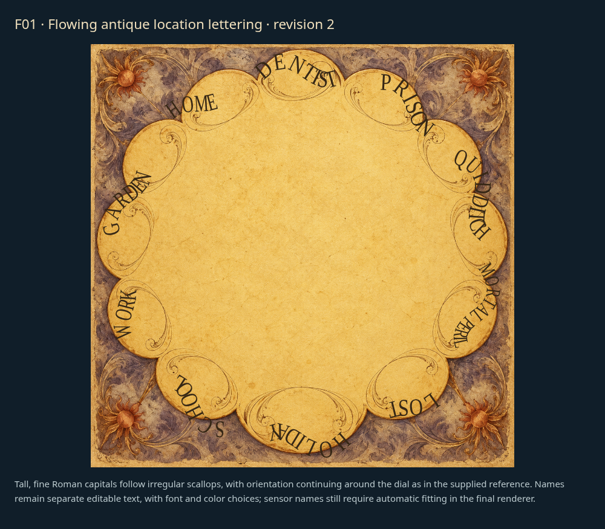

# Faces: individual review

[Latest revisions](LATEST-REVISIONS.md) · [Complete gallery](README.md)

**Release held. Explicit approvals and omissions are preserved.**

F02, F04 and F05 are approved. F01 lettering and F03 are separate art-direction proposals; their final editable production layers follow approval. F03 is being revised again for a more colorful, magical 1800s style without flowers.

## F01 · Scalloped whereabouts dial

**Revision 2 · awaiting approval.**

Lettering must more closely match the supplied reference: tall, thin irregular antique serif letters following flowing scalloped arcs, changing orientation around the face; all text remains editable.

Example: face and editable-lettering proposal; production mapping follows approval.

## F02 · Brass finish range

**Approved.**

Revision 1 explicitly approved by the user. Retain proposed continuous finish-age control requirement.

Example: proposed face concept; not integrated into the released renderer.

## F03 · Astronomical scene wheel

**Revision in progress.**

[Previous example — archived](items/F03-r3.png)

Old celestial grandfather clock face from a wizarding world. Restrained historical painted colors, aged brass and ivory. No flowers, rainbow palette, airbrushed nebula or modern scientific diagram.

Example: historical celestial face artwork proposal; separated rotating layers follow approval.

## F04 · whimsical-workshop

**Approved.**

Explicitly approved by the user in chat.

Example: current draft rendering.

## F05 · Layered castle and ornate location ring

**Approved.**

Explicitly approved by the user in chat.

Example: current draft rendering.
