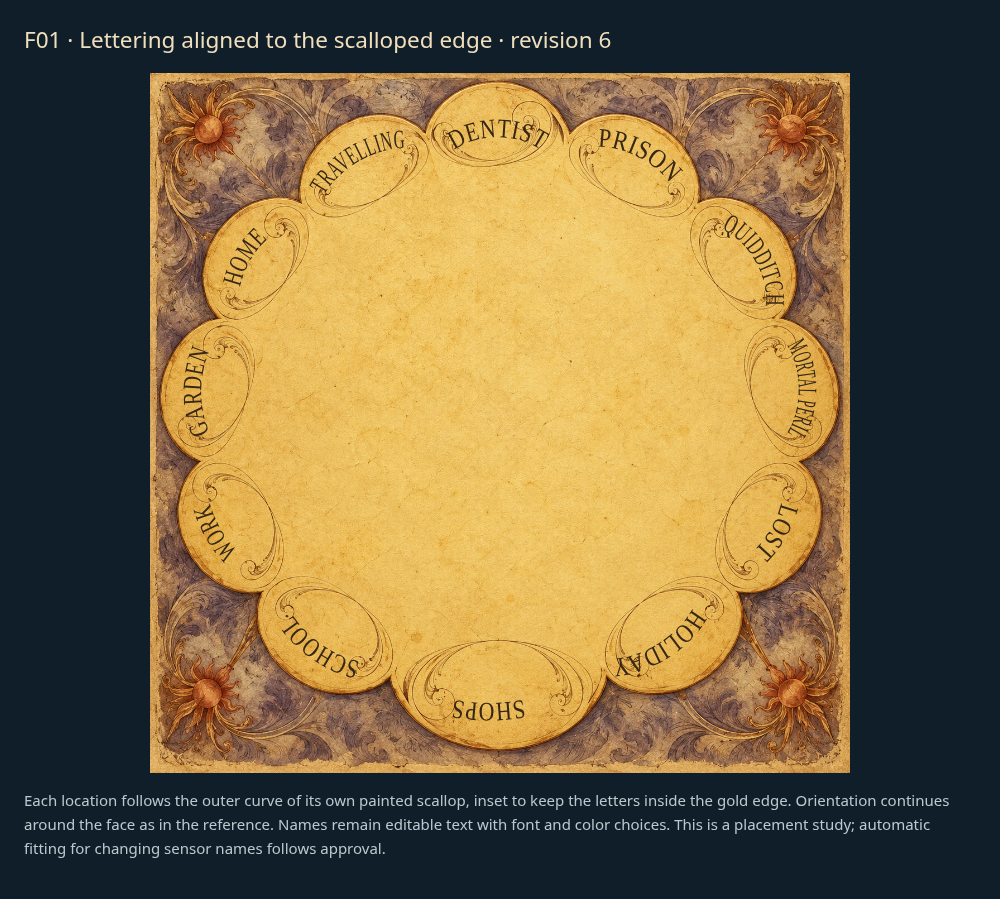
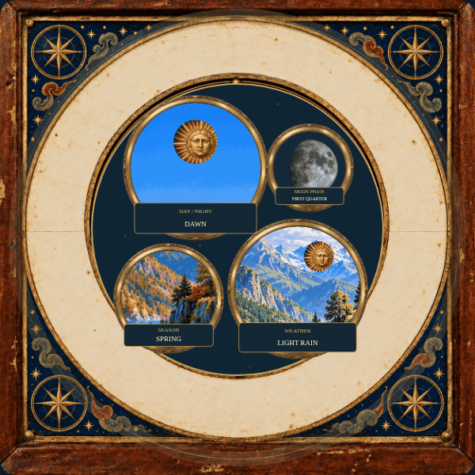

# Faces: individual review

[Latest revisions](LATEST-REVISIONS.md) · [Complete gallery](README.md)

**Release held. Explicit approvals and omissions are preserved.**

F02, F04 and F05 are approved. F01 revision 6 fits full lettering ink inside the gold scallops. F03 revision 8 uses four functional illustrated discs with labeled picture windows, no astronomical hands or numeric dials. Both require review. [Current review round](REVIEW-ROUND-3.md).

## F01 · Scalloped whereabouts dial

**Revision 6 · awaiting approval.**

Lettering alignment improved but remains unapproved. Fit the flowing letters to each scalloped edge.

Example: editable SVG lettering proposal; full painted glyph containment checked.

[Editable scalloped lettering revision 6](concepts/F01-editable-lettering-r6.svg)

## F02 · Brass finish range

**Approved.**

Revision 1 explicitly approved by the user. Retain proposed continuous finish-age control requirement.

Example: proposed face concept; not integrated into the released renderer.

## F03 · Astronomical scene wheel

**Revision 8 · awaiting approval.**

Use functional rotating illustrated discs showing information such as lunar phase, time of day, season and weather. Their meanings must be clear. No astronomical hands, numeric dials or scales; avoid arbitrary decorative rotation. Follow the antique magical-clock aesthetic. Revision 8 remains awaiting review.

Example: implemented runtime picture-disc mechanism using existing painted artwork.

[Picture disc mechanism close-up; selected test states](items/F03-detail-r8.gif)

[dawn test state](items/F03-dawn-r8.png)

[day test state](items/F03-day-r8.png)

[dusk test state](items/F03-dusk-r8.png)

[night test state](items/F03-night-r8.png)

[Still image](items/F03-r8.png)

## F04 · whimsical-workshop

**Approved.**

Explicitly approved by the user in chat.

Example: current draft rendering.

## F05 · Layered castle and ornate location ring

**Approved.**

Explicitly approved by the user in chat.

Example: current draft rendering.
