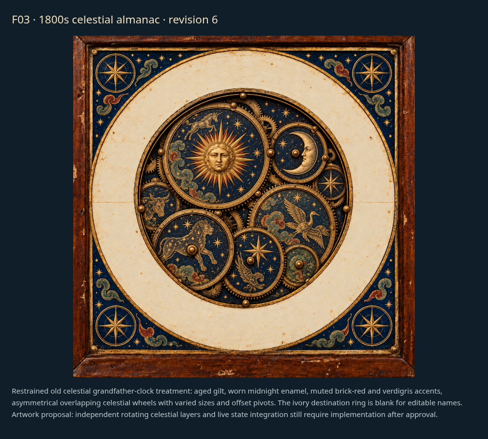

# Faces: individual review

[Latest revisions](LATEST-REVISIONS.md) · [Complete gallery](README.md)

**Release held. Explicit approvals and omissions are preserved.**

F02, F04 and F05 are approved. F01 lettering and F03 are separate art-direction proposals; their final editable production layers follow approval. F03 revision 6 uses asymmetrical overlapping celestial wheels in a restrained old wizarding grandfather-clock style.

## F01 · Scalloped whereabouts dial

**Revision 4 · awaiting approval.**

Align each location name along the curved outer edge of its own painted scallop, inset within the gold. Preserve editable text and UI font/color choices.

Example: individually aligned scallop lettering proposal; production mapping follows approval.

## F02 · Brass finish range

**Approved.**

Revision 1 explicitly approved by the user. Retain proposed continuous finish-age control requirement.

Example: proposed face concept; not integrated into the released renderer.

## F03 · Astronomical scene wheel

**Revision 6 · awaiting approval.**

Asymmetric overlapping celestial wheels with varied sizes and offset pivots. Preserve restrained old wizarding grandfather-clock style and blank editable destination ring.

Example: historical celestial face artwork proposal; separated rotating layers follow approval.

## F04 · whimsical-workshop

**Approved.**

Explicitly approved by the user in chat.

Example: current draft rendering.

## F05 · Layered castle and ornate location ring

**Approved.**

Explicitly approved by the user in chat.

Example: current draft rendering.
