> Original approved review examples. Current runtime integration is described in the [final integration record](REVISION-NOTES.md).

# Hand shapes: individual review

[Latest revisions](LATEST-REVISIONS.md) · [Complete gallery](README.md)

**Visual review complete. Explicit approvals and omissions are preserved.**

All twelve hand silhouettes are approved and preserved. See the separate K09–K12 attachment proposals for optional affixed names and portraits.

## H01 · spoon

**Approved.**

[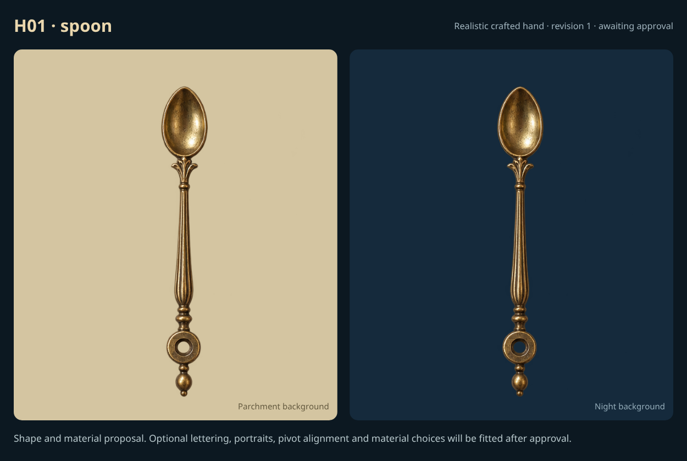](items/H01-r1.png)

Revised hand design explicitly approved by the user in chat. Optional affixed name/portrait attachments are proposed separately to keep names usable on narrow or openwork hands.

Example: proposed realistic crafted hand; renderer integration and engraved lettering pending approval.

## H02 · classic

**Approved.**

[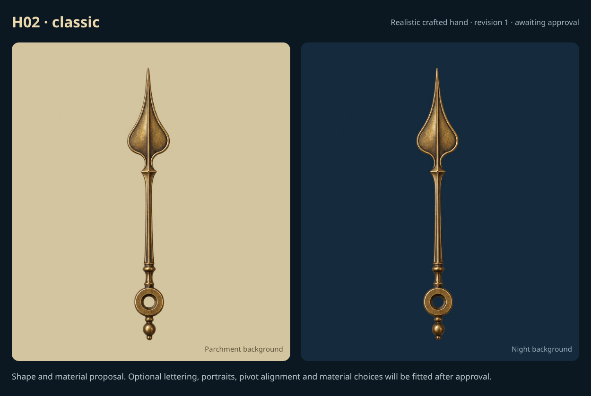](items/H02-r1.png)

Revised hand design explicitly approved by the user in chat. Optional affixed name/portrait attachments are proposed separately to keep names usable on narrow or openwork hands.

Example: proposed realistic crafted hand; renderer integration and engraved lettering pending approval.

## H03 · legacy-curved

**Approved.**

[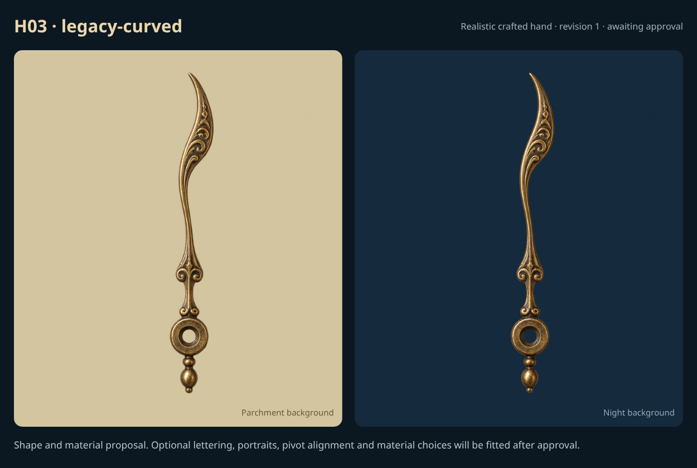](items/H03-r1.png)

Revised hand design explicitly approved by the user in chat. Optional affixed name/portrait attachments are proposed separately to keep names usable on narrow or openwork hands.

Example: proposed realistic crafted hand; renderer integration and engraved lettering pending approval.

## H04 · standalone-pointed

**Approved.**

[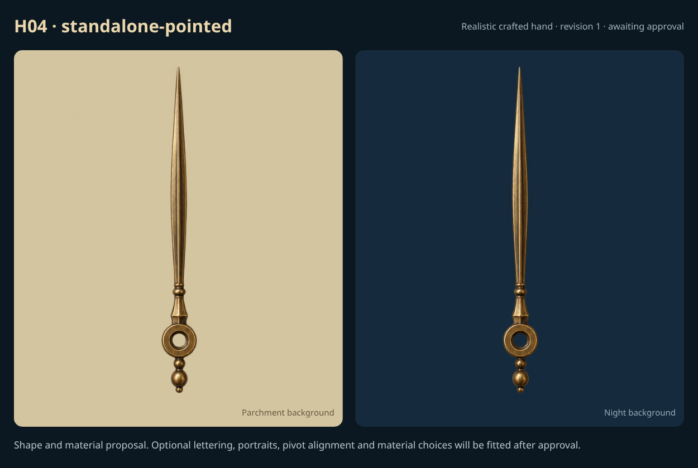](items/H04-r1.png)

Revised hand design explicitly approved by the user in chat. Optional affixed name/portrait attachments are proposed separately to keep names usable on narrow or openwork hands.

Example: proposed realistic crafted hand; renderer integration and engraved lettering pending approval.

## H05 · arrow

**Approved.**

[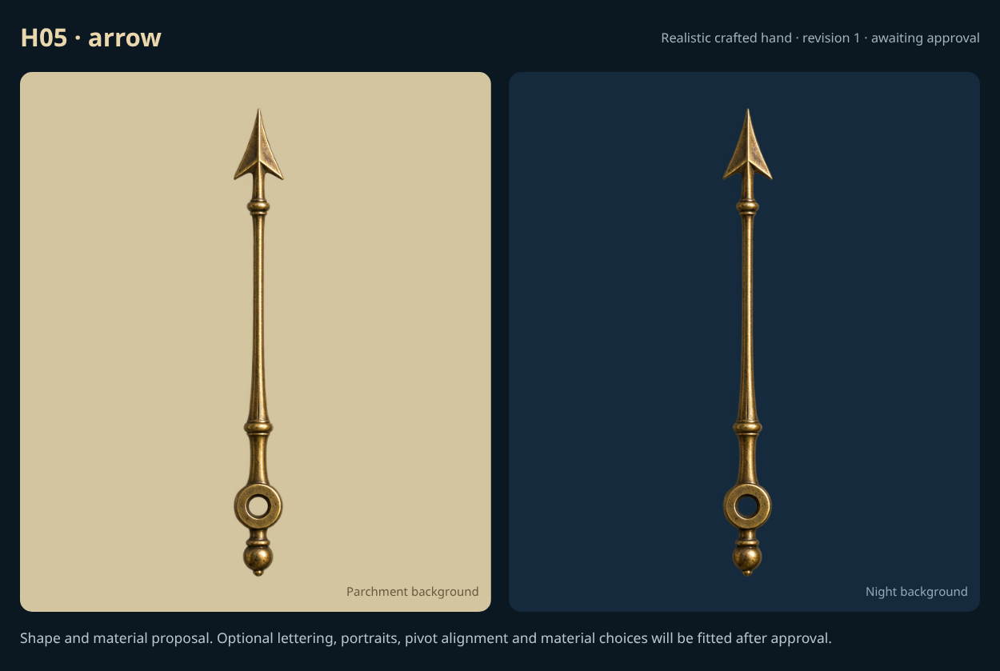](items/H05-r1.png)

Revised hand design explicitly approved by the user in chat. Optional affixed name/portrait attachments are proposed separately to keep names usable on narrow or openwork hands.

Example: proposed realistic crafted hand; renderer integration and engraved lettering pending approval.

## H06 · leaf

**Approved.**

[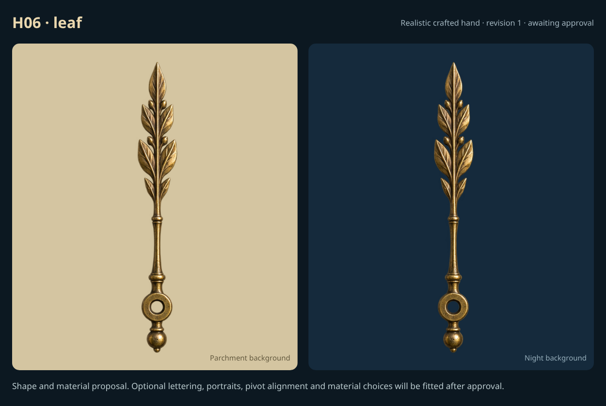](items/H06-r1.png)

Revised hand design explicitly approved by the user in chat. Optional affixed name/portrait attachments are proposed separately to keep names usable on narrow or openwork hands.

Example: proposed realistic crafted hand; renderer integration and engraved lettering pending approval.

## H07 · sword

**Approved.**

[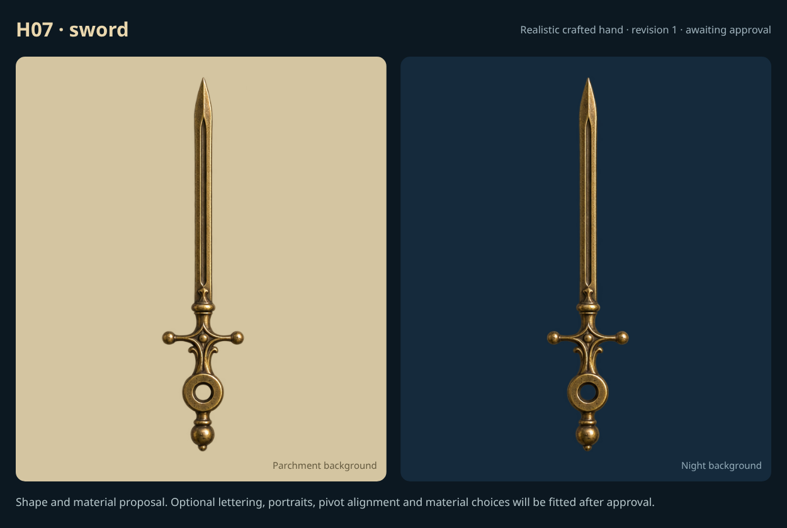](items/H07-r1.png)

Revised hand design explicitly approved by the user in chat. Optional affixed name/portrait attachments are proposed separately to keep names usable on narrow or openwork hands.

Example: proposed realistic crafted hand; renderer integration and engraved lettering pending approval.

## H08 · cathedral

**Approved.**

[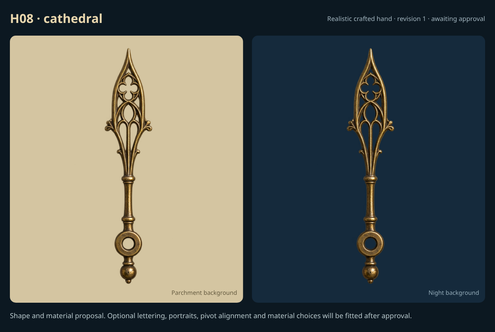](items/H08-r1.png)

Revised hand design explicitly approved by the user in chat. Optional affixed name/portrait attachments are proposed separately to keep names usable on narrow or openwork hands.

Example: proposed realistic crafted hand; renderer integration and engraved lettering pending approval.

## H09 · filigree

**Approved.**

[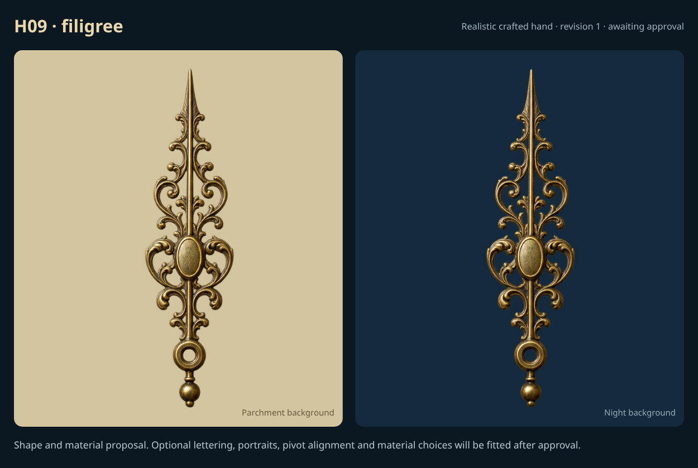](items/H09-r1.png)

Revised hand design explicitly approved by the user in chat. Optional affixed name/portrait attachments are proposed separately to keep names usable on narrow or openwork hands.

Example: proposed realistic crafted hand; renderer integration and engraved lettering pending approval.

## H10 · skeleton

**Approved.**

[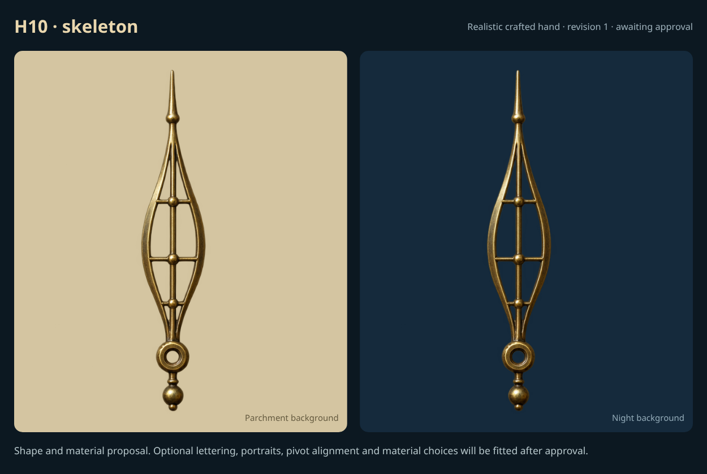](items/H10-r1.png)

Revised hand design explicitly approved by the user in chat. Optional affixed name/portrait attachments are proposed separately to keep names usable on narrow or openwork hands.

Example: proposed realistic crafted hand; renderer integration and engraved lettering pending approval.

## H11 · quill

**Approved.**

[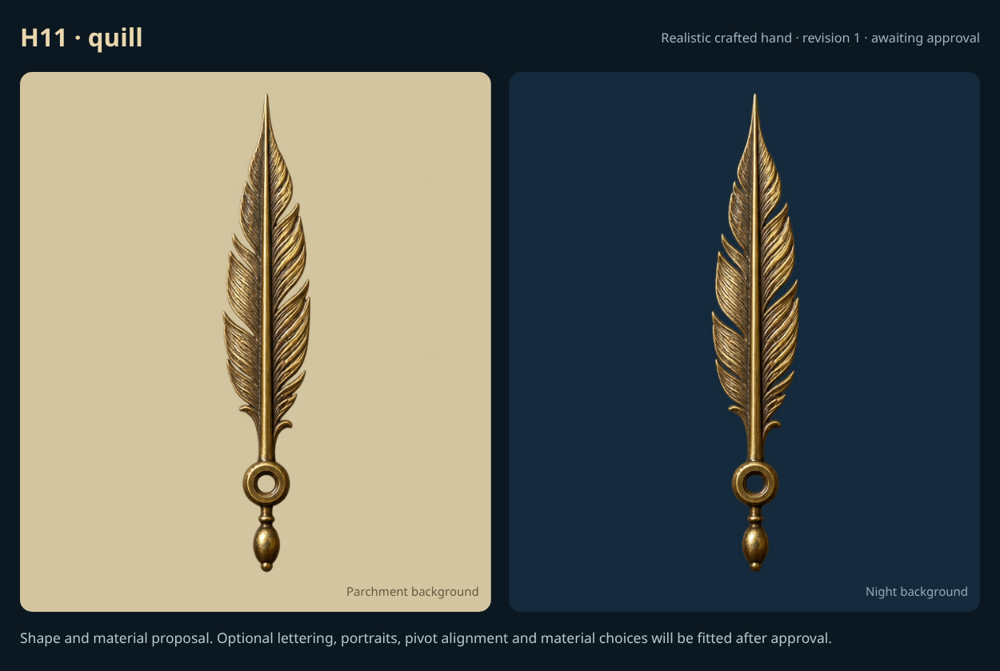](items/H11-r1.png)

Revised hand design explicitly approved by the user in chat. Optional affixed name/portrait attachments are proposed separately to keep names usable on narrow or openwork hands.

Example: proposed realistic crafted hand; renderer integration and engraved lettering pending approval.

## H12 · compass

**Approved.**

[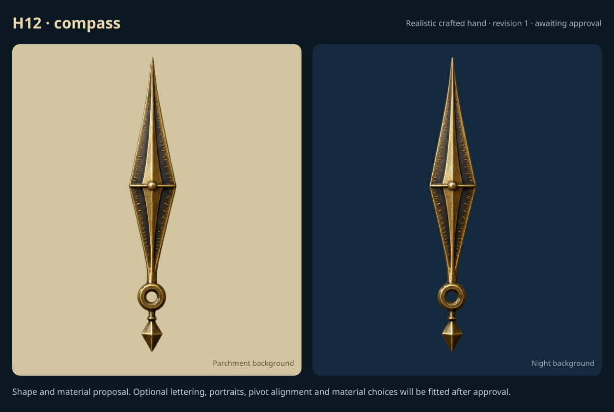](items/H12-r1.png)

Revised hand design explicitly approved by the user in chat. Optional affixed name/portrait attachments are proposed separately to keep names usable on narrow or openwork hands.

Example: proposed realistic crafted hand; renderer integration and engraved lettering pending approval.
