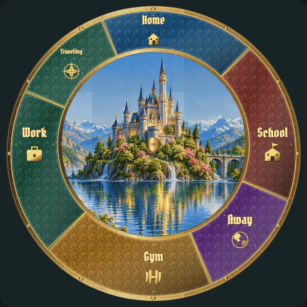

# Landscape motion: individual review

[Latest revisions](LATEST-REVISIONS.md) · [Complete gallery](README.md)

**Release held. Explicit approvals and omissions are preserved.**

L01 is approved and unchanged. New motion samples use controlled normal-speed renderer frames, with no video compression noise. Close-ups supplement the full-clock view. Meteor studies skip quiet waiting time only.

## L01 · Cloud drift

**Approved.**

Explicitly approved by the user in chat.

Example: normal-speed motion study.

[Still image](items/L01.png)

## L02 · Foliage sway

**Revision 1 · awaiting approval.**

Tree sway is not detectable. Make gentle sway visible and add windblown autumn leaves and spring blossom petals. Revised normal-speed previews require approval.

Example: implemented runtime rendering.

[Spring petals](items/L02-spring-r1.gif)

[Autumn leaves](items/L02-autumn-r1.gif)

[Close-up of the same normal-speed motion](items/L02-detail-r2.gif)

[spring foliage and seasonal debris](items/L02-spring-r2.gif)

[autumn foliage and seasonal debris](items/L02-autumn-r2.gif)

[Still image](items/L02-r2.png)

## L03 · Lake reflections

**Revision in progress.**

[Previous example — archived](items/L03-r1.gif)

Make lake movement a little more visible; current effect is too subtle. Revised normal-speed preview requires approval.

Example: normal-speed motion study.

[Still image](items/L03-r1.png)

## L04 · Waterfall flow and fine spray

**Revision in progress.**

[Previous example — archived](items/L04-r1.gif)

Increase visible downward waterfall flow. Restore visible fine spray close to impacts without the earlier round spotlight shapes. Revised normal-speed preview requires user approval.

Example: normal-speed motion study.

[Still image](items/L04-r1.png)

## L05 · Twinkling stars

**Revision in progress.**

[Previous example — archived](items/L05-r1.gif)

Brighter stars with more pronounced twinkling. Stars must always remain behind clouds, moon, castle and foreground elements; clouds hide stars. Revised normal-speed preview requires user approval.

Example: normal-speed motion study.

[Still image](items/L05-r1.png)

## L06 · Shooting star

**Revision in progress.**

[Previous example — archived](items/L06-r1.gif)

Irregular encounter times, random sky origins and varied realistic directions. Meteors always remain behind clouds, moon, castle and foreground elements. Revised normal-speed preview requires user approval.

Example: normal-speed motion study.

[Still image](items/L06-r1.png)

## L07 · Window lights

**Revision in progress.**

[Previous example — archived](items/L07-r1.gif)

Slow the independent window light animation substantially; retain candle/torch variation without synchronous breathing.

Example: normal-speed motion study.

[Still image](items/L07-r1.png)

## L08 · Fireflies

**Revision in progress.**

[Previous example — archived](items/L08-r1.gif)

Use a realistic greenish bioluminescent glow and place fireflies in the foreground. Revised normal-speed preview requires user approval.

Example: normal-speed motion study.

[Still image](items/L08-r1.png)
