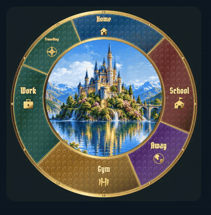
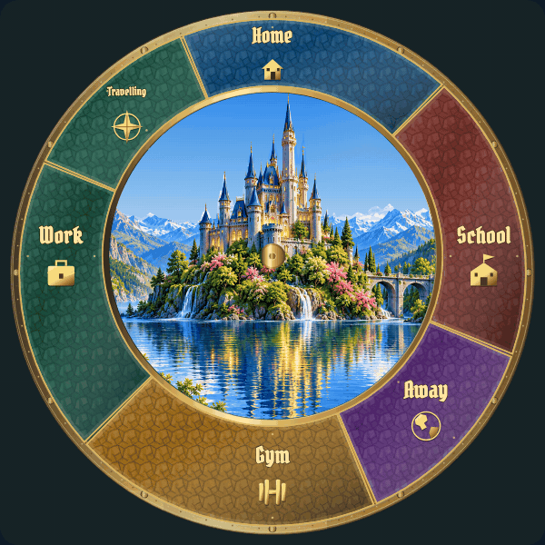
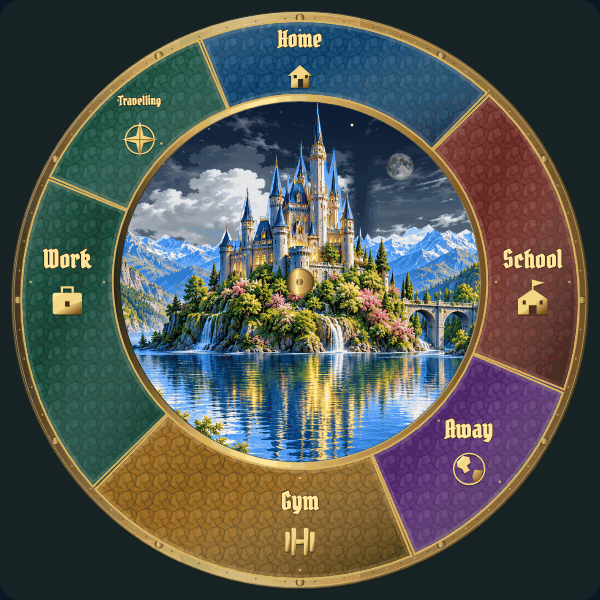
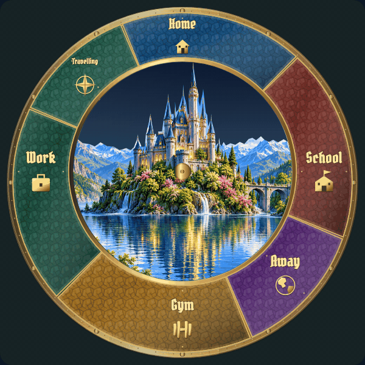

# Landscape motion: individual review

[Latest revisions](LATEST-REVISIONS.md) · [Complete gallery](README.md)

**Release held. Explicit approvals and omissions are preserved.**

L01–L06 motion effects are approved. Their exact approved files remain preserved; new context variants below use the corrected shared skyline. L07 and L08 revision 4 still require approval. [Current review round](REVIEW-ROUND-2.md) links the fresh full views and close-ups directly.

## L01 · Cloud drift

**Approved.**

Explicitly approved by the user in chat.

Example: normal-speed motion study.

[Approved motion with revised scene registration](items/L01-context-r1.gif)

[Close-up: approved motion with revised scene registration](items/L01-context-detail-r1.gif)

[Still image](items/L01.png)

## L02 · Foliage sway

**Approved.**

Explicitly approved in user review. Motion effect approved; shared castle/mountain edge registration and glow still require correction.

Example: implemented runtime rendering.

[Spring petals](items/L02-spring-r1.gif)

[Autumn leaves](items/L02-autumn-r1.gif)

[Close-up of the same normal-speed motion](items/L02-detail-r3.gif)

[spring foliage and seasonal debris](items/L02-spring-r3.gif)

[autumn foliage and seasonal debris](items/L02-autumn-r3.gif)

[Approved motion with revised scene registration](items/L02-context-r1.gif)

[Close-up: approved motion with revised scene registration](items/L02-context-detail-r1.gif)

[Still image](items/L02-r3.png)

## L03 · Lake reflections

**Approved.**

Explicitly approved in user review. Motion effect approved; shared castle/mountain edge registration and glow still require correction.

Example: implemented runtime animation; normal-speed frames.

[Close-up of the same normal-speed motion](items/L03-detail-r3.gif)

[Approved motion with revised scene registration](items/L03-context-r1.gif)

[Close-up: approved motion with revised scene registration](items/L03-context-detail-r1.gif)

[Still image](items/L03-r3.png)

## L04 · Waterfall flow and fine spray

**Approved.**

Explicitly approved in user review. Motion effect approved; shared castle/mountain edge registration and glow still require correction.

Example: implemented runtime animation; normal-speed frames.

[Close-up of the same normal-speed motion](items/L04-detail-r3.gif)

[Approved motion with revised scene registration](items/L04-context-r1.gif)

[Close-up: approved motion with revised scene registration](items/L04-context-detail-r1.gif)

[Still image](items/L04-r3.png)

## L05 · Twinkling stars

**Approved.**

Explicitly approved in user review. Motion effect approved; shared castle/mountain edge registration and glow still require correction.

Example: implemented runtime animation; normal-speed frames.

[Close-up of the same normal-speed motion](items/L05-detail-r3.gif)

[Approved motion with revised scene registration](items/L05-context-r1.gif)

[Close-up: approved motion with revised scene registration](items/L05-context-detail-r1.gif)

[Still image](items/L05-r3.png)

## L06 · Shooting star

**Approved.**

Explicitly approved in user review. Motion effect approved; shared castle/mountain edge registration and glow still require correction.

Example: implemented runtime animation; normal-speed frames.

[Close-up of the same normal-speed motion](items/L06-detail-r3.gif)

[Approved motion with revised scene registration](items/L06-context-r1.gif)

[Close-up: approved motion with revised scene registration](items/L06-context-detail-r1.gif)

[Still image](items/L06-r3.png)

## L07 · Window lights

**Revision 4 · awaiting approval.**

Make independent candle/torch fluctuations visibly detectable without fast synchronized pulsing. Correct shared skyline glow and cutout.

Example: implemented runtime rendering.

[New close-up, same natural-speed timeline](items/L07-detail-r4.gif)

[Still image](items/L07-r4.png)

## L08 · Fireflies

**Revision 4 · awaiting approval.**

Make green foreground firefly movement visibly detectable. Correct shared skyline glow and cutout.

Example: implemented runtime rendering.

[New close-up, same natural-speed timeline](items/L08-detail-r4.gif)

[Still image](items/L08-r4.png)
