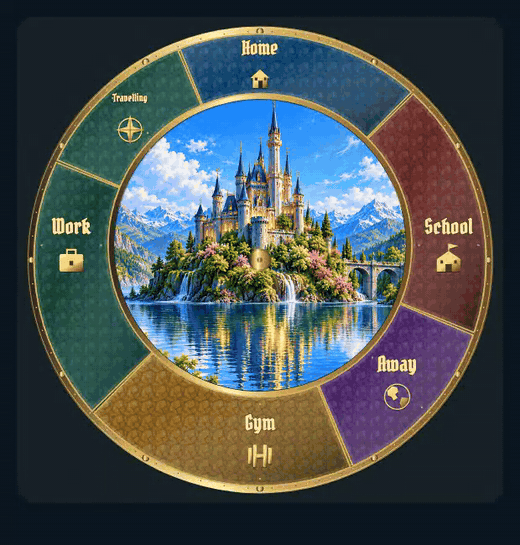
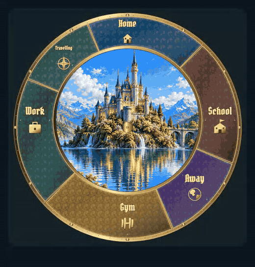
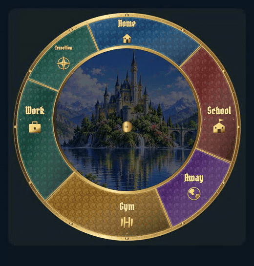

# Landscape motion: individual review

[Back to review gallery](README.md)

**Release held. Decisions below reflect your individual approvals and revision requests.**

Revised normal-speed clips are ready for individual review. Open each GIF to see it full size. Extra seasonal and occlusion studies appear below the main examples. The varied-meteor study skips quiet gaps between encounters; each visible pass runs at normal speed.

| **[L01 · Cloud drift](items/L01.gif)** | **[L02 · Foliage sway](items/L02-r1.gif)** |
| --- | --- |
|  |  |
| Approved | Revised r1 · awaiting approval |

L01: Approved original eight-second cloud study; its image and motion remain unchanged.

L02: More visible root-anchored canopy sway. Spring petals and autumn leaves follow the scene season; each clip runs at normal speed.

[Spring petals](items/L02-spring-r1.gif) | [Autumn leaves](items/L02-autumn-r1.gif)

| **[L03 · Lake reflections](items/L03-r1.gif)** | **[L04 · Waterfall flow and fine spray](items/L04-r1.gif)** |
| --- | --- |
|  |  |
| Revised r1 · awaiting approval | Revised r1 · awaiting approval |

L03: Stronger fine reflection displacement with a fixed shoreline; no sliding rectangular water bands.

L04: Stronger downward flow with visible fine droplets close to the impacts; no filled spray discs or spotlights.

| **[L05 · Twinkling stars](items/L05-r1.gif)** | **[L06 · Shooting star](items/L06-r1.gif)** |
| --- | --- |
|  |  |
| Revised r1 · awaiting approval | Revised r1 · awaiting approval |

L05: Brighter independent twinkling. Moving cloud coverage erases distant stars; the moon, castle and foreground remain in front.

[Cloud and moon occlusion](items/L05-clouds-r1.gif)

L06: Session-random sky origins, flight angles and 20–75 second quiet intervals. Meteors remain behind clouds, moon and foreground. The main clip starts just before an encounter.

[Varied encounters — quiet gaps skipped](items/L06-varied-r1.gif) | [Cloud and moon occlusion](items/L06-clouds-r1.gif)

| **[L07 · Window lights](items/L07-r1.gif)** | **[L08 · Fireflies](items/L08-r1.gif)** |
| --- | --- |
|  |  |
| Revised r1 · awaiting approval | Revised r1 · awaiting approval |

L07: The actual painted window regions have independently varying candle/torch flicker; they no longer breathe together.

L08: Greenish bioluminescent fireflies wander and pulse independently near foreground vegetation.
