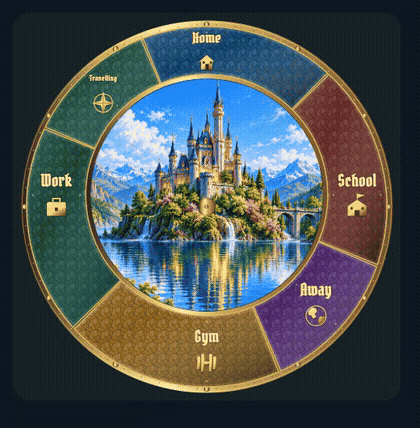
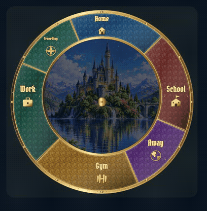
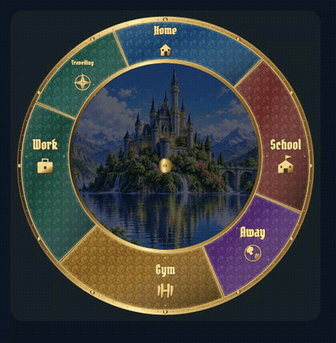
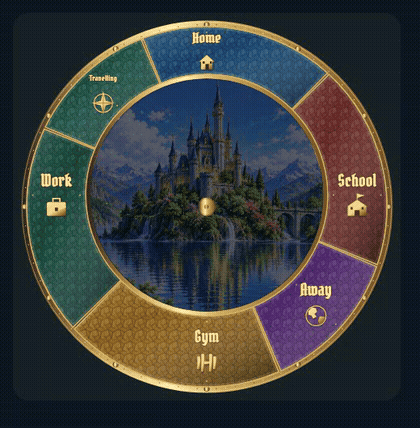

# Landscape motion: individual review

[Back to review gallery](README.md)

**Release held. Every item below is awaiting your approval.**

Each eight-second GIF runs at normal speed and isolates one effect. There are no creature placeholders in these clips. Open an example to inspect the full-size animation.

| **[L01 · Cloud drift](items/L01.gif)** | **[L02 · Foliage sway](items/L02.gif)** |
| --- | --- |
|  |  |
| Awaiting approval | Awaiting approval |

L01: 8-second clip at normal playback speed; no creatures.

L02: 8-second clip at normal playback speed; no creatures.

| **[L03 · Lake reflections](items/L03.gif)** | **[L04 · Waterfall flow and fine spray](items/L04.gif)** |
| --- | --- |
|  |  |
| Awaiting approval | Awaiting approval |

L03: 8-second clip at normal playback speed; no creatures.

L04: 8-second clip at normal playback speed; no creatures.

| **[L05 · Twinkling stars](items/L05.gif)** | **[L06 · Shooting star](items/L06.gif)** |
| --- | --- |
|  |  |
| Awaiting approval | Awaiting approval |

L05: 8-second clip at normal playback speed; no creatures.

L06: Clip starts just before a meteor; normal recurrence is 47 seconds.

| **[L07 · Window lights](items/L07.gif)** | **[L08 · Fireflies](items/L08.gif)** |
| --- | --- |
|  |  |
| Awaiting approval | Awaiting approval |

L07: 8-second clip at normal playback speed; no creatures.

L08: 8-second clip at normal playback speed; no creatures.
