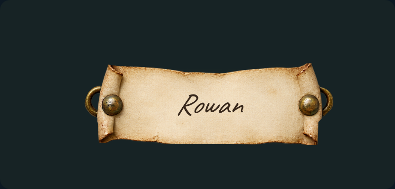
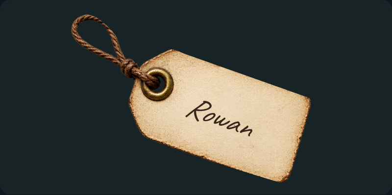
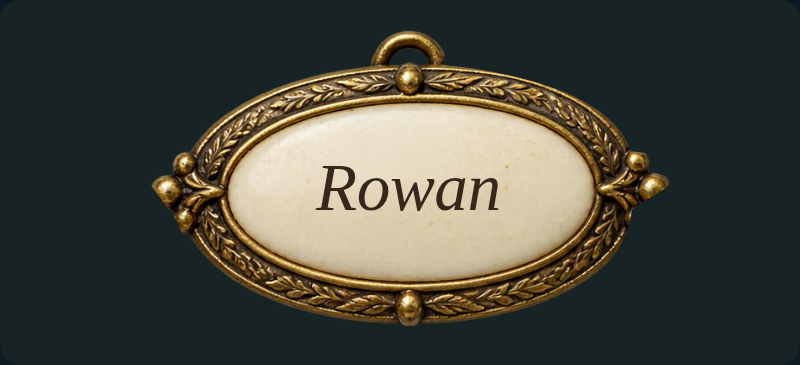
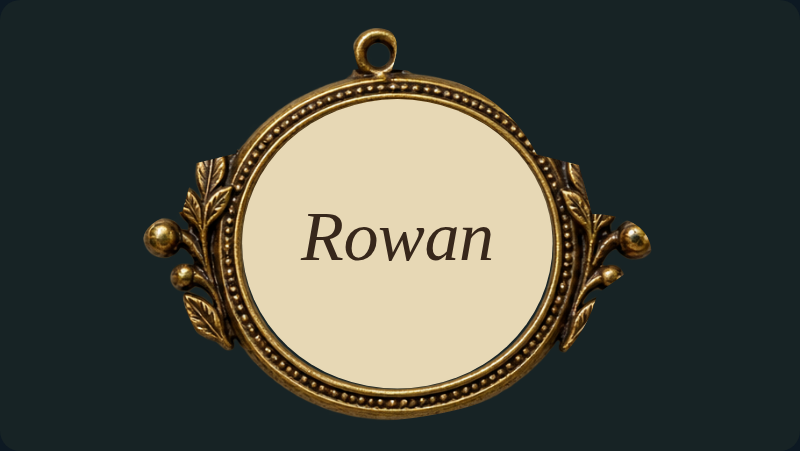

# Lettering and portraits: individual review

[Latest revisions](LATEST-REVISIONS.md) · [Complete gallery](README.md)

**Release held. Explicit approvals and omissions are preserved.**

K01–K08 are approved with UI text-color control. K09–K12 revision 2 now use runtime attachment rendering, individual artwork clips and adjustable font, size, ink color, alignment, position and rotation. [Current review round](REVIEW-ROUND-2.md).

## K01 · stem / parallel

**Approved.**

Explicitly approved by the user in chat, conditional on the ability to change text color in the UI. Preserve text-color control for lettering, initials and future name tags.

Example: current draft rendering.

## K02 · stem / perpendicular

**Approved.**

Explicitly approved by the user in chat, conditional on the ability to change text color in the UI. Preserve text-color control for lettering, initials and future name tags.

Example: current draft rendering.

## K03 · tip / parallel

**Approved.**

Explicitly approved by the user in chat, conditional on the ability to change text color in the UI. Preserve text-color control for lettering, initials and future name tags.

Example: current draft rendering.

## K04 · tip / perpendicular

**Approved.**

Explicitly approved by the user in chat, conditional on the ability to change text color in the UI. Preserve text-color control for lettering, initials and future name tags.

Example: current draft rendering.

## K05 · No hand lettering

**Approved.**

Explicitly approved by the user in chat, conditional on the ability to change text color in the UI. Preserve text-color control for lettering, initials and future name tags.

Example: current draft rendering.

## K06 · oval portrait / brass frame

**Approved.**

Explicitly approved by the user in chat, conditional on the ability to change text color in the UI. Preserve text-color control for lettering, initials and future name tags.

Example: current draft rendering.

## K07 · circle portrait / brass frame

**Approved.**

Explicitly approved by the user in chat, conditional on the ability to change text color in the UI. Preserve text-color control for lettering, initials and future name tags.

Example: current draft rendering.

## K08 · oval portrait / none frame

**Approved.**

Explicitly approved by the user in chat, conditional on the ability to change text color in the UI. Preserve text-color control for lettering, initials and future name tags.

Example: current draft rendering.

## K09 · Affixed parchment slip

**Revision 2 · awaiting approval.**

Remove neighbouring-tag leakage. Adjustable text font, size, color, position, rotation and alignment. Handwritten ink on parchment.

Example: implemented runtime rendering.

## K10 · Hanging name tag

**Revision 2 · awaiting approval.**

Remove neighbouring-tag leakage. Adjustable text font, size, color, position, rotation and alignment.

Example: implemented runtime rendering.

## K11 · Oval name brooch

**Revision 2 · awaiting approval.**

Remove neighbouring-tag leakage. Adjustable text font, size, color, position, rotation and alignment.

Example: implemented runtime rendering.

## K12 · Framed portrait attachment

**Revision 2 · awaiting approval.**

Remove neighbouring-tag leakage. Adjustable text font, size, color, position, rotation and alignment.

Example: implemented runtime rendering.
