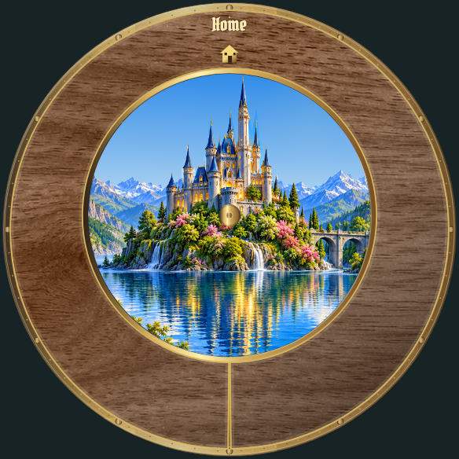

# Location panels: individual review

[Latest revisions](LATEST-REVISIONS.md) · [Complete gallery](README.md)

**Release held. Explicit approvals and omissions are preserved.**

## P01 · cracked-glass

**Approved.**

Explicitly approved by the user in chat.

Example: current draft rendering.

## P02 · hammered-metal

**Revision 3 · awaiting approval.**

Visible texture tiling is rejected. Use a continuous, natural material surface without repeated motifs or seams.

Example: implemented runtime rendering.

## P03 · parchment

**Revision 3 · awaiting approval.**

Visible texture tiling is rejected. Use a continuous, natural material surface without repeated motifs or seams.

Example: implemented runtime rendering.

## P04 · wood

**Revision 3 · awaiting approval.**

Visible texture tiling is rejected. Use a continuous, natural material surface without repeated motifs or seams.

Example: implemented runtime rendering.

## P05 · plain

**Approved.**

Explicitly approved by the user in chat.

Example: current draft rendering.
