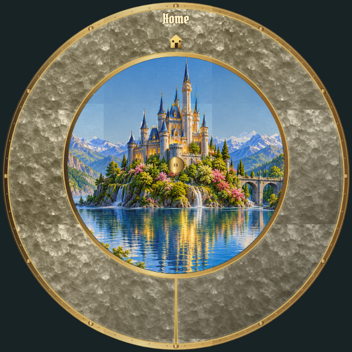
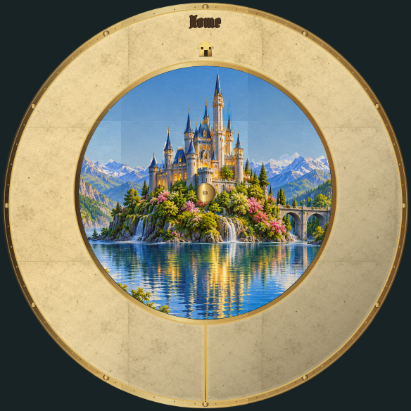
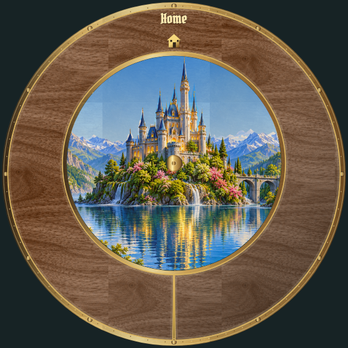

# Location panels: individual review

[Latest revisions](LATEST-REVISIONS.md) · [Complete gallery](README.md)

**Release held. Explicit approvals and omissions are preserved.**

## P01 · cracked-glass

**Approved.**

Explicitly approved by the user in chat.

Example: current draft rendering.

## P02 · hammered-metal

**Revision 1 · awaiting approval.**

Replace regular spotted pattern with irregular realistic hammered metal: varied overlapping shallow dents and physical reflected highlights; no repeating dots.

Example: implemented photographic material pattern; editable panel color preserved.

## P03 · parchment

**Revision 1 · awaiting approval.**

Replace line pattern with realistic aged parchment, fibers, mottling and subtle wear.

Example: implemented photographic material pattern; editable panel color preserved.

## P04 · wood

**Revision 1 · awaiting approval.**

Replace drawn lines with realistic natural wood grain and surface detail.

Example: implemented photographic material pattern; editable panel color preserved.

## P05 · plain

**Approved.**

Explicitly approved by the user in chat.

Example: current draft rendering.
