# Materials: individual review

[Latest revisions](LATEST-REVISIONS.md) · [Complete gallery](README.md)

**Release held. Explicit approvals and omissions are preserved.**

New realistic material art studies. Applying these finishes consistently to arbitrary approved hand silhouettes remains separate runtime work after approval.

## M01 · color

**Revision 1 · awaiting approval.**

[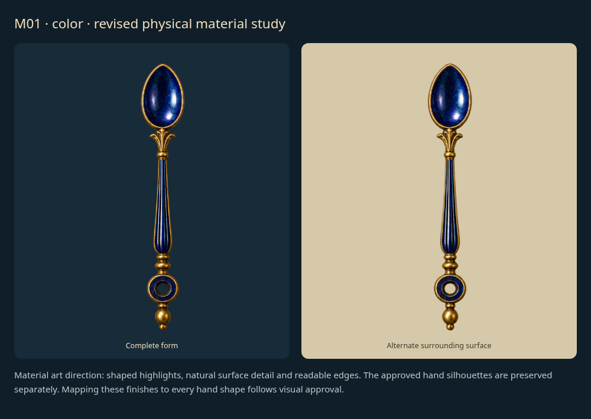](items/M01-r1.png)

Rework this material/finish to look realistic, with appropriate physical texture, depth, reflections and wear rather than a flat colored shape. Revised examples require review.

Example: material artwork proposal; arbitrary-hand mapping follows approval.

## M02 · brass

**Revision 1 · awaiting approval.**

[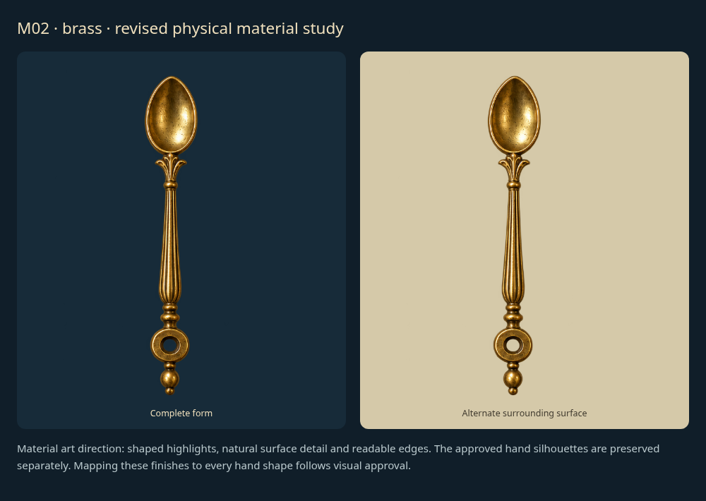](items/M02-r1.png)

Rework this material/finish to look realistic, with appropriate physical texture, depth, reflections and wear rather than a flat colored shape. Revised examples require review.

Example: material artwork proposal; arbitrary-hand mapping follows approval.

## M03 · aged-brass

**Revision 1 · awaiting approval.**

[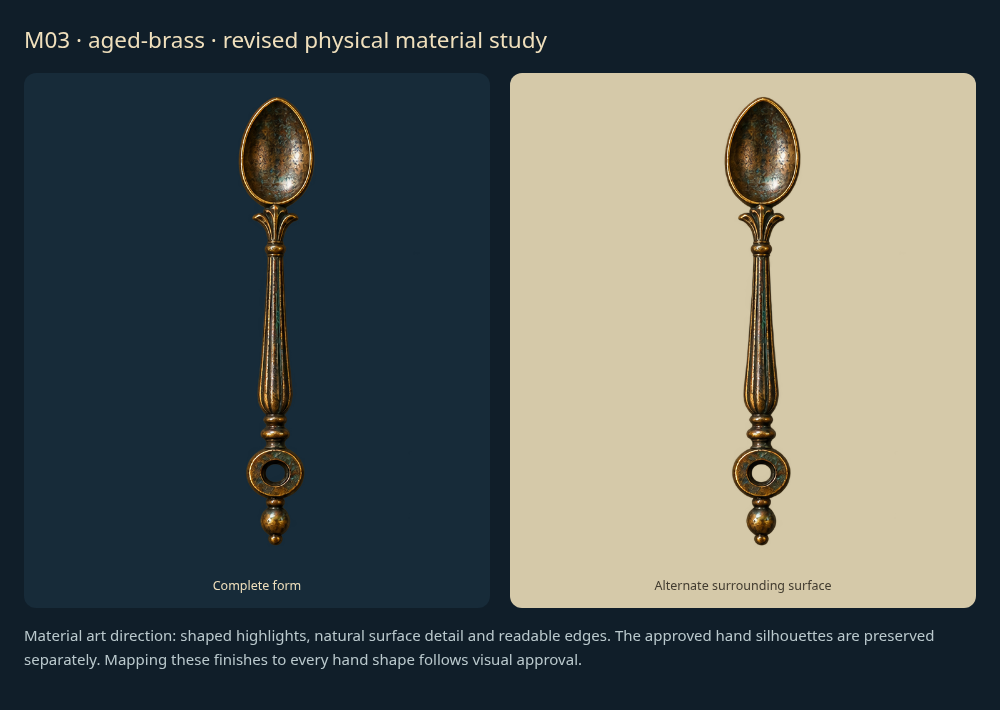](items/M03-r1.png)

Rework this material/finish to look realistic, with appropriate physical texture, depth, reflections and wear rather than a flat colored shape. Revised examples require review.

Example: material artwork proposal; arbitrary-hand mapping follows approval.

## M04 · copper

**Revision 1 · awaiting approval.**

[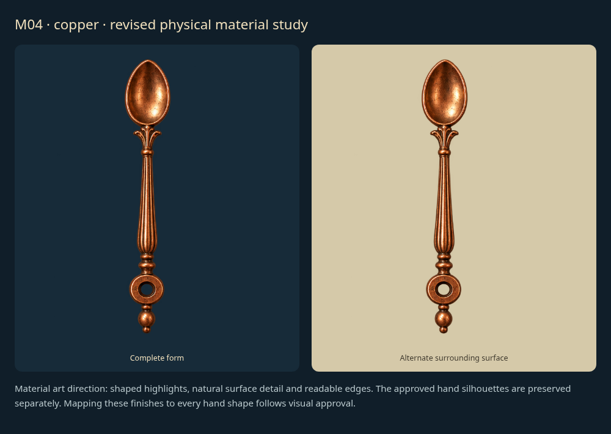](items/M04-r1.png)

Rework this material/finish to look realistic, with appropriate physical texture, depth, reflections and wear rather than a flat colored shape. Revised examples require review.

Example: material artwork proposal; arbitrary-hand mapping follows approval.

## M05 · silver

**Revision 1 · awaiting approval.**

[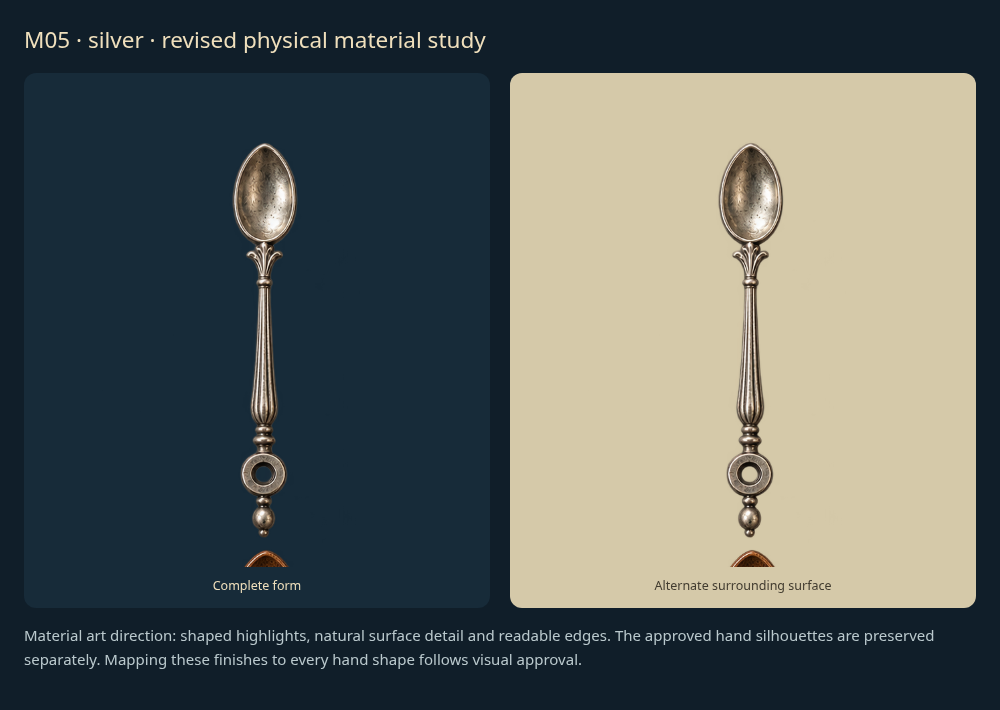](items/M05-r1.png)

Rework this material/finish to look realistic, with appropriate physical texture, depth, reflections and wear rather than a flat colored shape. Revised examples require review.

Example: material artwork proposal; arbitrary-hand mapping follows approval.

## M06 · steel

**Revision 1 · awaiting approval.**

[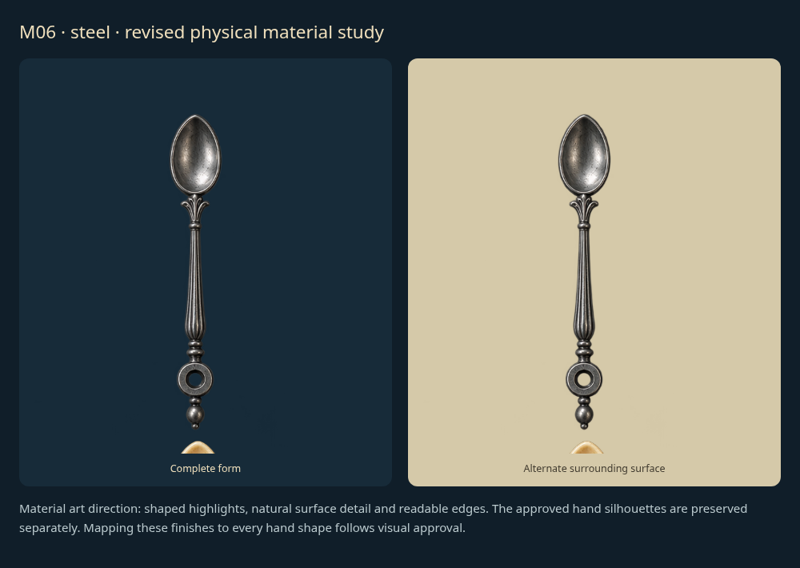](items/M06-r1.png)

Rework this material/finish to look realistic, with appropriate physical texture, depth, reflections and wear rather than a flat colored shape. Revised examples require review.

Example: material artwork proposal; arbitrary-hand mapping follows approval.

## M07 · wood

**Revision 1 · awaiting approval.**

[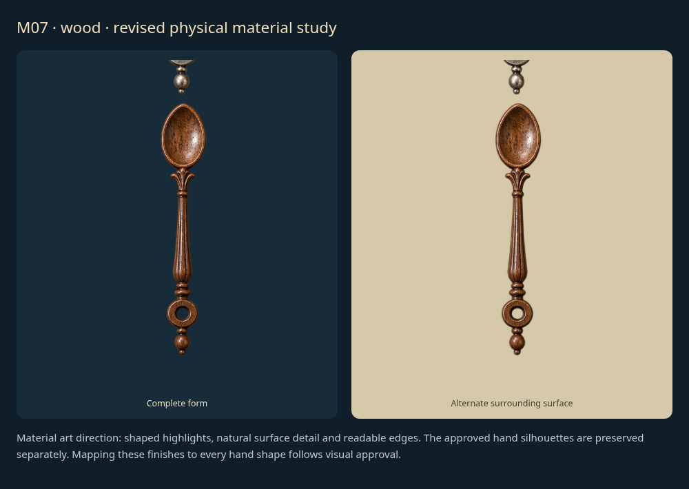](items/M07-r1.png)

Rework this material/finish to look realistic, with appropriate physical texture, depth, reflections and wear rather than a flat colored shape. Revised examples require review.

Example: material artwork proposal; arbitrary-hand mapping follows approval.

## M08 · ivory

**Revision 1 · awaiting approval.**

[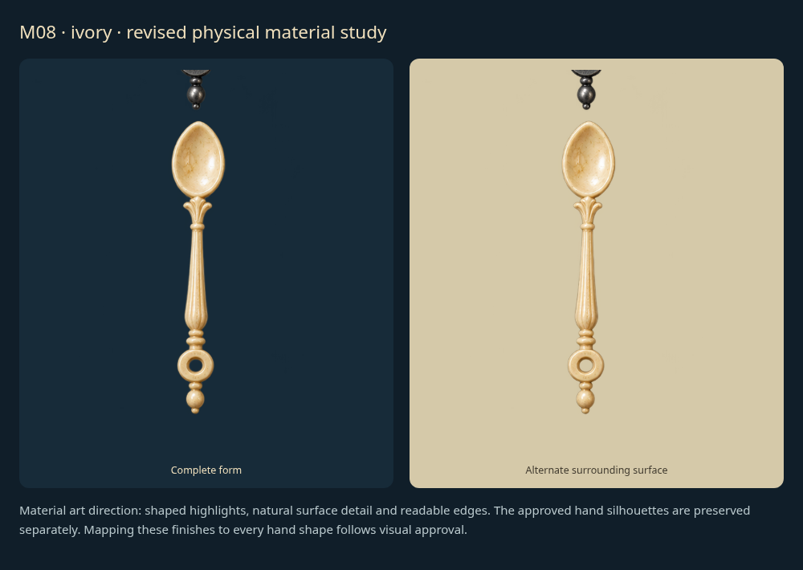](items/M08-r1.png)

Rework this material/finish to look realistic, with appropriate physical texture, depth, reflections and wear rather than a flat colored shape. Revised examples require review.

Example: material artwork proposal; arbitrary-hand mapping follows approval.

## M09 · obsidian

**Revision 1 · awaiting approval.**

[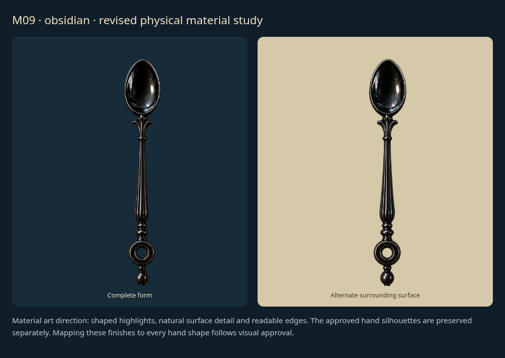](items/M09-r1.png)

Rework this material/finish to look realistic, with appropriate physical texture, depth, reflections and wear rather than a flat colored shape. Revised examples require review.

Example: material artwork proposal; arbitrary-hand mapping follows approval.

## M10 · glass

**Revision 1 · awaiting approval.**

[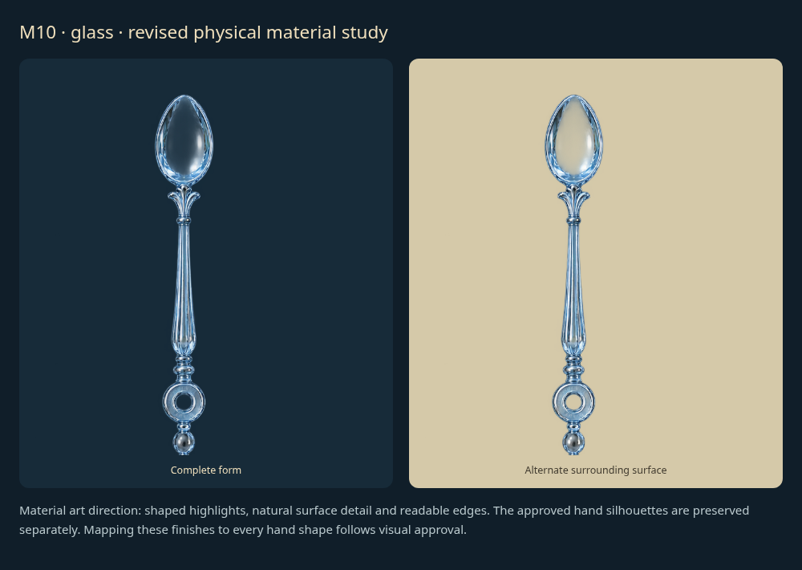](items/M10-r1.png)

Rework this material/finish to look realistic, with appropriate physical texture, depth, reflections and wear rather than a flat colored shape. Revised examples require review.

Example: material artwork proposal; arbitrary-hand mapping follows approval.

## M11 · Brass finish: polished

**Revision 1 · awaiting approval.**

[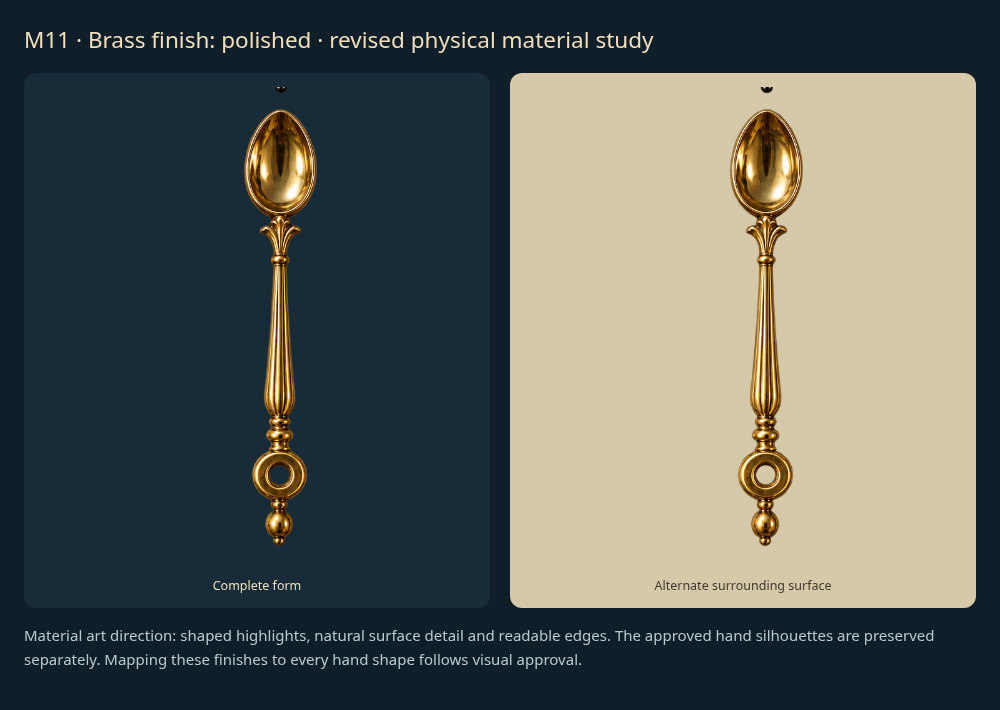](items/M11-r1.png)

Rework this material/finish to look realistic, with appropriate physical texture, depth, reflections and wear rather than a flat colored shape. Revised examples require review.

Example: material artwork proposal; arbitrary-hand mapping follows approval.

## M12 · Brass finish: brushed

**Revision 1 · awaiting approval.**

[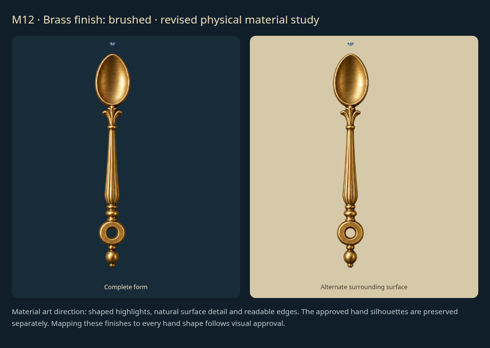](items/M12-r1.png)

Rework this material/finish to look realistic, with appropriate physical texture, depth, reflections and wear rather than a flat colored shape. Revised examples require review.

Example: material artwork proposal; arbitrary-hand mapping follows approval.

## M13 · Brass finish: aged

**Revision 1 · awaiting approval.**

[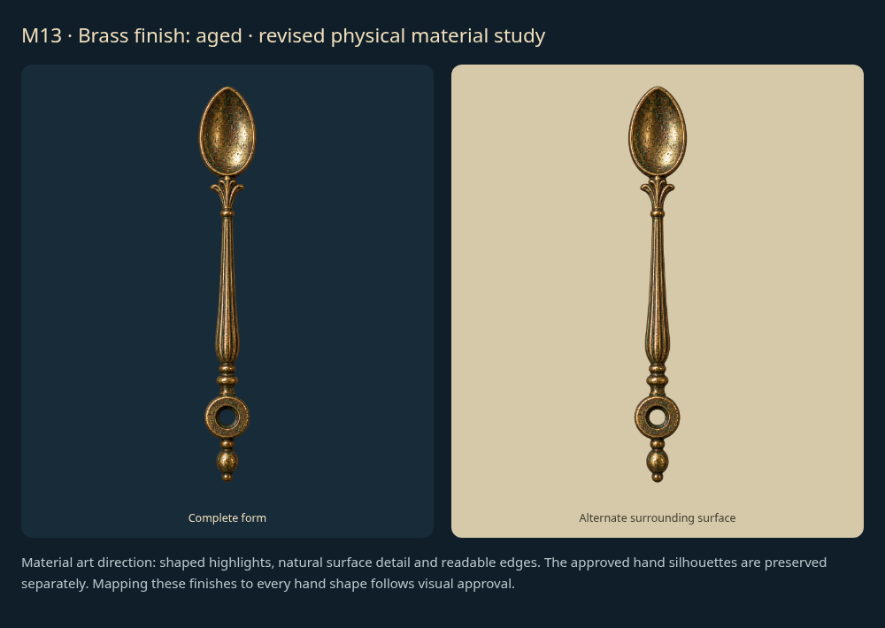](items/M13-r1.png)

Rework this material/finish to look realistic, with appropriate physical texture, depth, reflections and wear rather than a flat colored shape. Revised examples require review.

Example: material artwork proposal; arbitrary-hand mapping follows approval.
