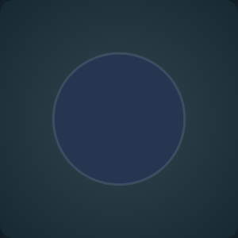
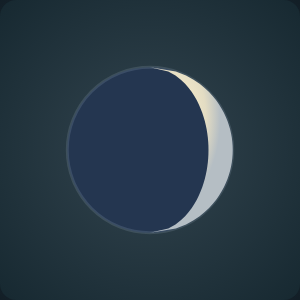
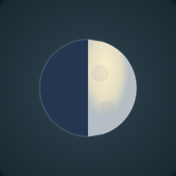
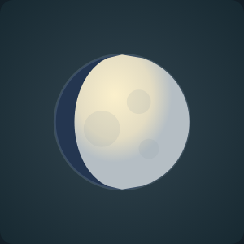
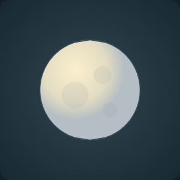
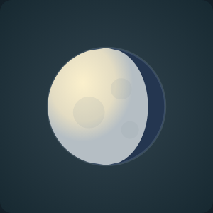
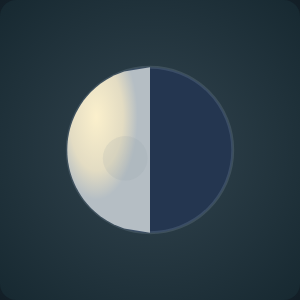
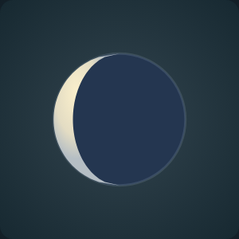

# Moon phases: individual review

[Back to review gallery](README.md)

**Release held. Every item below is awaiting your approval.**

The eight named lunar phases, shown close up on a dark sky.

| **[N01 · new_moon](items/N01.png)** | **[N02 · waxing_crescent](items/N02.png)** |
| --- | --- |
|  |  |
| Awaiting approval | Awaiting approval |

| **[N03 · first_quarter](items/N03.png)** | **[N04 · waxing_gibbous](items/N04.png)** |
| --- | --- |
|  |  |
| Awaiting approval | Awaiting approval |

| **[N05 · full_moon](items/N05.png)** | **[N06 · waning_gibbous](items/N06.png)** |
| --- | --- |
|  |  |
| Awaiting approval | Awaiting approval |

| **[N07 · last_quarter](items/N07.png)** | **[N08 · waning_crescent](items/N08.png)** |
| --- | --- |
|  |  |
| Awaiting approval | Awaiting approval |
