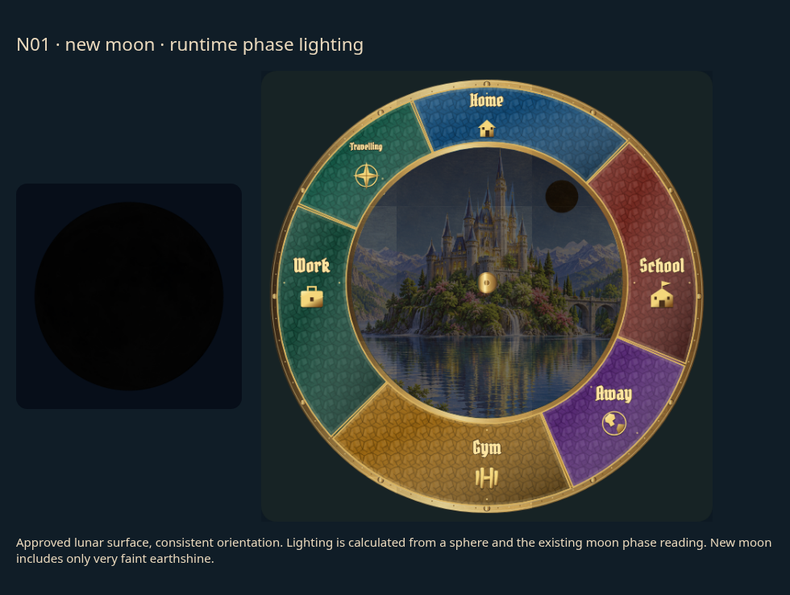
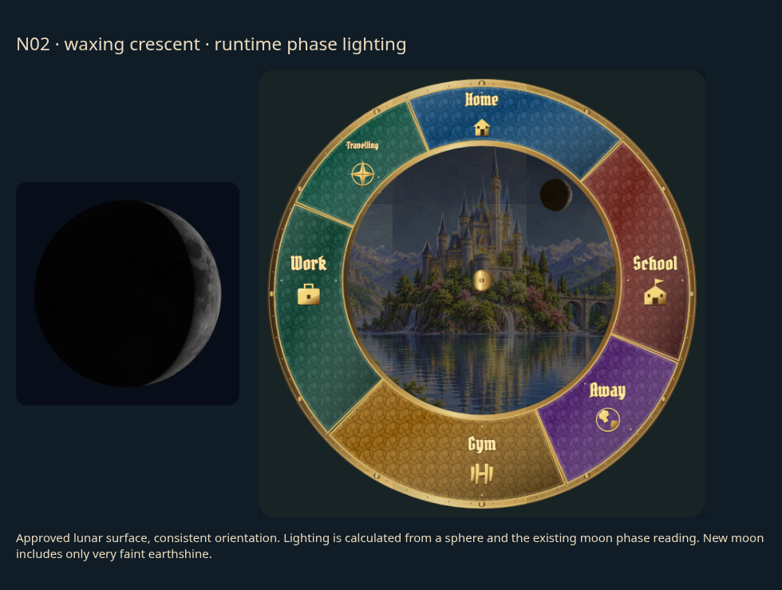
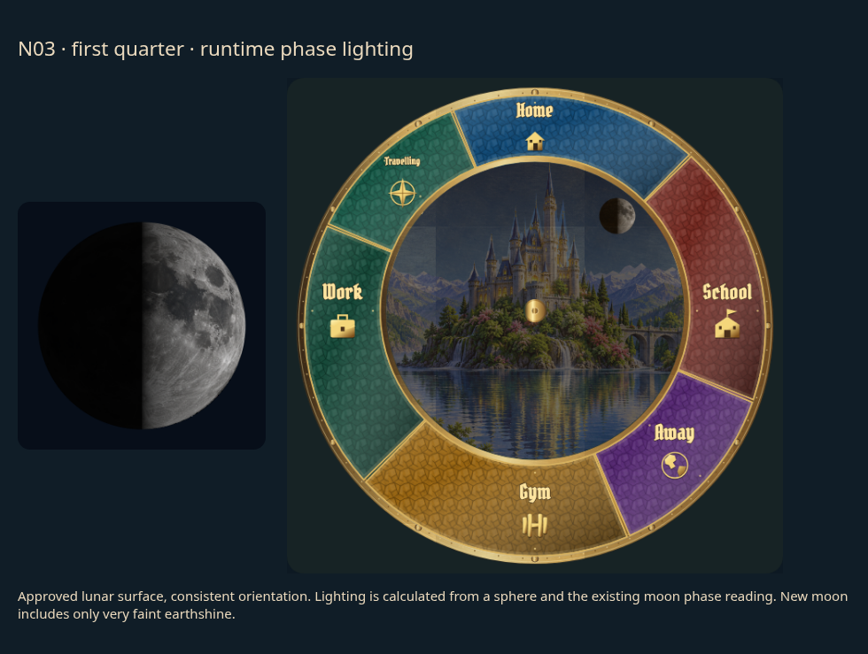
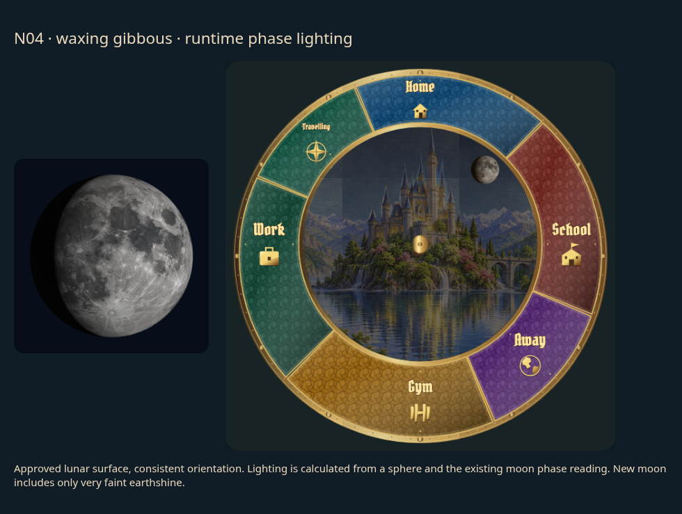
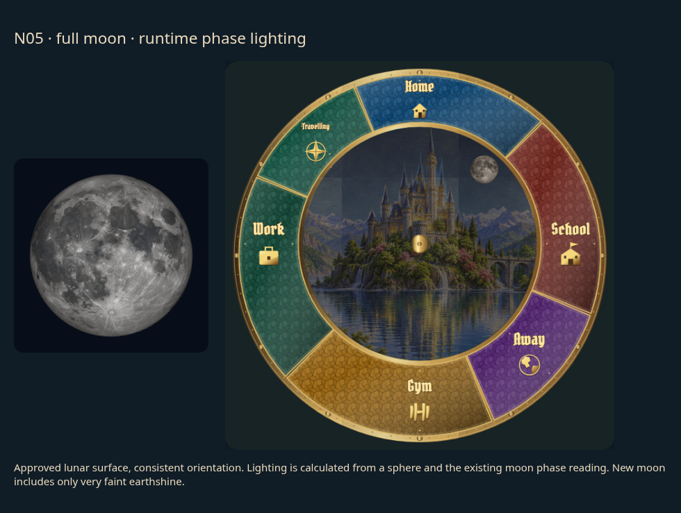
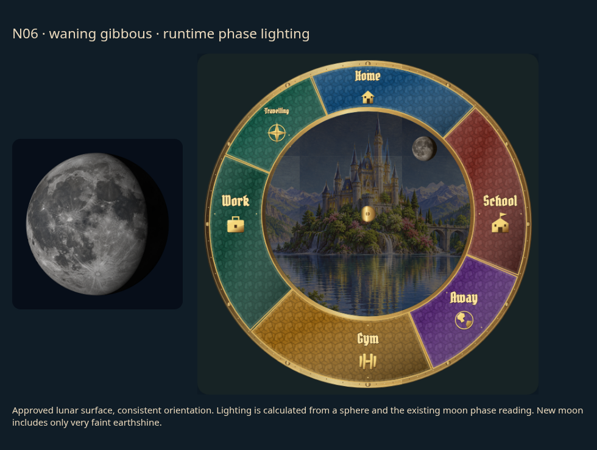
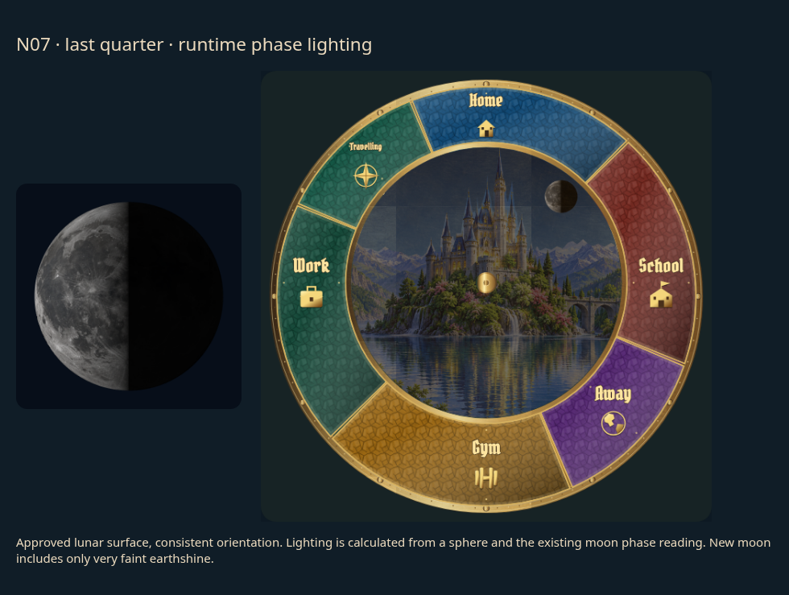
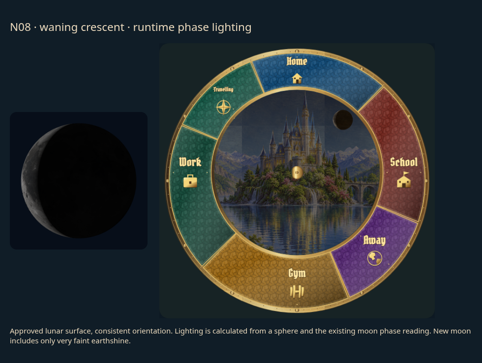

# Moon phases: individual review

[Latest revisions](LATEST-REVISIONS.md) · [Complete gallery](README.md)

**Release held. Explicit approvals and omissions are preserved.**

The lunar surface artwork is approved. These eight renderings use that same surface with sphere-based directional illumination and the existing Home Assistant phase mapping. Final phase examples remain awaiting approval.

## N01 · new_moon

**Revision 1 · awaiting approval.**

Realistic consistent gray lunar surface, spherical lighting and smooth accurate phase geometry; preserve sensor mappings.

Example: implemented runtime rendering.

## N02 · waxing_crescent

**Revision 1 · awaiting approval.**

Realistic consistent gray lunar surface, spherical lighting and smooth accurate phase geometry; preserve sensor mappings.

Example: implemented runtime rendering.

## N03 · first_quarter

**Revision 1 · awaiting approval.**

Realistic consistent gray lunar surface, spherical lighting and smooth accurate phase geometry; preserve sensor mappings.

Example: implemented runtime rendering.

## N04 · waxing_gibbous

**Revision 1 · awaiting approval.**

Realistic consistent gray lunar surface, spherical lighting and smooth accurate phase geometry; preserve sensor mappings.

Example: implemented runtime rendering.

## N05 · full_moon

**Revision 1 · awaiting approval.**

Realistic consistent gray lunar surface, spherical lighting and smooth accurate phase geometry; preserve sensor mappings.

Example: implemented runtime rendering.

## N06 · waning_gibbous

**Revision 1 · awaiting approval.**

Realistic consistent gray lunar surface, spherical lighting and smooth accurate phase geometry; preserve sensor mappings.

Example: implemented runtime rendering.

## N07 · last_quarter

**Revision 1 · awaiting approval.**

Realistic consistent gray lunar surface, spherical lighting and smooth accurate phase geometry; preserve sensor mappings.

Example: implemented runtime rendering.

## N08 · waning_crescent

**Revision 1 · awaiting approval.**

Realistic consistent gray lunar surface, spherical lighting and smooth accurate phase geometry; preserve sensor mappings.

Example: implemented runtime rendering.
