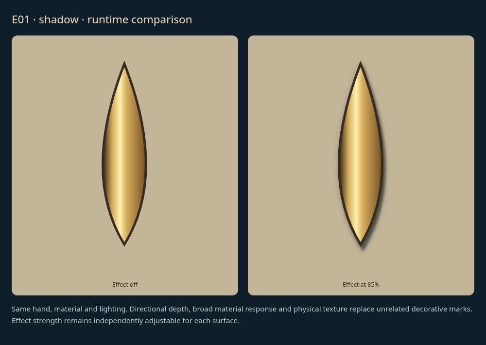
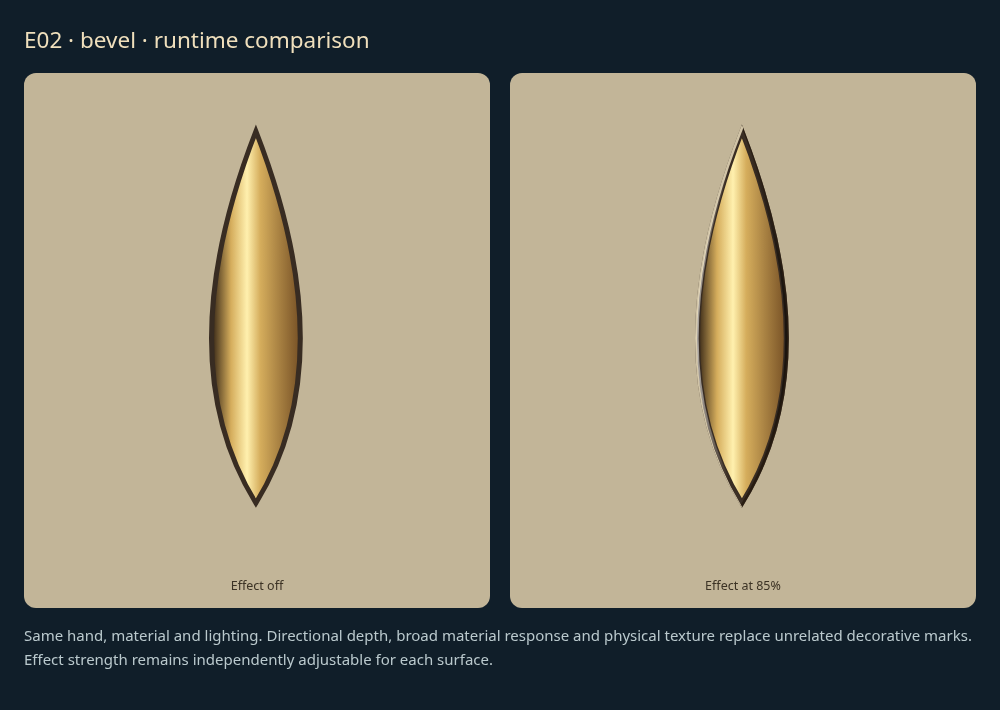
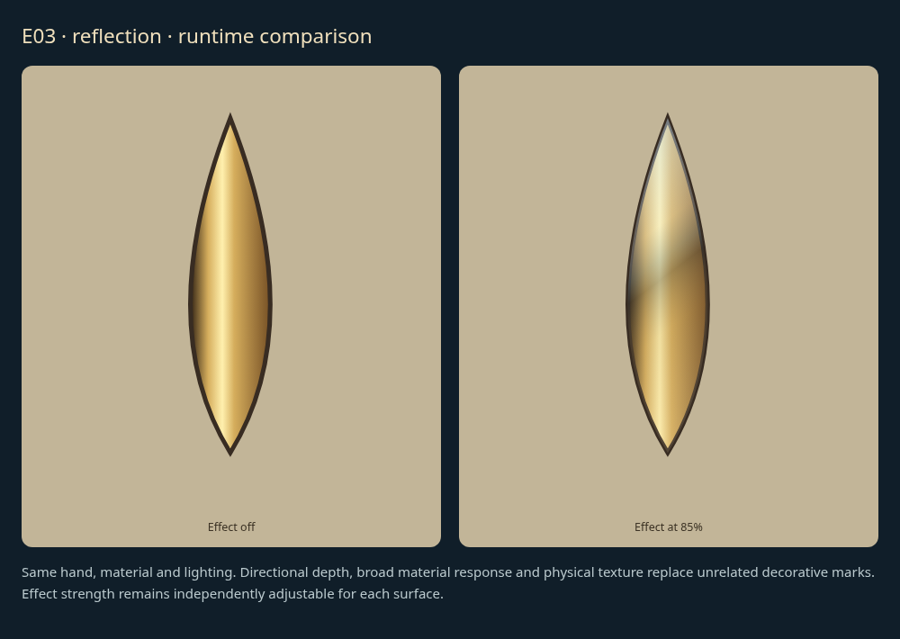
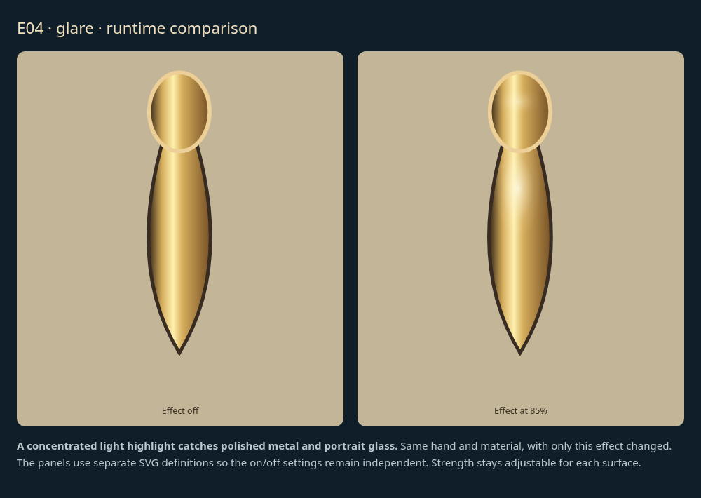
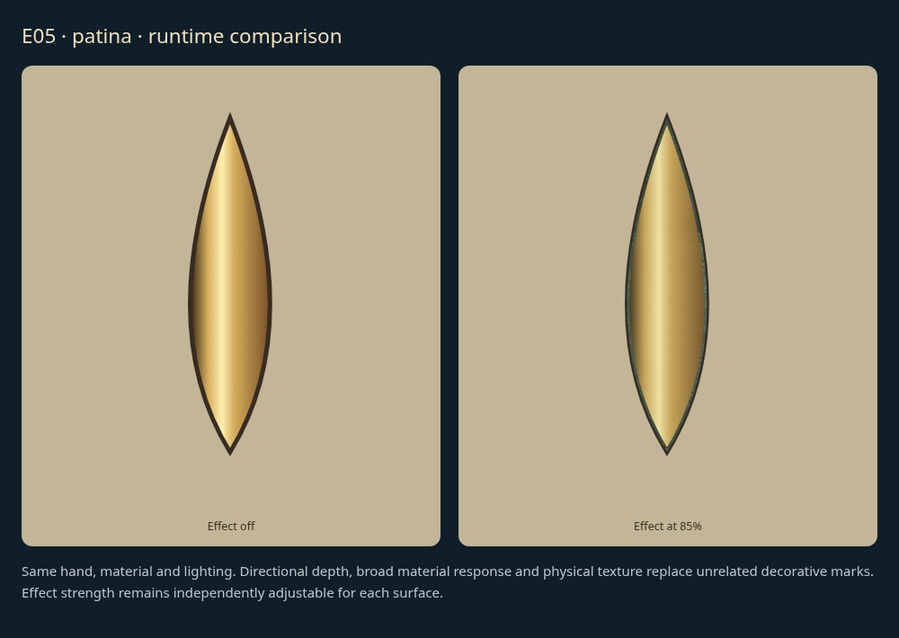
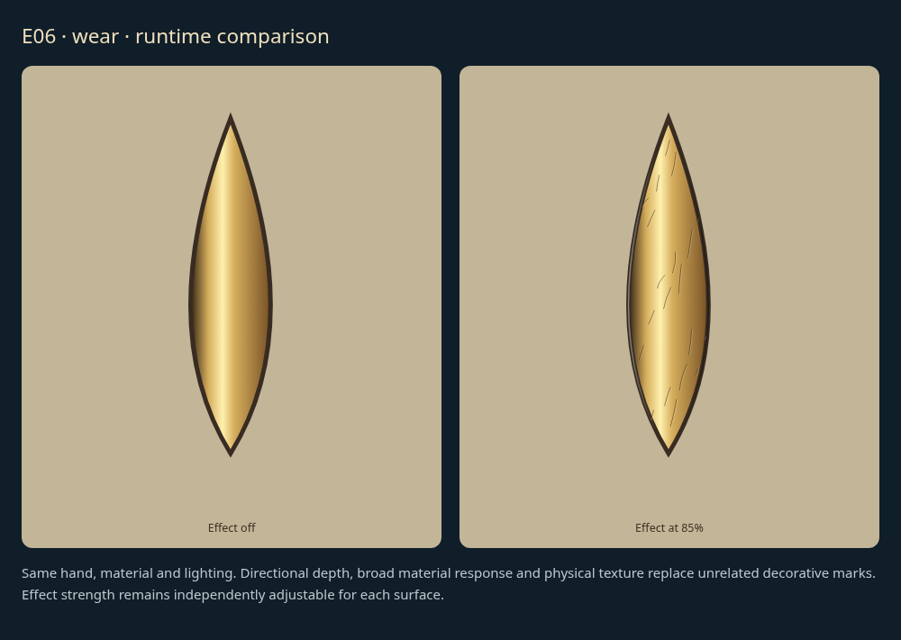

> Original approved review examples. Current runtime integration is described in the [final integration record](REVISION-NOTES.md).

# Surface effects: individual review

[Latest revisions](LATEST-REVISIONS.md) · [Complete gallery](README.md)

**Visual review complete. Explicit approvals and omissions are preserved.**

Each new runtime comparison shows the same material with the effect off and at 85%. Controls remain independent. Visual realism remains for the user to assess.

## E01 · shadow at full strength

**Approved.**

Explicitly approved in user review.

Example: implemented runtime surface effect comparison; isolated SVG definitions.

## E02 · bevel at full strength

**Approved.**

Explicitly approved in user review.

Example: implemented runtime surface effect comparison; isolated SVG definitions.

## E03 · reflection at full strength

**Approved.**

Explicitly approved in user review.

Example: implemented runtime surface effect comparison; isolated SVG definitions.

## E04 · glare at full strength

**Approved.**

Explicitly approved in user review.

Example: implemented runtime surface effect comparison; isolated SVG definitions.

## E05 · patina at full strength

**Approved.**

Explicitly approved in user review.

Example: implemented runtime surface effect comparison; isolated SVG definitions.

## E06 · wear at full strength

**Approved.**

Explicitly approved in user review.

Example: implemented runtime surface effect comparison; isolated SVG definitions.
