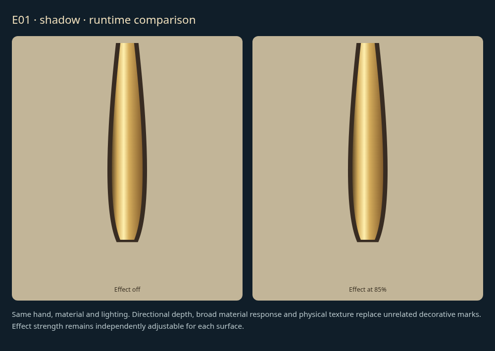
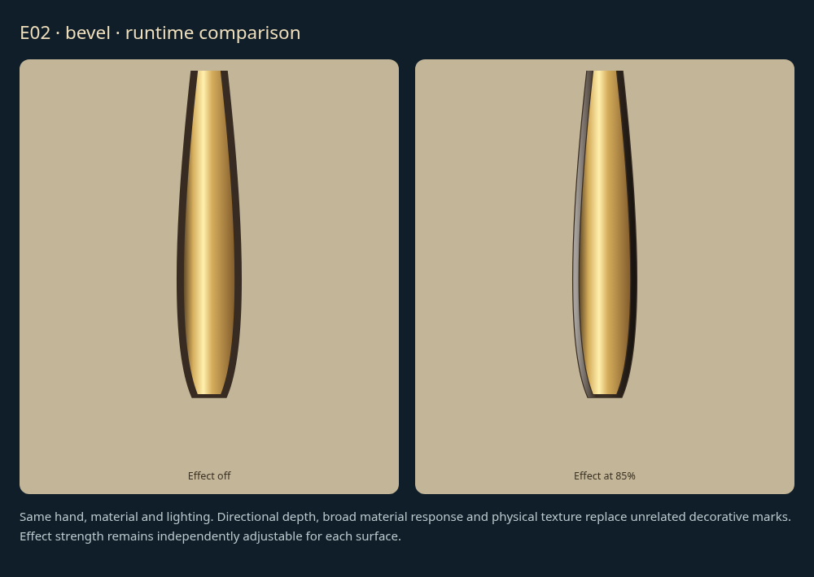
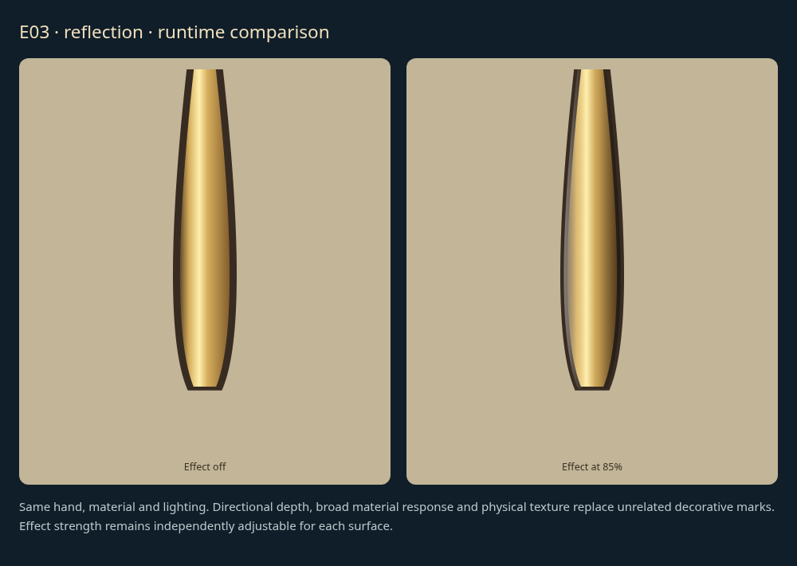
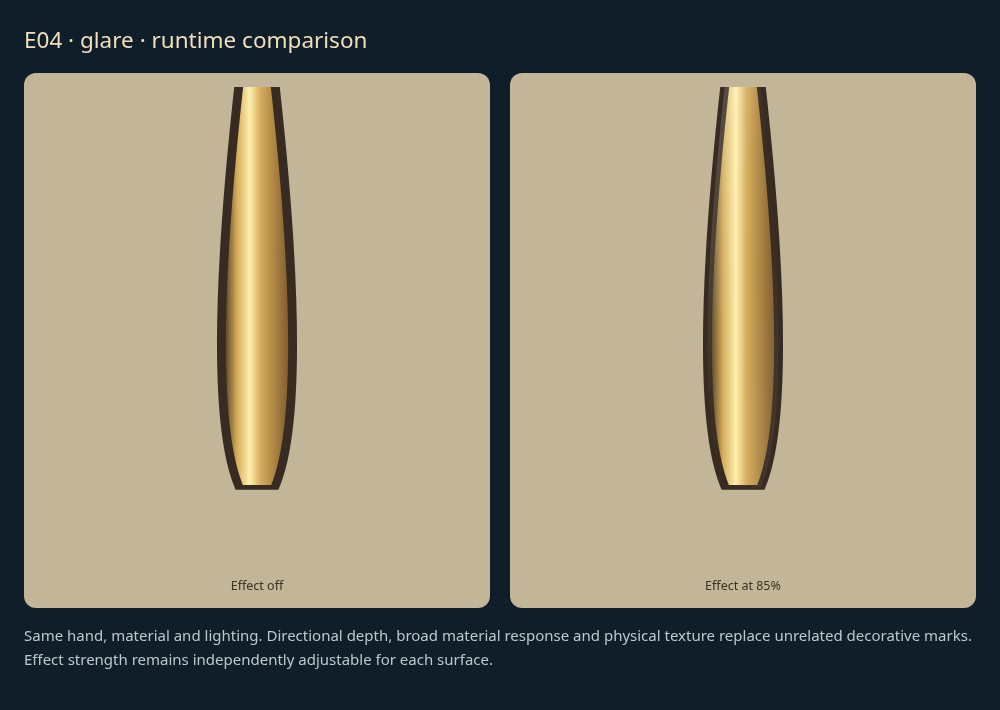

# Surface effects: individual review

[Latest revisions](LATEST-REVISIONS.md) · [Complete gallery](README.md)

**Release held. Explicit approvals and omissions are preserved.**

Each new runtime comparison shows the same material with the effect off and at 85%. Controls remain independent. Visual realism remains for the user to assess.

## E01 · shadow at full strength

**Revision 1 · awaiting approval.**

Physically informed material-aware surface effect. Replace arbitrary shapes with appropriate directional lighting, reflections, oxidation and wear; preserve readability.

Example: implemented runtime surface effect comparison.

## E02 · bevel at full strength

**Revision 1 · awaiting approval.**

Physically informed material-aware surface effect. Replace arbitrary shapes with appropriate directional lighting, reflections, oxidation and wear; preserve readability.

Example: implemented runtime surface effect comparison.

## E03 · reflection at full strength

**Revision 1 · awaiting approval.**

Physically informed material-aware surface effect. Replace arbitrary shapes with appropriate directional lighting, reflections, oxidation and wear; preserve readability.

Example: implemented runtime surface effect comparison.

## E04 · glare at full strength

**Revision 1 · awaiting approval.**

Physically informed material-aware surface effect. Replace arbitrary shapes with appropriate directional lighting, reflections, oxidation and wear; preserve readability.

Example: implemented runtime surface effect comparison.

## E05 · patina at full strength

**Revision 1 · awaiting approval.**

Physically informed material-aware surface effect. Replace arbitrary shapes with appropriate directional lighting, reflections, oxidation and wear; preserve readability.

Example: implemented runtime surface effect comparison.

## E06 · wear at full strength

**Revision 1 · awaiting approval.**

Physically informed material-aware surface effect. Replace arbitrary shapes with appropriate directional lighting, reflections, oxidation and wear; preserve readability.

Example: implemented runtime surface effect comparison.
