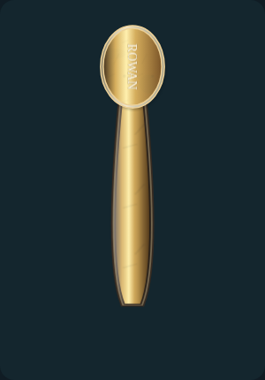
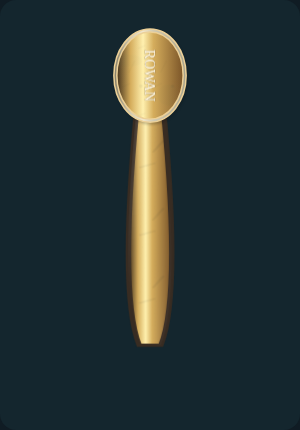
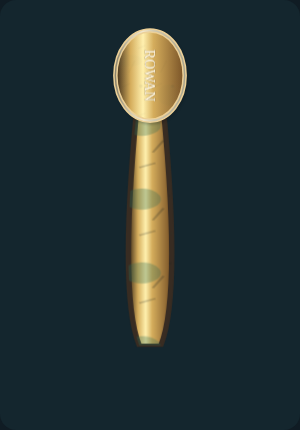
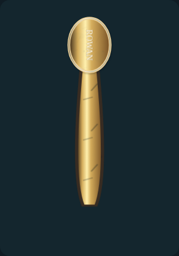

# Surface effects: individual review

[Back to review gallery](README.md)

**Release held. Every item below is awaiting your approval.**

Each example isolates one effect at maximum strength so its appearance is easy to identify. Normal intensity remains adjustable.

| **[E01 · shadow at full strength](items/E01.png)** | **[E02 · bevel at full strength](items/E02.png)** |
| --- | --- |
|  |  |
| Awaiting approval | Awaiting approval |

| **[E03 · reflection at full strength](items/E03.png)** | **[E04 · glare at full strength](items/E04.png)** |
| --- | --- |
|  |  |
| Awaiting approval | Awaiting approval |

| **[E05 · patina at full strength](items/E05.png)** | **[E06 · wear at full strength](items/E06.png)** |
| --- | --- |
|  |  |
| Awaiting approval | Awaiting approval |
