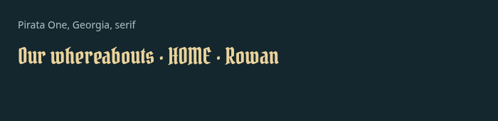
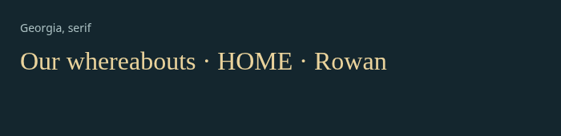
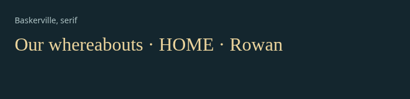
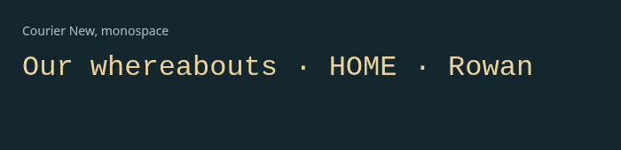
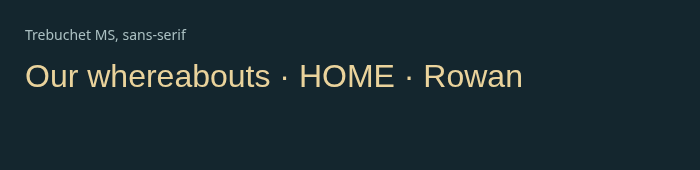
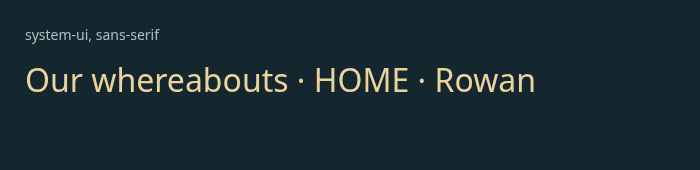
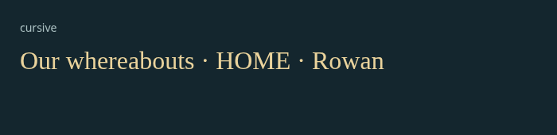

# Typography: individual review

[Latest revisions](LATEST-REVISIONS.md) · [Complete gallery](README.md)

**Release held. Explicit approvals and omissions are preserved.**

## T01 · Pirata One, Georgia, serif

**Approved.**

Explicitly approved by the user in the uploaded continuation instructions. Preserve the reviewed appearance.

Example: device font example.

## T02 · Georgia, serif

**Approved.**

Explicitly approved by the user in the uploaded continuation instructions. Preserve the reviewed appearance.

Example: device font example.

## T03 · Palatino, serif

**Approved.**

Explicitly approved by the user in the uploaded continuation instructions. Preserve the reviewed appearance.

Example: device font example.

## T04 · Garamond, serif

**Approved.**

Explicitly approved by the user in the uploaded continuation instructions. Preserve the reviewed appearance.

Example: device font example.

## T05 · Baskerville, serif

**Approved.**

Explicitly approved by the user in the uploaded continuation instructions. Preserve the reviewed appearance.

Example: device font example.

## T06 · Courier New, monospace

**Approved.**

Explicitly approved by the user in the uploaded continuation instructions. Preserve the reviewed appearance.

Example: device font example.

## T07 · Trebuchet MS, sans-serif

**Approved.**

Explicitly approved by the user in the uploaded continuation instructions. Preserve the reviewed appearance.

Example: device font example.

## T08 · Verdana, sans-serif

**Approved.**

Explicitly approved by the user in the uploaded continuation instructions. Preserve the reviewed appearance.

Example: device font example.

## T09 · system-ui, sans-serif

**Approved.**

Explicitly approved by the user in the uploaded continuation instructions. Preserve the reviewed appearance.

Example: device font example.

## T10 · cursive

**Approved.**

Explicitly approved by the user in the uploaded continuation instructions. Preserve the reviewed appearance.

Example: device font example.
