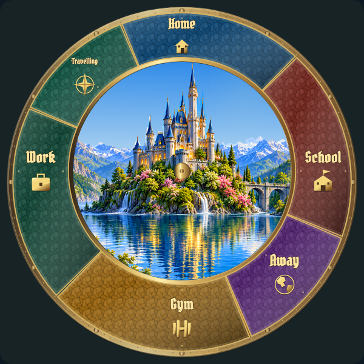
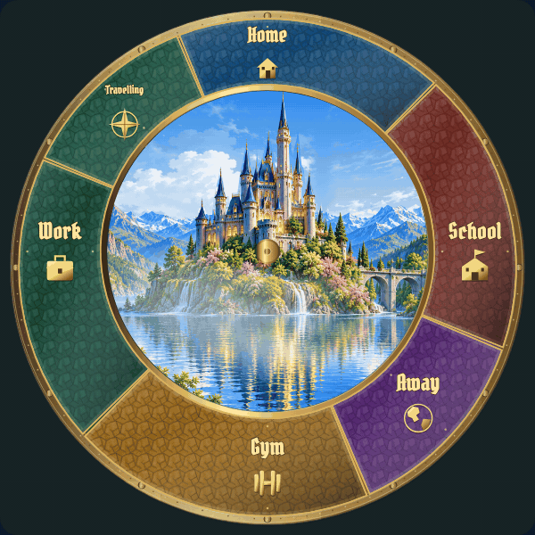
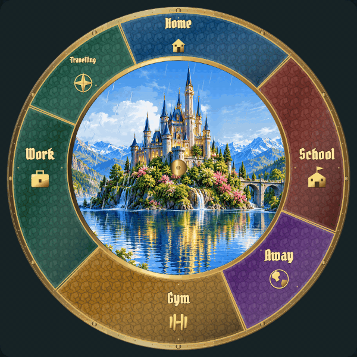

# Weather: individual review

[Current review round](REVIEW-ROUND-4.md) · [Complete gallery](README.md)

**Visual review complete. Explicit approvals and omissions are preserved.**

W01–W10 are approved. W09 revision 6 appearance and continuous growth are preserved.

## W01 · clear

**Approved.**

Explicitly approved in user review.

## W02 · clouds

**Approved.**

Explicitly approved in user review.

[Still](items/W02-r3.png)

## W03 · light-rain

**Approved.**

Explicitly approved in user review.

[Still](items/W03-r3.png)

## W04 · rain

**Approved.**

Explicitly approved in user review.

[Still](items/W04-r3.png)

## W05 · snow

**Approved.**

Explicitly approved in user review.

[Still](items/W05-r3.png)

## W06 · sleet

**Approved.**

Explicitly approved in user review.

[Still](items/W06-r3.png)

## W07 · wind

**Approved.**

Revision 4 explicitly approved by the user.

[Still](items/W07-r4.png)

## W08 · fog

**Approved.**

Explicitly approved in user review.

[Still](items/W08-r3.png)

## W09 · ice

**Approved · revision 6.**

Revision 6 explicitly approved by the user: denser fine angular frost, 15% lower layer opacity and preserved continuous inward growth.

[Close-up: denser fine ice, same continuous growth](items/W09-detail-r6.gif)

[Still](items/W09-r6.png)

Revision 6 increases rim crystal seeds from 34 to 100 and small crystals from 18 to 62 per intensity unit, with smaller asymmetric branching needles and additional angular crystal axes. Entire frost layer opacity is multiplied by 0.85. Accepted 28-second continuous inward growth and central-glass placement are retained.

## W10 · lightning

**Approved.**

Explicitly approved in user review.

[Still](items/W10-r3.png)
