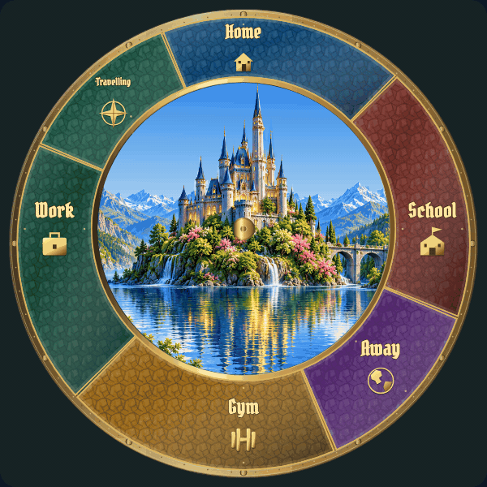

# Weather: individual review

[Latest revisions](LATEST-REVISIONS.md) · [Complete gallery](README.md)

**Release held. Explicit approvals and omissions are preserved.**

W01–W08 and W10 are approved. W09 revision 5 shows fine needle ice growing continuously inward across the central glass. Open the GIF to judge motion; the PNG shows completed growth.

## W01 · clear

**Approved.**

Explicitly approved in user review.

Example: implemented runtime rendering.

## W02 · clouds

**Approved.**

Explicitly approved in user review.

Example: implemented runtime rendering.

[Still image](items/W02-r3.png)

## W03 · light-rain

**Approved.**

Explicitly approved in user review.

Example: implemented runtime rendering.

[Still image](items/W03-r3.png)

## W04 · rain

**Approved.**

Explicitly approved in user review.

Example: implemented runtime rendering.

[Still image](items/W04-r3.png)

## W05 · snow

**Approved.**

Explicitly approved in user review.

Example: implemented runtime rendering.

[Still image](items/W05-r3.png)

## W06 · sleet

**Approved.**

Explicitly approved in user review.

Example: implemented runtime rendering.

[Still image](items/W06-r3.png)

## W07 · wind

**Approved.**

Revision 4 explicitly approved by the user.

Example: implemented runtime rendering.

[Still image](items/W07-r4.png)

## W08 · fog

**Approved.**

Explicitly approved in user review.

Example: implemented runtime rendering.

[Still image](items/W08-r3.png)

## W09 · ice

**Revision 5 · awaiting approval.**

Ice belongs on the central glass, never the outer location ring. Follow the supplied window-frost photos: fine white feathery/needle crystals rather than leaves, growing continuously from the circle inward without whole-shape pop-in. A correctly placed static ice treatment is also acceptable. Revision 5 remains awaiting review.

Example: implemented runtime rendering.

[Central glass close-up, full inward growth at natural speed](items/W09-detail-r5.gif)

[Still image](items/W09-r5.png)

## W10 · lightning

**Approved.**

Explicitly approved in user review.

Example: implemented runtime rendering.

[Still image](items/W10-r3.png)
