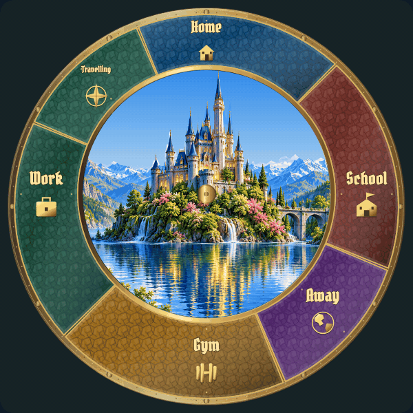

# Weather: individual review

[Latest revisions](LATEST-REVISIONS.md) · [Complete gallery](README.md)

**Release held. Explicit approvals and omissions are preserved.**

Revised runtime effects. Open each GIF to judge movement; the PNG is only a still. Clear weather removes painted and moving clouds. Frost is on the outer protective glass; lightning is clipped behind the castle skyline with restrained scene illumination.

## W01 · clear

**Revision 3 · awaiting approval.**

Clear weather must have no clouds in either the underlying sky artwork or the moving cloud layer. Preserve time-of-day sky colors and other appropriate effects.

Example: implemented runtime rendering.

## W02 · clouds

**Awaiting approval.**

Example: implemented runtime rendering.

[Still image](items/W02-r3.png)

## W03 · light-rain

**Revision 1 · awaiting approval.**

Visible gentle animated rain; brighter detailed scene.

Example: implemented runtime rendering.

[Still image](items/W03-r3.png)

## W04 · rain

**Revision 1 · awaiting approval.**

Visible denser animated rain; brighter detailed scene.

Example: implemented runtime rendering.

[Still image](items/W04-r3.png)

## W05 · snow

**Revision 1 · awaiting approval.**

Visible falling snow at normal size; brighter detailed scene.

Example: implemented runtime rendering.

[Still image](items/W05-r3.png)

## W06 · sleet

**Revision 1 · awaiting approval.**

Visible mixed rain and snow/sleet; brighter detailed scene.

Example: implemented runtime rendering.

[Still image](items/W06-r3.png)

## W07 · wind

**Revision 1 · awaiting approval.**

Visible wind: moving loose leaves and gust-bent foliage. Fix leaf trajectories so rotation occurs around the leaf rather than around the scene origin.

Example: implemented runtime rendering.

[Still image](items/W07-r3.png)

## W08 · fog

**Revision 1 · awaiting approval.**

Fog must visibly drift in natural depth layers while clock data stays readable.

Example: implemented runtime rendering.

[Still image](items/W08-r3.png)

## W09 · ice

**Revision 1 · awaiting approval.**

Completely replace lines with gradually growing fern-like frost on outer watchglass. Restrained translucent highlights; keep all data readable.

Example: implemented runtime rendering.

[Still image](items/W09-r3.png)

## W10 · lightning

**Revision 1 · awaiting approval.**

More irregular branching strikes in different sky positions and both near and distant layers. Lengthen flashes so they can be seen. Keep momentary scene illumination and clock readability.

Example: implemented runtime rendering.

[Still image](items/W10-r3.png)
